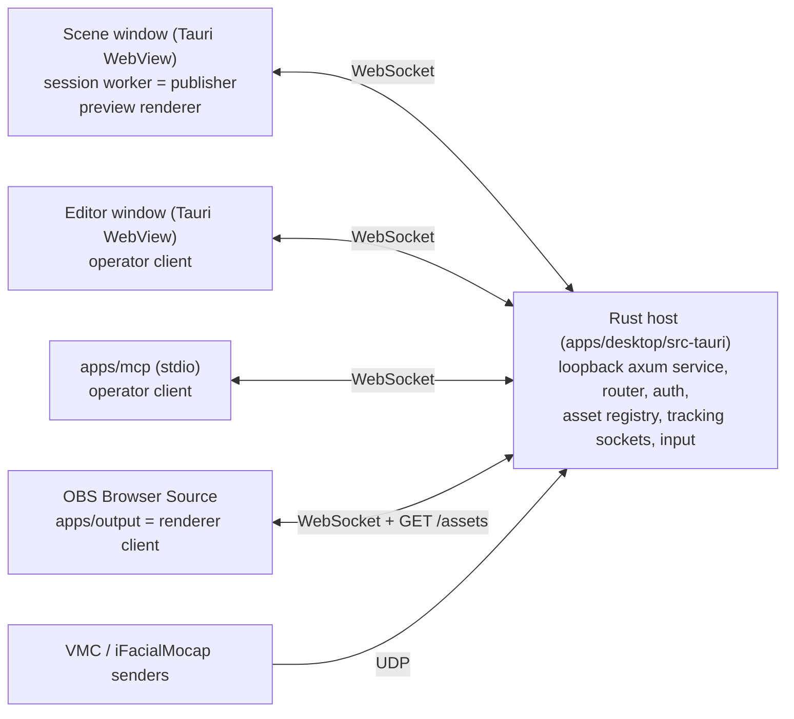

# Architecture

This file is a map of the code as it is now. It tells you where things are and which rules hold the parts together. The target direction is in [the architecture design](docs/superpowers/specs/2026-10-02-opensekai-architecture-design.md). Feature status is in [the parity checklist](docs/warudo-parity.md). Keep this file short and true. Update it in the same commit as a change that adds, removes, or moves a package, crate, process boundary, data path, or trust check (see AGENTS.md).

## Processes and windows

- **Rust host** (`apps/desktop/src-tauri`). It owns sockets, files, the asset library, native dialogs, global input, and the loopback service on `127.0.0.1:0`. It does not own scene state.
- **Session worker** (`packages/session`, started in the Scene window). It is the one authority for scene state, the simulation tick, tracking application, idle animation, character expressions, and Blueprints. It connects to the host as the `publisher`.
- **Clients** connect with a connection descriptor and a role: `publisher`, `operator` (editor and MCP), or `renderer` (preview and OBS). The host relays operator calls to the publisher and sends evaluated frames to renderers.
- **Renderers** (`packages/renderer`) draw evaluated frames. They own GPU resources only. The Scene window preview, the editor viewport, and the OBS output use the same `createRenderer`.

## Workspace map

| Path | Role |
| --- | --- |
| `packages/contracts` | zod schemas and types for scenes, shows, patches, assets, Blueprints, tracking, and the call API. The source of truth for the wire shape. |
| `crates/contracts` | Rust mirror of the contracts. `fixtures/protocol/validation-vectors.json` keeps both sides equal. |
| `packages/session` | Session worker: scene operations (`scene-ops.ts`), ECS, tracking filters, idle, Blueprint runtime and evaluators. |
| `packages/renderer` | three.js `WebGPURenderer` (WebGL 2 fallback), VRM loading, load jobs, texture sharing and limits, editor viewport and gizmos, diagnostics. |
| `packages/extensions` | Extension sandbox: manifest schema, one QuickJS WASM instance for each extension, worker protocol, and a main-thread client with a watchdog. No app process loads it yet. |
| `packages/browser-client` | WebSocket client, frame stream, `readAsset` over `GET /assets/{id}`. Used by every TypeScript client. |
| `apps/desktop/src` | Svelte 5 Scene window (`App.svelte`, `bootstrap.ts`) and Editor window (`EditorApp.svelte`, `editor/`, `components/`, `blueprints/`). Controls come from `@oshi-connect/ui`. |
| `apps/desktop/src-tauri` | Tauri commands (`lib.rs`), service (`service/`), asset registry (`assets/`), show and Blueprint files, tracking, input. |
| `apps/output` | The OBS Browser Source page, served by the host at `/renderer/`. |
| `apps/mcp` | MCP stdio server. Each tool maps to one call in the same API as the editor (`tools.ts`). |
| `crates/evaluation`, `tools/evaluation` | Capture and benchmark run records, and the Blueprint node audit check against the node catalog. |
| `scripts/` | UI kit snapshot, output bundle, tracking model download, test fixture download, glTF validation, GPU probe. |
| `fixtures/` | Smoke scene and assets, protocol vectors, Blueprint fixtures. `cloud/manifest.json` lists the test fixtures that `scripts/prepare-fixtures.ts` downloads (public URLs and the private R2 bucket `opensekai-fixtures`) into ignored `local/`. |
| `spdd/`, `docs/` | Analysis, REASONS contracts, design specs, plans, evaluation evidence, parity. |

## Command path

Editor and MCP edits use the same route: a call (for example `scenePatch`) goes to the host router (`service/router.rs`). The router checks the role capability and relays the call to the publisher. Expression triggers (`expressionGet`, `expressionSet`) take the same relay, but they change runtime state in the session (`expressions.ts`), not the scene, so they do not increase the revision. The host answers two calls itself and does not relay them: `appStatus` (connection and output state) and `assetList` (one page of asset summaries from the registry). Evaluation calls (`captureFrame`, `benchmark*`, `evidenceRead`) go to the native evaluation handler. Editor viewport navigation (`renderer/src/viewport-navigation.ts`) sends its camera moves as ordinary `scenePatch` calls, at most one every 100 ms and only after the previous reply. The session validates the patch against `expectedRevision`, applies the operations, and validates the whole scene again with `SceneViewSchema`. Each accepted edit increases the scene revision. Do not add an edit path that skips this route.

## Asset path

1. **Import.** Editor-only Tauri commands open a native dialog. The frontend never sends a file path. `import_avatar` accepts `.vrm`. `assets/vrm.rs` checks the humanoid (each error names the failing bones) and reads the expression names into the record. `import_scene` accepts `.glb`, `.gltf`, and `.zip`: `assets/scene_import.rs` packs every external buffer and image into one GLB under one shared read budget (256 MiB) before the registry stores it, and keeps `asset.extras` credits on the record. Both imports pack, hash, and write temporary library files without the registry lock (`stage_avatar`, `stage_scene`); only `AssetRegistry::commit` (deduplication check, rename, insert) takes the lock. The registry (`assets/registry.rs`) validates the file and writes `<app local data>/assets/library/<id>.<ext>` with a JSON `AssetRecord`. The ID is the kind prefix (`avatar_`, `scene_`) plus the SHA-256 of the stored bytes.
2. **Serve.** `GET /assets/{id}` with a bearer token. The registry resolves the ID inside the library under its lock. The service then reads the file, checks size and SHA-256, and runs `validate_glb` again without the lock.
3. **Records to the session.** The Scene window passes the record list to the session worker at start. After each import, the host sends the new record to the Scene window as the `asset-record` event, and the Scene window passes the list again. The session uses the expression names to validate triggers.
4. **Load.** `createAssetLoader` (`renderer/src/assets.ts`) runs `inspectContainer`, then `GLTFLoader` with the VRM plugin. Load jobs (`load-jobs.ts`) run outside frame submission and report status to the overlay.

Trust rule: a stored asset is one self-contained GLB container. The importers embed or reject every external URI before they store the asset. The asset service (`validate_glb`) and the renderer (`inspectContainer`) reject any external URI. Do not loosen one of these checks without a design change to all three.

## Output path

The OBS page draws with `alpha: true`, a clear color with alpha 0, and `scene.background = null`. Lights are `light` entities (directional or point, at most 8, at most 2 with a shadow); `scene-lights.ts` keeps one three.js light for each, plus one fixed ambient light. A scene without a light entity gets the built-in directional light. Each lit material gets the `lightsNode` of its group (characters, props, or environment) with the lights whose affect flag is on; a change of type, affect flag, shadow switch, or light count rebuilds the groups, and a visibility change does not. When a light has a shadow, the renderer turns on its PCF shadow map and every avatar, prop, and environment mesh casts and receives shadows. Each prop and environment instance gets per-instance copies of its lit materials (`environment-light.ts`); only the environment copies get a PMREM `RoomEnvironment` map, with the environment Reflections Intensity, and `scene.environment` stays null. Light helpers exist only in the editor viewport. On WebGPU, `pipeline-diagnostics.ts` logs a render pipeline that fails to compile with its WGSL, and frame acknowledgments carry a `Pipeline compile failed` warning until the next light-set rebuild. In a WebKit WebView (the Scene and Editor windows), `webkit-shader-modules.ts` gives each render pipeline new shader modules, because WebKit adds a bounds clamp to a module each time a pipeline reuses it. Each renderer client hides the environment when its output camera has `renderEnvironment: false`, and the viewport never picks it. Each renderer client starts with one quality profile (`packages/contracts/src/quality.ts`): the Scene preview uses `preview_v1`, and the OBS page reads `?quality=` (default `production_v1`). The profile sets the drawing buffer scale, the texture limit, and MSAA, and each frame acknowledgment names it. When the output camera has `antiAliasing: 'fxaa'`, the renderer draws through a TSL post-processing chain (`anti-aliasing.ts`) that keeps alpha. Frame acknowledgments carry warnings such as `Asset loading`. No image data goes through Tauri IPC in the production output path.

## Screenshot path

`cameraScreenshot` (Edit capability) goes from the editor or MCP to the host router. The host checks the revision, the camera, and a host-wide limit of one screenshot each second, then sends `screenshotRequest` to the `preview_main` renderer (the Scene window). That renderer draws the given camera once to offscreen targets at 1920 × 1080 with a transparent clear (`renderer/src/screenshot.ts`), encodes a PNG, and answers `screenshotReply` (base64 JSON, at most 12 MiB; only a renderer connection may send that size). The host (`screenshots.rs`) checks the PNG signature, the IHDR size, and the 8 MiB limit, and writes `<app local data>/screenshots/<UTC time>-<camera part>.png` with create-new. The reply carries the file name only. No client sends a path, and no image data goes through Tauri IPC. `open_screenshots_folder` is an editor-only command without arguments; it uses the Rust API of `tauri-plugin-opener`, and no window has an `opener:` permission. The OBS output path does not change.

## Extension sandbox

Guest code runs in QuickJS (`packages/extensions`). The only bridge is the frozen `opensekai` global: strings go in, the host parses them with zod, and the manifest capabilities decide each call. A fault disables the extension and releases its registrations and its VM. Each extension has its own WASM instance and its own `WebAssembly.Memory` with a fixed maximum (64 MiB by default); that maximum is the hard memory bound. The QuickJS time limit is soft, and the worker watchdog is the hard time bound (see the [gate analysis](spdd/analysis/2026-10-16-extension-sandbox-gate.md)). Guest plugins must not ship before the gate passes on macOS.

## Persistence

Shows are `.osekai` files (`show.rs`), validated on both sides with `ShowDocumentSchema`. The host keeps the current show path and the unsaved flag (`ShowFile`); the editor sends only the flag, never a path. Save writes to the current path, and Save As and Open set it. Closing the main window and the app's Quit menu item ask before a quit with unsaved changes. The native File menu (`install_menu` in `lib.rs`) shows the editor and emits a `show-command` event (`open`, `save`, `saveAs`) to the editor window; the editor runs the same action as its toolbar. A show refers to asset IDs. A missing asset stays in the show as a repairable reference.
