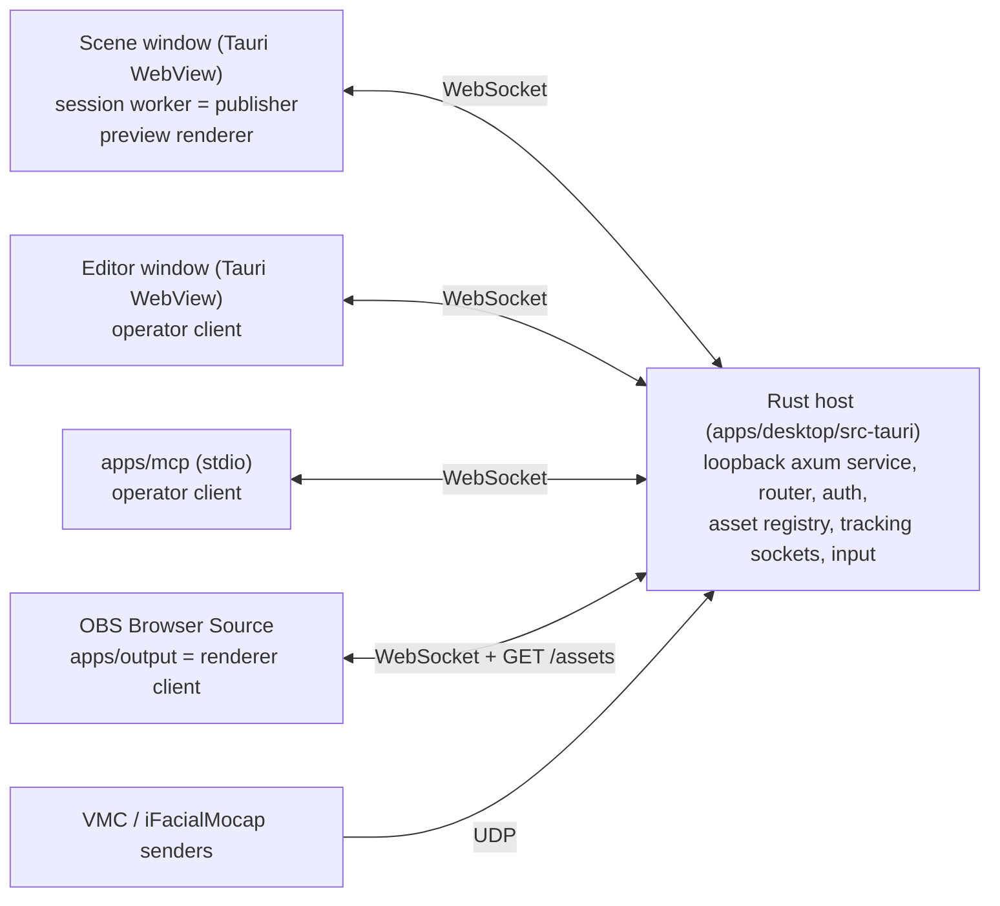

# Architecture

This file is a map of the code as it is now. It tells you where things are and which rules hold the parts together. The target direction is in [the architecture design](docs/superpowers/specs/2026-10-02-opensekai-architecture-design.md). Feature status is in [the parity checklist](docs/warudo-parity.md). Keep this file short and true. Update it in the same commit as a change that adds, removes, or moves a package, crate, process boundary, data path, or trust check (see AGENTS.md).

## Processes and windows

- **Rust host** (`apps/desktop/src-tauri`). It owns sockets, files, the asset library, native dialogs, global input, and the loopback service on `127.0.0.1:0`. It does not own scene state.
- **Session worker** (`packages/session`, started in the Scene window). It is the one authority for scene state, the simulation tick, tracking application, idle animation, and Blueprints. It connects to the host as the `publisher`.
- **Clients** connect with a connection descriptor and a role: `publisher`, `operator` (editor and MCP), or `renderer` (preview and OBS). The host relays operator calls to the publisher and sends evaluated frames to renderers.
- **Renderers** (`packages/renderer`) draw evaluated frames. They own GPU resources only. The Scene window preview, the editor viewport, and the OBS output use the same `createRenderer`.

## Workspace map

| Path | Role |
| --- | --- |
| `packages/contracts` | zod schemas and types for scenes, shows, patches, assets, Blueprints, tracking, and the call API. The source of truth for the wire shape. |
| `crates/contracts` | Rust mirror of the contracts. `fixtures/protocol/validation-vectors.json` keeps both sides equal. |
| `packages/session` | Session worker: scene operations (`scene-ops.ts`), ECS, tracking filters, idle, Blueprint runtime and evaluators. |
| `packages/renderer` | three.js `WebGPURenderer` (WebGL 2 fallback), VRM loading, load jobs, texture sharing and limits, editor viewport and gizmos, diagnostics. |
| `packages/extensions` | Extension sandbox: manifest schema, one QuickJS WASM instance for each extension, worker protocol, and a main-thread client with a watchdog. No app process loads it yet. |
| `packages/browser-client` | WebSocket client, frame stream, `readAsset` over `GET /assets/{id}`. Used by every TypeScript client. |
| `apps/desktop/src` | Svelte 5 Scene window (`App.svelte`, `bootstrap.ts`) and Editor window (`EditorApp.svelte`, `editor/`, `components/`, `blueprints/`). Controls come from `@oshi-connect/ui`. |
| `apps/desktop/src-tauri` | Tauri commands (`lib.rs`), service (`service/`), asset registry (`assets/`), show and Blueprint files, tracking, input. |
| `apps/output` | The OBS Browser Source page, served by the host at `/renderer/`. |
| `apps/mcp` | MCP stdio server. Each tool maps to one call in the same API as the editor (`tools.ts`). |
| `crates/evaluation`, `tools/evaluation` | Capture and benchmark run records. |
| `scripts/` | UI kit snapshot, output bundle, tracking model download. |
| `fixtures/` | Smoke scene and assets, protocol vectors, Blueprint fixtures. |
| `spdd/`, `docs/` | Analysis, REASONS contracts, design specs, plans, evaluation evidence, parity. |

## Command path

Editor and MCP edits use the same route: a call (for example `scenePatch`) goes to the host router (`service/router.rs`). The router checks the role capability and relays the call to the publisher. The host answers two calls itself and does not relay them: `appStatus` (connection and output state) and `assetList` (one page of asset summaries from the registry). Evaluation calls (`captureFrame`, `benchmark*`, `evidenceRead`) go to the native evaluation handler. The session validates the patch against `expectedRevision`, applies the operations, and validates the whole scene again with `SceneViewSchema`. Each accepted edit increases the scene revision. Do not add an edit path that skips this route.

## Asset path

1. **Import.** Editor-only Tauri commands open a native dialog. The frontend never sends a file path. `import_avatar` accepts `.vrm`. `import_scene` accepts `.glb`, `.gltf`, and `.zip`: `assets/scene_import.rs` packs every external buffer and image into one GLB under one shared read budget (256 MiB) before the registry stores it, and keeps `asset.extras` credits on the record. Both imports pack, hash, and write temporary library files without the registry lock (`stage_avatar`, `stage_scene`); only `AssetRegistry::commit` (deduplication check, rename, insert) takes the lock. The registry (`assets/registry.rs`) validates the file and writes `<app local data>/assets/library/<id>.<ext>` with a JSON `AssetRecord`. The ID is the kind prefix (`avatar_`, `scene_`) plus the SHA-256 of the stored bytes.
2. **Serve.** `GET /assets/{id}` with a bearer token. The registry resolves the ID inside the library under its lock. The service then reads the file, checks size and SHA-256, and runs `validate_glb` again without the lock.
3. **Load.** `createAssetLoader` (`renderer/src/assets.ts`) runs `inspectContainer`, then `GLTFLoader` with the VRM plugin. Load jobs (`load-jobs.ts`) run outside frame submission and report status to the overlay.

Trust rule: a stored asset is one self-contained GLB container. The importers embed or reject every external URI before they store the asset. The asset service (`validate_glb`) and the renderer (`inspectContainer`) reject any external URI. Do not loosen one of these checks without a design change to all three.

## Output path

The OBS page draws with `alpha: true`, a clear color with alpha 0, and `scene.background = null`. Lights are one ambient and one directional light in `renderer.ts`. The one `environment` entity gets a PMREM `RoomEnvironment` map on per-instance copies of its own materials (`environment-light.ts`); `scene.environment` stays null, so avatar materials do not change. Each renderer client hides the environment when its output camera has `renderEnvironment: false`, and the viewport never picks it. Frame acknowledgments carry warnings such as `Asset loading`. No image data goes through Tauri IPC in the production output path.

## Extension sandbox

Guest code runs in QuickJS (`packages/extensions`). The only bridge is the frozen `opensekai` global: strings go in, the host parses them with zod, and the manifest capabilities decide each call. A fault disables the extension and releases its registrations and its VM. Each extension has its own WASM instance and its own `WebAssembly.Memory` with a fixed maximum (64 MiB by default); that maximum is the hard memory bound. The QuickJS time limit is soft, and the worker watchdog is the hard time bound (see the [gate analysis](spdd/analysis/2026-10-16-extension-sandbox-gate.md)). Guest plugins must not ship before the gate passes on macOS.

## Persistence

Shows are `.osekai` files (`show.rs`), validated on both sides with `ShowDocumentSchema`. A show refers to asset IDs. A missing asset stays in the show as a repairable reference.
