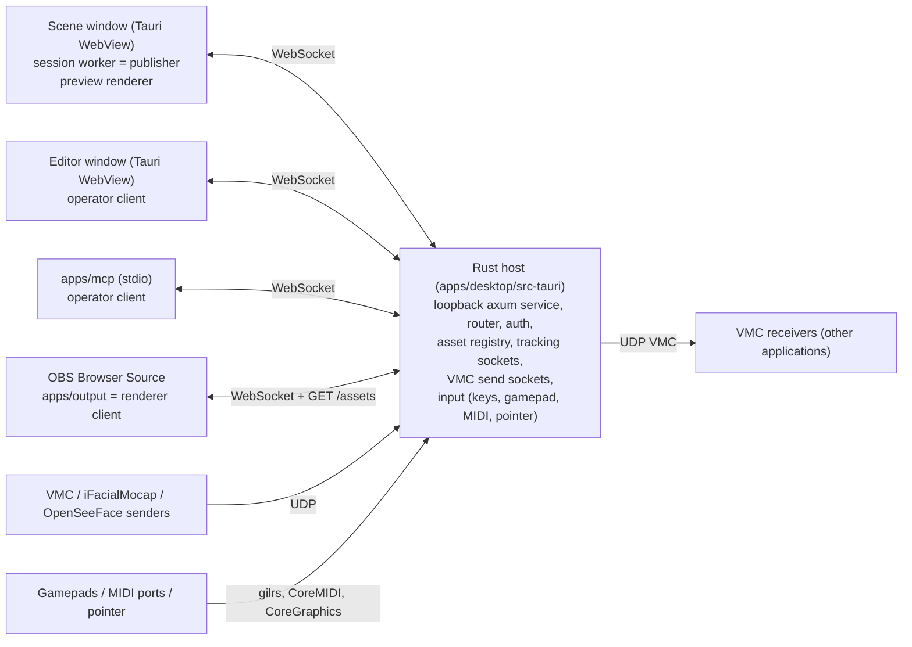

# Architecture

This file is a map of the code as it is now. It tells you where things are and which rules hold the parts together. The target direction is in [the architecture design](docs/superpowers/specs/2026-10-02-opensekai-architecture-design.md). Feature status is in [the parity checklist](docs/warudo-parity.md). Keep this file short and true. Update it in the same commit as a change that adds, removes, or moves a package, crate, process boundary, data path, or trust check (see AGENTS.md).

## Processes and windows

- **Rust host** (`apps/desktop/src-tauri`). It owns sockets, files, the asset library, native dialogs, global input, and the loopback service on `127.0.0.1:0`. It does not own scene state.
- **Session worker** (`packages/session`, started in the Scene window). It is the one authority for scene state, the simulation tick, tracking application, idle animation, character expressions, and Blueprints. It connects to the host as the `publisher`.
- **Clients** connect with a connection descriptor and a role: `publisher`, `operator` (editor and MCP), or `renderer` (preview and OBS). The host relays operator calls to the publisher and sends evaluated frames to renderers.
- **Renderers** (`packages/renderer`) draw evaluated frames. They own GPU resources only. The Scene window preview, the editor viewport, and the OBS output use the same `createRenderer`. In the Scene window, one `requestAnimationFrame` pump (`apps/desktop/src/preview-pump.ts`) applies the newest preview frame, one at a time. The Scene toolbar **Preview** toggle pauses the pump; the renderer and its connection stay open. A `cameraScreenshot` request wakes the pump until the screenshot completes.

## Workspace map

| Path | Role |
| --- | --- |
| `packages/contracts` | zod schemas and types for scenes, shows, patches, assets, Blueprints, tracking, device input, and the call API. The source of truth for the wire shape. The Blueprint value model (`blueprint-values.ts`) holds the data types, the value limits, and the one connection rule `canConnect`. Tracking presets (`tracking-presets.ts`) are plain data for the setup guide: source config, slots, smoothing, and expression steps. One definition per node type (`blueprint-nodes/`) gives its ports, settings, fields, and inline input defaults. Graphs carry optional `comments`; `duplicateGraph` derives new IDs deterministically (`blueprint-duplicate.ts`). |
| `crates/contracts` | Rust mirror of the contracts. `fixtures/protocol/validation-vectors.json` keeps both sides equal. The host checks the structure of Blueprint node `inputs`, typed variables, comments, and each Blueprint op kind; it does not check port types. |
| `packages/session` | Session worker: scene operations (`scene-ops.ts`), ECS, tracking filters, idle, bone offset layer (`bone-offsets.ts`), Blueprint runtime and evaluators, transitions (`tweens.ts`), blend shape and look-at layers (`blend-shapes.ts`, `look-at.ts`), device input state (`devices.ts`), VMC send poses (`vmc-send.ts`). |
| `packages/renderer` | three.js `WebGPURenderer` (WebGL 2 fallback), VRM loading, load jobs, texture sharing and limits, editor viewport and gizmos, diagnostics. |
| `packages/extensions` | Extension sandbox: manifest schema, one QuickJS WASM instance for each extension, worker protocol, and a main-thread client with a watchdog. No app process loads it yet. |
| `packages/browser-client` | WebSocket client, frame stream, `readAsset` over `GET /assets/{id}`. Used by every TypeScript client. |
| `apps/desktop/src` | Svelte 5 Scene window (`App.svelte`, `bootstrap.ts`) and Editor window (`EditorApp.svelte`, `editor/`, `components/`, `blueprints/`). Controls come from `@oshi-connect/ui`. Blueprint palette state (collapsed sections, favorites) is per user in the Editor window `localStorage` key `opensekai.blueprint.palette`. Inspector section collapse state is per user in the Editor window `localStorage` key `opensekai.inspector.sections`. Inspector reset defaults come from the add defaults in `editor/property-defaults.ts`; a reset is an ordinary scene patch. Hidden tracker camera patterns are per user in the Editor window `localStorage` key `opensekai.tracking.hiddenCameras`; a module Worker (`tracking/hidden-cameras-worker.ts`) runs the user patterns with a 100 ms deadline, never the Editor main thread, and the Scene window sends at most 16 camera devices that fit in one 4096-byte UI message. Scene preview guides (center mark, thirds) are per user in the Scene window `localStorage` key `opensekai.scene.guides` and draw as an SVG overlay in the DOM, never in a renderer. Comments are DOM boxes behind the wires in the Rete area. |
| `apps/desktop/src-tauri` | Tauri commands (`lib.rs`), service (`service/`), asset registry (`assets/`), show and Blueprint files, tracking (`tracking/`, with the VMC encoder `tracking/osc_out.rs`), VMC sender sockets (`vmc_sender.rs`), input (`input/`: keyboard monitor, and `input/devices/` gamepad, MIDI, and pointer adapters). |
| `apps/output` | The OBS Browser Source page, served by the host at `/renderer/`. |
| `apps/mcp` | MCP stdio server. Each tool maps to one call in the same API as the editor (`tools.ts`). |
| `crates/evaluation`, `tools/evaluation` | Capture and benchmark run records, and the Blueprint node audit check against the node catalog. |
| `scripts/` | UI kit snapshot, output bundle, tracking model download, test fixture download, glTF validation, GPU probe, Warudo sceneshare list, unpack, and inventory, and a Warudo scene to show mapping for the visual benchmark (research only, not an import path). |
| `fixtures/` | Smoke scene and assets, protocol vectors, Blueprint fixtures. `cloud/manifest.json` lists the test fixtures that `scripts/prepare-fixtures.ts` downloads (public URLs and the private R2 bucket `opensekai-fixtures`) into ignored `local/`. `scripts/test-stage` builds the test stage fixture with Blender. |
| `spdd/`, `docs/` | Analysis, REASONS contracts, design specs, plans, evaluation evidence, parity. |

## Command path

Editor and MCP edits use the same route: a call (for example `scenePatch`) goes to the host router (`service/router.rs`). The router checks the role capability and relays the call to the publisher. Expression triggers (`expressionGet`, `expressionSet`) take the same relay, but they change runtime state in the session (`expressions.ts`), not the scene, so they do not increase the revision. `trackingProbe` relays like `blueprintInspect`: it reads the live ARKit values of a tracking source from the session. It changes no scene state; `resetPeaks` clears the run peaks of the source after the reply takes them. The Editor window tracking guide (`components/TrackingGuide.svelte`, with the pure reducer `editor/tracking-guide.ts` and the patch plans `editor/tracking-guide-plan.ts`) polls `trackingProbe` each 100 ms while it is open, with one request in flight, and stops when it closes. It stays mounted while another rail panel shows. It writes its setup only through `scenePatch`, one write at a time: one patch to connect, `calibrateTracking`, `fitBlendShapeRanges`, a `setTrackingMapping` from the Look around eye-bones checkbox, and one patch to cancel on a close before Done. The host answers two calls itself and does not relay them: `appStatus` (connection and output state) and `assetList` (one page of asset summaries from the registry). Evaluation calls (`captureFrame`, `benchmark*`, `evidenceRead`) go to the native evaluation handler. Editor viewport navigation (`renderer/src/viewport-navigation.ts`) sends its camera moves as ordinary `scenePatch` calls, at most one every 100 ms and only after the previous reply. A gizmo drag (`renderer/src/editor-viewport.ts`) sends `setTransform` through the same committer, at most one every 33 ms and a last one on release, so the OBS output follows the drag; the preview also draws a dragged light at the gizmo pose on each frame (`withDrafts`). Inspector sliders and the color swatch send live edits through `editor/live-edit.ts` (latest value only, one request in flight). The session validates the patch against `expectedRevision`, applies the operations, and validates the whole scene again with `SceneViewSchema`. Each accepted edit increases the scene revision. Do not add an edit path that skips this route.

## Tracking path

1. **Receive.** The host tracking manager (`src-tauri/src/tracking/mod.rs`) binds one UDP socket for each endpoint. The pure function `endpoint_routes` (`tracking/endpoints.rs`) makes the endpoint plan from the enabled VMC, iFacialMocap, and OpenSeeFace sources on each accepted revision. Two sources of the same kind can share one endpoint when each has a different sender or phone address; the host gives each datagram to the source whose address equals the sender IP, before parsing, and counts other datagrams in `unmatchedPackets`. Overlapping sources that cannot share get "Endpoint used by <name>"; the source that holds the endpoint wins. Each source keeps its own decoder (`tracking/parser.rs`: VMC OSC, iFacialMocap text, or OpenSeeFace binary face records, chosen by the endpoint kind), generation, counters, and sample. The OpenSeeFace decoder converts the tracker quaternion to a normalized head and maps its features to ARKit names. iFacialMocap and OpenSeeFace sources are face-only: the contracts reject them in a body or finger slot. An iFacialMocap source with a phone address sends the handshake from the endpoint socket to the phone, and again each 2 s while no packet arrives. `appStatus` also returns the IPv4 addresses of this computer (`localAddresses`).
2. **Clock.** The host sends the latest samples and statuses to the publisher in the credited `clock` envelope.
3. **Compose.** For each source the session applies smoothing, then the VMC position rule of the source (`applyPositionRule` in `tracking.ts`: the optional `positions` field of a VMC config; `rotationsOnly` removes every bone position and the root position, `hipsOnly` keeps only the hips position, and a missing value means `all`; the SelfReflect preset sets `rotationsOnly`), then the saved calibration (`tracking-calibration.ts`: the captured hips-to-head neutral becomes identity), then the face mapping (`tracking-mapping.ts`: head and eye intensity, head offset, blend shape ranges and sensitivity, linked blink). Then it mixes each avatar's body, face, and finger sources (the finger source gives only the 30 finger bones), applies hold, fade, and idle, and makes one `AvatarPose` for each avatar. `calibrateTracking` reads the current smoothed sample in the session and becomes a saved `setTrackingCalibration`; the MediaPipe worker keeps no neutral and sends the face rotation in camera space. `fitBlendShapeRanges` resolves in the live session in the same way: it turns the run peaks and the given neutral values into a saved `setTrackingMapping` that changes only the ranges of the channels that rose. A `scenePatch` that makes two avatars use one source is rejected. Blueprint `character.offsetBoneRotation` writes to a bone offset layer that is empty at the start of each tick; the session adds it to the frame pose as `boneOffsets`. The layer is never committed or saved. `character.getBoneRotation` reads the pose of the previous tick. `tracking.getBlendShape` reads the ARKit value from the same pose, by canonical name. The session also keeps run peaks of the smoothed ARKit values for each tracking source (`tracking.ts`). The peaks are runtime state: they are never saved, and they clear when the sample drops or the generation changes. `trackingProbe` reads the values before calibration and mapping, with the peaks, the channels that the sender includes, and whether it sends eye bones.
4. **Render.** The renderer applies each pose to its own VRM instance (`renderer/src/avatar-pose.ts`): normalized bones, raw bones, root, expressions, then `boneOffsets` in the parent frame of each bone.

Blueprint transitions (`session/src/tweens.ts`) are runtime state on the session clock. A property tween writes its eased sample to the override layer at each advance, after the Blueprint step and before the idle commit. An override under a tween does not commit, so the revision changes once after the end. A scene patch or an immediate write stops the tween, and the transitions of a disabled, deleted, or changed graph stop. Tween failures stay as runtime errors of their graph until it changes. A Set Asset Property write records the On Transition End of its node (`TransitionEnd`, with the logic key of its graph) on its tween, or as a pending end when the write has no tween. A tween that reaches its end adds its ends to the pending list; a tween that stops for another reason drops them. Only the next clock step (`advance`) runs the pending ends, in Phase 3 after due delays and timers, so an end never runs in the step of its write. Blend shape weights (`blend-shapes.ts`) merge into `AvatarPose.expressions` by max after expressions. Look At (`look-at.ts`) adds a head rotation to the bone offset layer each tick. None of this is committed, saved, or advanced by a renderer.

## VMC send path

A `vmcSender` entity (at most 4) sends the pose of one character to another application over UDP with the VMC protocol. It starts stopped after Add, Duplicate, a show Open, and the start scene; only a `scenePatch` from the editor or MCP starts it.

1. **Pose.** After each frame, the session makes one pose for each enabled sender whose character has a model record with `rig.identityRest` (`vmc-send.ts`). `vmcSendPose` repeats the renderer composition (`avatar-pose.ts`) in data with each rest rotation as identity, so the result is the raw local transform of each humanoid bone of the record rig. A character without a pose sends its rest pose. The session sends the poses in one `vmcPoses` envelope on the publisher connection. The envelope is never part of a frame, and the host never relays it.
2. **Plan.** The host sender manager (`vmc_sender.rs`) reads the senders on each accepted scene revision. It binds one UDP socket on the unspecified address of the target family for each enabled sender. A sender is in error and sends nothing when its target is a local address on the port of an enabled VMC receiver of the same scene (`sender_conflicts`), when the record has no `rig`, or when `identityRest` is false.
3. **Send.** The host accepts `vmcPoses` only from the publisher. It drops a pose that comes less than 15 ms after the last sent pose of the sender. The encoder (`tracking/osc_out.rs`) is the exact inverse of the VMC decoder (`tracking/parser.rs`): OSC bundles of at most 1,200 bytes and 32 messages, `OK` and `T` first, the root, the bones, the blends with VRM 0 clip names, and `Blend/Apply` last.
4. **Status.** `appStatus` returns `vmcSenders` (state, datagram and error counts, error text). No pose for 1 s gives `waiting`, for example when the Scene window is closed.

## Blueprint runtime path

The session compiles each enabled graph and runs it in phases on each step: On Disable of departing versions, On Enable, due delays, debounces, and timers, the transition ends of the previous clock step, then input events (keystrokes, devices, tracking triggers, manual and external events, On Update). A run writes to a copy of its state, and the session keeps the copy only when the run and its scene commit succeed. Besides scene effects, a run can make requests: emit an event, enable or disable a graph, start or stop a timer, or debounce. Emitted events go to a per-step FIFO queue and reach the On Event nodes of the enabled graphs in the same tick (hop limit 8, 64 events per step). Control requests apply after the step as one `updateGraph` edit through the Blueprint store (client `opensekai-runtime`), so a toggle is saved with the show and syncs like an editor edit. The host key, held-key, and device sets cover the listened graphs: the enabled graphs, plus each graph that an Enable or Toggle node in a listened graph can enable. `blueprintRun` also takes `{event, payload?}` (checked in TypeScript and Rust) to send an event from the editor API or MCP. The tracking trigger phase runs after device events and before On Update: On Blend Shape Threshold reads the previous tick's avatar pose, and On Tracking Lost and On Tracking Found read the previous tick's source status (`RunEnv.trackingStatus`, matched by source generation) at the session clock. Each trigger node keeps its edge state (above or below, and receiving, lost, or not-receiving since) in a per-graph `trackingEdges` map on the runtime entry. A new entry (after an install that changes the graph logic, or a show open) starts with an empty map, so a reinstall resets the edges. A Blueprint file lists the tracking source of these nodes as a `tracking` reference and remaps it by name on import. A Blueprint file import lists control nodes that target a graph outside the file as `blueprint` in its `Missing` report.

## Blueprint debug path

Log, Show Toast, and Emit Debug Event nodes make debug effects that the session gate applies with the run. Debug Value results travel in `GraphRun.debug`, not in the effects. The session records debug entries and values only after the step's scene commit succeeds, in a runtime ring (`session/src/debug-log.ts`): the last 1000 entries with session time, graph, and node, the latest Debug Value text per node, and per-node and per-graph rate limits with drop counts. The log is never saved or put in a frame. The editor and MCP (`blueprint_debug_log`) read it with `blueprintDebug { since }`, which the host relays like `blueprintInspect` and checks on both sides. Each reply has the log `epoch` and the full value set. The Editor window polls it each 500 ms and shows toasts only in its own window.

## Device input path

The session reports the device kinds that the listened graphs use (`devices`) in `blueprintEdit` and `blueprintInspect` replies, through the same path as `heldKeys`. The host `DeviceHub` (`input/devices.rs`) activates one `DeviceAdapter` per used kind: a gilrs gamepad thread, a midir MIDI thread with the CoreMIDI run loop, and a macOS pointer poll on each clock that also reads the CoreGraphics button-down counters. No adapter needs a new permission, consumes input, or injects input. Device events and state ride the clock as `input.devices`; a clock with tracking or device input may use 64 KiB (`clock_byte_limit` / `clockByteLimit`), and any other clock 2 KiB. The session keeps the MIDI control values and starts device-trigger runs after keystrokes and before On Update. A used kind without a working adapter shows as an app status warning (`device-gamepad`, `device-midi`, `device-pointer`).

## Asset path

1. **Import.** Editor-only Tauri commands open a native dialog. The frontend never sends a file path. `import_avatar` accepts `.vrm`. `assets/vrm.rs` checks the humanoid (each error names the failing bones) and reads the expression names and the rig rest data (`rig`: VRM version, rest translation of each humanoid bone, `identityRest`) into the record, and sets `eyeBones` when the humanoid has both eye bones. At startup the registry fills `rig` for an older avatar record from its stored file. `import_scene` accepts `.glb`, `.gltf`, and `.zip`: `assets/scene_import.rs` packs every external buffer and image into one GLB under one shared read budget (256 MiB) before the registry stores it, and keeps `asset.extras` credits on the record. Both imports pack, hash, and write temporary library files without the registry lock (`stage_avatar`, `stage_scene`); only `AssetRegistry::commit` (deduplication check, rename, insert) takes the lock. The registry (`assets/registry.rs`) validates the file and writes `<app local data>/assets/library/<id>.<ext>` with a JSON `AssetRecord`. The ID is the kind prefix (`avatar_`, `scene_`) plus the SHA-256 of the stored bytes.
2. **Serve.** `GET /assets/{id}` with a bearer token. The registry resolves the ID inside the library under its lock. The service then reads the file, checks size and SHA-256, and runs `validate_glb` again without the lock.
3. **Records to the session.** The Scene window passes the record list to the session worker at start. After each import, the host sends the new record to the Scene window as the `asset-record` event, and the Scene window passes the list again. The session uses the expression names to validate triggers.
4. **Load.** `createAssetLoader` (`renderer/src/assets.ts`) runs `inspectContainer`, then `GLTFLoader` with the VRM plugin. Load jobs (`load-jobs.ts`) run outside frame submission and report status to the overlay.

Trust rule: a stored asset is one self-contained GLB container. The importers embed or reject every external URI before they store the asset. The asset service (`validate_glb`) and the renderer (`inspectContainer`) reject any external URI. Do not loosen one of these checks without a design change to all three.

## Output path

The OBS page draws with `alpha: true`, a clear color with alpha 0, and `scene.background = null`. Lights are `light` entities (directional, point, spot, or ambient; at most 8, at most 2 with a shadow); `scene-lights.ts` keeps one three.js light for each, plus one fixed ambient light that an ambient entity replaces. A `haze` entity (at most 1) is a box volume on its own layer (`haze.ts`): point and spot lights with `volumetric` scatter in it. When a visible haze exists, the renderer draws through `post-chain.ts`: the scene pass, the haze pass at a quarter of the resolution with the scene depth, a blur, and a premultiplied-alpha composite, so beams keep the OBS alpha. A directional light centers its 20 m shadow box on its position. A scene without a light entity gets the built-in directional light. Each lit material gets the `lightsNode` of its group (characters, props, or environment) with the lights whose affect flag is on; a change of type, affect flag, shadow switch, or light count rebuilds the groups, and a visibility change does not. When a light has a shadow, the renderer turns on its PCF shadow map and every avatar, prop, and environment mesh casts and receives shadows. Each prop and environment instance gets per-instance copies of its lit materials (`environment-light.ts`); standard and physical copies get a PMREM `RoomEnvironment` map, with the environment Reflections Intensity for the environment and the props, and `scene.environment` stays null. Those copies are node materials whose room map has two uniform shares: when a scene has an ambient entity, the diffuse fill of the map is off and its reflections follow the ambient light on the environment and the props, so spot and directional shadows show on an imported stage. Light helpers exist only in the editor viewport. On WebGPU, `pipeline-diagnostics.ts` logs a render pipeline that fails to compile with its WGSL, and frame acknowledgments carry a `Pipeline compile failed` warning until the next light-set rebuild. In a WebKit WebView (the Scene and Editor windows), `webkit-shader-modules.ts` gives each render pipeline new shader modules, because WebKit adds a bounds clamp to a module each time a pipeline reuses it. Each renderer client hides the environment when its output camera has `renderEnvironment: false`, and the viewport never picks it. Each renderer client starts with one quality profile (`packages/contracts/src/quality.ts`): the Scene preview uses `preview_v1`, and the OBS page reads `?quality=` (default `production_v1`). The profile sets the drawing buffer scale, the texture limit, and MSAA, and each frame acknowledgment names it. The `output_main` output of the scene holds the output format (B22): a size of 1920 × 1080, 1600 × 900, 1280 × 720, or 960 × 540, an optional render scale of 0.5, 0.75, or 1 that multiplies the profile scale, and a frame limit of 30 or 60. `preview_main` keeps 1920 × 1080 at 60. The OBS page paces the applied frames with `apps/output/src/frame-pacer.ts` (one timer, no animation loop) and acknowledges only the frames that it applies; the host clock and the simulation stay at 60 Hz. `benchmarkStart` refuses an `output_main` that is not the default format. When the output camera has `antiAliasing: 'fxaa'`, the renderer draws through the same TSL post-processing chain (`post-chain.ts`), which keeps alpha. Frame acknowledgments carry warnings such as `Asset loading`. An `fpsCounter` entity (at most 1) has no scene object: each renderer client that draws into a page (the OBS page and the Scene window preview) counts its own successful `applyFrame` calls in `renderer/src/fps-counter.ts` and shows the value in one DOM element over its canvas, so the value is never in the canvas, a screenshot, a capture, the session, or a frame acknowledgment. No image data goes through Tauri IPC in the production output path.

## Screenshot path

`cameraScreenshot` (Edit capability) goes from the editor or MCP to the host router. The host checks the revision, the camera, and a host-wide limit of one screenshot each second, then sends `screenshotRequest` to the `preview_main` renderer (the Scene window). That renderer draws the given camera once to offscreen targets at 1920 × 1080 with a transparent clear (`renderer/src/screenshot.ts`), encodes a PNG, and answers `screenshotReply` (base64 JSON, at most 12 MiB; only a renderer connection may send that size). The host (`screenshots.rs`) checks the PNG signature, the IHDR size, and the 8 MiB limit, and writes `<app local data>/screenshots/<UTC time>-<camera part>.png` with create-new. The reply carries the file name only. No client sends a path, and no image data goes through Tauri IPC. `open_screenshots_folder` is an editor-only command without arguments; it uses the Rust API of `tauri-plugin-opener`, and no window has an `opener:` permission. The OBS output path does not change.

## Extension sandbox

Guest code runs in QuickJS (`packages/extensions`). The only bridge is the frozen `opensekai` global: strings go in, the host parses them with zod, and the manifest capabilities decide each call. A fault disables the extension and releases its registrations and its VM. Each extension has its own WASM instance and its own `WebAssembly.Memory` with a fixed maximum (64 MiB by default); that maximum is the hard memory bound. The QuickJS time limit is soft, and the worker watchdog is the hard time bound (see the [gate analysis](spdd/analysis/2026-10-16-extension-sandbox-gate.md)). Guest plugins must not ship before the gate passes on macOS.

## Persistence

Shows are `.osekai` files (`show.rs`), validated on both sides with `ShowDocumentSchema`. The host keeps the current show path and the unsaved flag (`ShowFile`); the editor sends only the flag, never a path. Save writes to the current path, and Save As and Open set it. Closing the main window and the app's Quit menu item ask before a quit with unsaved changes. The native File menu (`install_menu` in `lib.rs`) shows the editor and emits a `show-command` event (`open`, `save`, `saveAs`) to the editor window; the editor runs the same action as its toolbar. A show refers to asset IDs. A missing asset stays in the show as a repairable reference.
