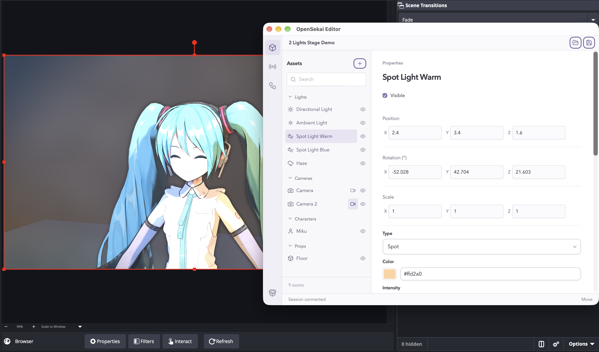
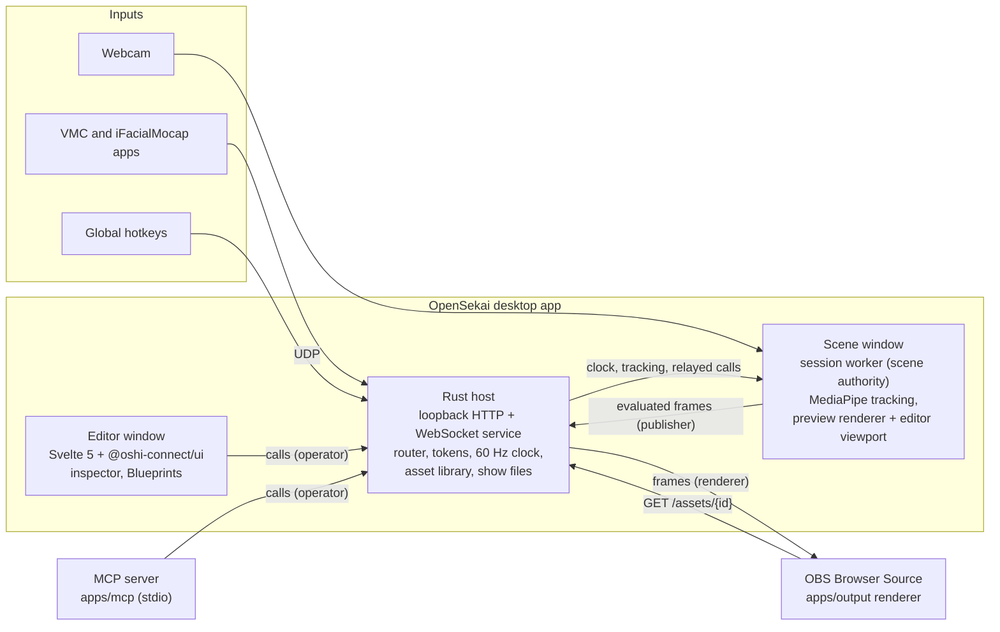

# OpenSekai

OpenSekai is the working name for an open-source 3D VTubing and live production app.

Start on macOS. Keep the core portable to Windows, and keep a path to mobile. Use web technology for rendering, a Tauri v2 desktop host, and external tracking apps. The main performance target is a 3D concert hall with one or two performers at 1920 × 1080 and 60 FPS.



## Status

The macOS app runs a session worker as the single scene authority. It also has a VRM/glTF renderer, a separate editor window, a transparent OBS output, and MCP tools. The [Warudo parity checklist](docs/warudo-parity.md) owns feature status. It claims only behavior that was verified.

The app has these features on macOS:

- **Scene and editor:**
  - Cameras, avatars, and tracking sources can be added, renamed, duplicated, and removed.
  - The editor has live transform controls, gizmos, and an exact preview camera frame.
  - Shows can be saved and opened, with missing assets kept as repairable references.
  - An environment (glTF, GLB, or zip) behind the characters, with Render Environment for each camera.
  - A Scene performance monitor is available.
- **Live tracking:**
  - VMC body, iFacialMocap face, and bundled MediaPipe webcam tracking.
  - One Euro smoothing with per-source controls.
  - A built-in idle animation for new avatars.
- **Blueprints:**
  - Typed node graphs, edited on a Rete canvas. A show holds up to 8 graphs, and each graph can be enabled or disabled.
  - Global keyboard hotkeys fire while other apps have focus. A hotkey must use Control, Option (Alt), or Command (Meta).
  - Flow nodes: If Branch, Sequence, Flip Flop, and Delay. Actions: set or toggle visibility, and switch the output camera.
  - The editor and MCP edit the same graphs, and their edits stay in sync. See [Blueprint interactions](docs/evaluation/blueprint-interactions.md).
- **Output and automation:**
  - The OBS browser-source output is transparent, and it continues while the editor is minimized.
  - MCP tools give scene queries, controlled edits, Blueprint edits, captures, and benchmark evidence.

These items remain open:

- **Blueprints:** On Update, variables, and more input types.
- **Characters:** expressions and wider animation support.
- **Shows:** recent shows and recovery.
- **Platforms:** Windows acceptance.
- **Measurements:** GPU memory reclamation, minimum hardware, and the concert benchmark. These remain unknown.

## Architecture

OpenSekai is one Tauri desktop app. A small Rust service in the app connects its windows and its external clients. [ARCHITECTURE.md](ARCHITECTURE.md) is the detailed map of the code. [The architecture design](docs/superpowers/specs/2026-10-02-opensekai-architecture-design.md) gives the direction.



The design follows these rules:

- **One authority.** The session worker (`packages/session`) runs in the Scene window. It owns the scene state, the simulation, tracking, idle animation, expressions, and Blueprints. The host does not own scene state.
- **One command path.** The editor and the MCP server send the same validated calls (`packages/contracts`). The host router checks the role of the caller and relays the call to the session. Each accepted edit increases the scene revision.
- **State, not pixels.** On each tick of the host clock, the session publishes an evaluated frame: the scene view, the avatar poses, and the tracking status. The host sends each frame to each renderer. Each renderer draws the frame with the same three.js renderer (`packages/renderer`) and loads assets from `GET /assets/{id}`. No image data goes through Tauri IPC.
- **Local trust.** The service listens on `127.0.0.1` on a random port. Each connection has a token and one role: `publisher`, `operator`, or `renderer`. The host checks the `Host` and `Origin` headers. A stored asset is one self-contained GLB, and the host and the renderer both reject external URIs.

| Layer | Path |
| --- | --- |
| Wire contracts (zod and Rust mirror) | `packages/contracts`, `crates/contracts` |
| Scene authority | `packages/session` |
| Renderer | `packages/renderer` |
| Client for all TypeScript connections | `packages/browser-client` |
| Native host, service, and assets | `apps/desktop/src-tauri` |
| Scene and Editor windows | `apps/desktop/src` |
| OBS output page | `apps/output` |
| MCP server | `apps/mcp` |
| Extension sandbox (QuickJS) | `packages/extensions` |

## Requirements

- macOS (the first target).
- Node 26.10.0 (see `.node-version`) and pnpm 12.8.1 (see `packageManager`). Do not use npm or yarn.
- Rust 1.93.1 (pinned in `rust-toolchain.toml`).
- A local checkout of `oshi-connect-ui` for the shared UI kit snapshot.
- OBS Studio, if you want to check the OBS output.

## Getting started

1. Make the UI kit snapshot in this checkout. Do this once in each worktree:

   ```sh
   OPENSEKAI_UI_SOURCE=/path/to/oshi-connect-ui node scripts/bootstrap-ui.ts
   ```

2. Install the dependencies:

   ```sh
   pnpm install
   ```

3. Download the cached tracking models. Do this one time:

   ```sh
   pnpm exec tsx scripts/prepare-tracking.ts --download
   ```

4. Start the desktop app in development mode:

   ```sh
   pnpm dev:desktop
   ```

To make the macOS release app, run `pnpm build:mac`.

In a Linux cloud container, run `bash scripts/cloud-setup.sh` to do the setup and the build. See [Cloud agent intake](docs/agent-intake.md).

## Checks

```sh
pnpm check              # Svelte and TypeScript type checks
pnpm test:unit          # unit tests
pnpm test:integration   # process, network, and protocol tests
cargo test --workspace  # Rust contracts and native host
```

Verify UI changes in the running app. Use the OBS output for changes to alpha, camera, material, or visual performance. See [Development and checkpoints](docs/development-workflow.md) and [the evaluation rubric](docs/evaluation/rubric-v1.md).

## Test stage

[Download the OpenSekai Test Stage](https://assets.oshi-connect.net/opensekai/test-stage/opensekai-test-stage-fbeb8623.glb) (GLB, 15 MB, [CC0-1.0](https://creativecommons.org/publicdomain/zero/1.0/)). It is a 10 × 10 m environment for visual checks. It has these parts:
- a floor grid with camera marks;
- two walls with a resolution chart, a Siemens star, a zone plate, and a colour checker;
- focus targets at three depths;
- shadow props;
- chrome and grey reference balls;
- a green cyclorama cove.

SHA-256: `fbeb862301bc8a78851849b2b0bf750cbb5f570425efce889c28f41332655f6b`.

To use it:
1. In the editor, do Add › Environment, then Source › Import file…, and choose the GLB.
2. Open `fixtures/shows/test-stage.osekai`. The show has a sun and a spot light with shadows, an ambient fill, and four cameras: Wide, Chart, Cove, and Corner.
3. Choose a character model for Performer.

`pnpm build:test-stage` builds the stage with Blender. [The test stage contract](spdd/prompt/2026-10-18-test-stage.md) gives the layout.

## MCP

The app writes an owner-only operator descriptor. The MCP server uses the same validated commands as the editor. To set up a client, see [MCP client setup](docs/mcp-client-setup.md).

## Documents

- [Architecture and scope](docs/superpowers/specs/2026-10-02-opensekai-architecture-design.md)
- [Warudo feature parity checklist](docs/warudo-parity.md)
- [Performance contract](docs/evaluation/benchmark-contract.md)
- [MCP and model evaluation](docs/evaluation/mcp-evaluation-design.md)
- [macOS feasibility results](docs/evaluation/macOS-feasibility/results.md) and [desktop shell verification](docs/evaluation/macOS-feasibility/desktop-shell.md)
- [Observed macOS and OBS baseline](docs/evaluation/2026-10-02-local-baseline.md)
- [Development and checkpoints](docs/development-workflow.md)
- [Quality assurance](docs/qa.md) and [testing](docs/testing.md)
- [Dependencies and licenses](docs/dependencies.md)
- Specs and plans: `docs/superpowers/specs/` and `docs/superpowers/plans/`
- SPDD analyses and contracts: `spdd/analysis/` and `spdd/prompt/`
- Evaluation evidence: `docs/evaluation/`

This repository owns OpenSekai code, specs, and evidence. The Oshi Connect ai-native checkout can remain the agent workspace. Each checkout has its own Git history.

## License

Open-source release is the intent. No project license is selected yet. Select one before distribution. Asset and dependency licenses are separate, and the UI kit has no license yet. See [Dependencies and licenses](docs/dependencies.md).
