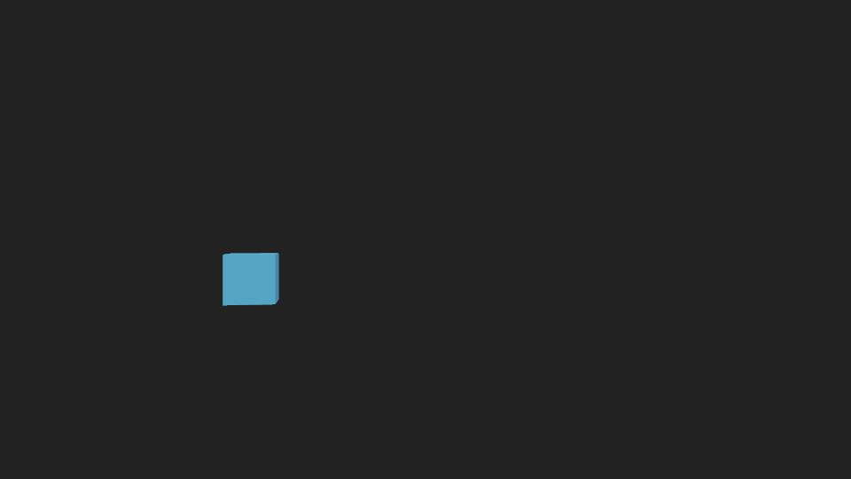
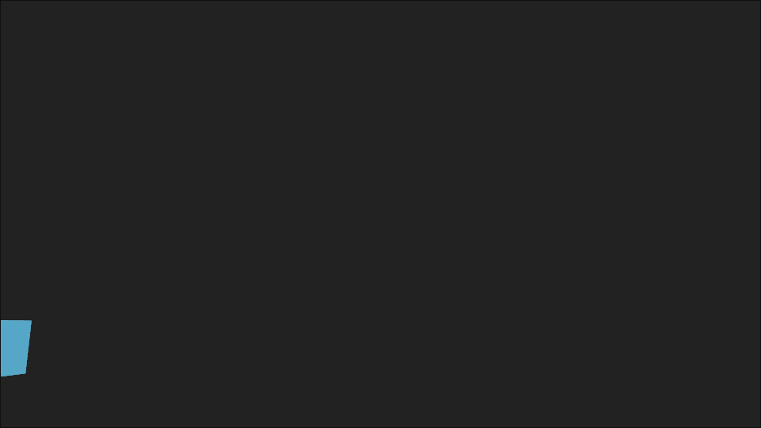
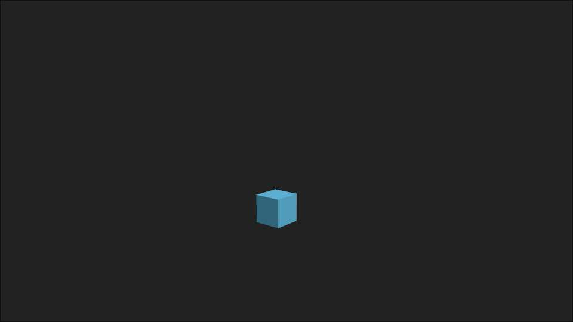
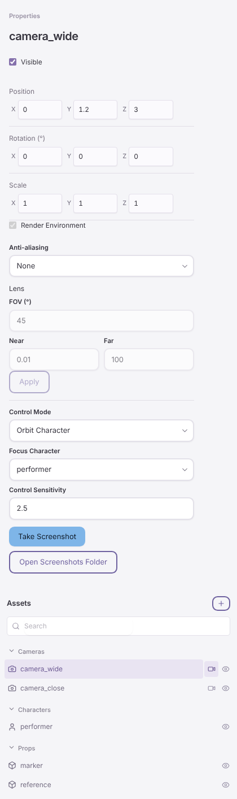

# Camera workflow check (B7)

Date: 2026-10-17. Contract: [camera workflow](../../spdd/prompt/2026-10-17-camera-workflow.md). Issues: #49 (CAM-01), #50 (CAM-02), #53 (CAM-05).

Platform: Linux cloud container (Ubuntu 24.04, x86_64, no GPU, no OBS). Node 26.10.0, pnpm 12.8.1, rustc 1.93.1, three.js 0.180.0, Playwright Chromium 1194 (headless) from `/opt/pw-browsers`. Commit: see the pull request head. A software adapter proves that the code runs. It does not prove the feel of navigation, visual quality, or timing on macOS.

## Navigation in the editor viewport (headless Chromium)

Method. A scratch Vite page (not in the repository) called the real `createRenderer` from `packages/renderer/src` with an editor and `mode: 'force-webgl2'` (ANGLE on Vulkan, llvmpipe). The scene was the smoke scene without its asset meshes, on a real `createSession`. The page answered `onNavigate` with `session.applyPatch` after 30 ms, as the host relay does, and drew one session frame on each animation frame. Playwright moved the mouse and pressed keys on the 960 × 540 canvas. `camera_wide` was the preview camera with the control mode under test.

| Check | Requirement | Result |
| --- | --- | --- |
| Free Look: right drag 100 px right, 50 px up | R5, R8 | PASS. Yaw −20°, pitch +10° (0.2° for each pixel), position unchanged. 15 `setTransform` patches with revisions 0 to 14 in sequence, all accepted. Smallest interval between two sends 100 ms; each send came after the previous reply. No context menu. |
| Free Look: W with the right button up | R5 | PASS. No patch. |
| Free Look: W for 1 s with the right button down | R5 | PASS. 1.87 m forward (2 m/s; the key and button events take part of the second). |
| Free Look: Shift+W for 1 s | R5 | PASS. 5.80 m (3 × 2 m/s). |
| Free Look: right click without motion | R7 | PASS. One context menu, no patch. |
| Tab, Ctrl+Tab, Shift+Tab with canvas focus | R12 | PASS. `onCycleCamera` got `1`, then `-1`. Shift+Tab moved the focus out of the canvas. |
| Another edit during a gesture | R8 | PASS. A `setTransform` on another entity in the middle of a right drag ended the gesture. No later patch from the gesture; the camera kept the scene value. |
| Orbit Character: left drag 120 px, 40 px | R6, R7 | PASS. Yaw −36.1°, pitch −10.0° (0.3° for each pixel), distance to the pivot kept, no selection change. Only `setTransform`. |
| Orbit Character: left click | R7 | PASS. The click selected (here: nothing under the pointer), no patch. |
| Orbit Character: 3 wheel steps | R6, R8 | PASS. Distance × 1.1³. 3 patches, last one after the wheel became idle. |
| Orbit Character: middle drag 60 px | R6, R8 | PASS. Each patch had `setTransform` and `setCameraNavigation` together. `pivotOffset` changed in the view plane; the camera kept its distance to the new pivot. |
| Orbit Character: right drag 80 px | R7 | PASS. No context menu. |
| None: right, left, and middle drags and a wheel step | R4 | PASS. No patch, camera unchanged, the right press still opened the context menu. |

The smoke scene moves the performer root. The orbit pivot uses the evaluated root position at the start of the gesture, so the measured distance to `[0, 1.3, 0]` changed by 2 mm during an orbit; the distance to the real pivot did not change.

| Before | After a Free Look turn | After an orbit pan |
| --- | --- | --- |
|  |  |  |

## Inspector controls (headless Chromium)

Method. A scratch Svelte page mounted the real `Inspector` and `Hierarchy` components with a real `createEditorModel` on a real `createSession` (smoke scene, `camera_wide` selected). `cameraScreenshot` and Open Screenshots Folder were fakes at the call boundary. Playwright used the controls.

| Check | Requirement | Result |
| --- | --- | --- |
| A camera without the field | R1, R10 | PASS. Control Mode shows None; no sensitivity field. |
| Control Mode Free Look | R10 | PASS. `{ mode: 'freeLook', sensitivity: 1 }`; no Focus Character. |
| Control Sensitivity 2.5, then 20 | R10 | PASS. 2.5 was stored. 20 was not sent, and the field showed 2.5 again. |
| Control Mode Orbit Character | R10, R11 | PASS. `targetId: 'performer'`, `pivotOffset: [0, 1.3, 0]`, sensitivity kept. Focus Character lists None and the characters. |
| Focus Character None | R10 | PASS. `targetId: null`. |
| A rejected mode change | R10 | PASS. The select showed the scene value again. |
| Take Screenshot | R18 | PASS. One `cameraScreenshot` call with the camera ID and the scene revision; the file name shows under the buttons. |
| Open Screenshots Folder | R18 | PASS. One call. |
| Add cameras to 8 | R12a | PASS. Camera was enabled for the 3rd to 8th camera and disabled at 8. An added camera has Free Look with sensitivity 1. |
| Page errors | | None after the fix below. |

The first run found a defect: the number field gives a number, and the sensitivity parser called `trim()` on it. The parser now takes a string or a number, and a unit test covers both.

## Selection (CAM-02)

`packages/session/test/camera-navigation-patch.test.ts` cuts between `camera_close` and `camera_wide` three times through `selectCamera` for `output_main` and `preview_main`, the session API that the host relay calls. After each cut, the next runtime frame names the selected camera for both outputs and the tick increases. Removal of the output camera fails with `INVALID_INPUT`. The renderer reads the output camera in each frame (`renderer.ts`), and `FrameApplied.cameraId` names it; the existing test in `packages/renderer/test/asset-lifecycle.test.ts` applies two frames with a cut and checks the camera, the lens, and `cameraId`. A cut in OBS with continued motion while the editor is minimized is a local check.

## Screenshots (CAM-05)

Integration tests (`apps/desktop/src-tauri/tests/service_integration.rs`, module `screenshots`) run the real host service with a fake `preview_main` renderer client at the WebSocket boundary. They cover: relay and file write (name `20261017-090507-042-camera_main.png` from an injected clock, bytes and SHA-256 equal), a name collision (`-1`, then `BUSY` after `-9`, no file replaced), the host-wide rate limit across two operators, `CONFLICT` and `NOT_FOUND` before the relay, `UNAVAILABLE` without a renderer, `STALE_FRAME` for another session, revision, or camera, `INVALID_INPUT` for a reply that is not a PNG, is 16 × 9, or is larger than 8 MiB, `TIMEOUT` with a late reply ignored, and the socket size and role checks. `service_integration` passed 3 runs in a row.

PNG size and encode time. A scratch page called `createRenderer` with `preview_v1` on `preview_main` (`camera_wide`) and `renderer.screenshot` in headless Chromium with `chromiumGpuArgs`. WebGL 2 is ANGLE on Vulkan (llvmpipe); WebGPU is SwiftShader. "Encode" is `encodePng` alone; "whole" is the call from request to PNG, warm.

| Scene | PNG | Encode | Whole (WebGL 2 / WebGPU) |
| --- | --- | --- | --- |
| Smoke scene (`fixture_glb_1` not present) | 78 KB | 115–123 ms | 0.63 s / 2.8 s |
| VRM 0.x avatar and box, transparent | 85–87 KB | 110–130 ms | 0.67 s / 3.5 s |
| Avatar and stage environment | 611 KB | 183–221 ms | 1.2 s / 5.9–6.5 s |
| Avatar, stage, and FXAA | 683 KB | 180–250 ms | 1.3 s / 8.0–8.3 s |

Each PNG is 1920 × 1080 RGBA. The corner alpha is 0 in the transparent scenes. The WebGL 2 orientation is equal to the canvas capture, and the two backends give the same image. The largest PNG is 0.67 MB, far below 4 MiB, so the 8 MiB limit stays (R16).

## Gaps

- The feel of each control mode on macOS, and Tab and Ctrl+Tab in the macOS WebView.
- OBS following the camera during a gesture at about 10 Hz, and a camera cut in OBS with continued motion while the editor is minimized.
- The screenshot alpha over a checker background in an image viewer, and the screenshot frame cost in the Scene window on a real GPU. On SwiftShader WebGPU the stage scene takes 6–8 s and gets `TIMEOUT` at the 5 s relay limit; the time on a real GPU is unknown.
- Open Screenshots Folder in Finder.
- Windows: not checked.
