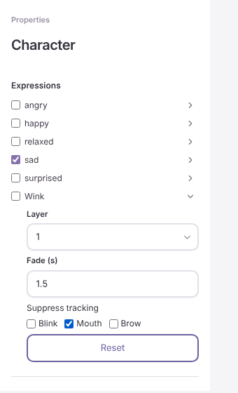

# Character expressions: Linux cloud check

Date: 2026-10-17. Contract: [character expressions](../../spdd/prompt/2026-10-10-character-expressions.md). Platform: Linux cloud (Ubuntu x86_64, no GPU), headless Chromium 1194 from `/opt/pw-browsers`. No renderer and no OBS were used.

## What was checked

A temporary Vite page mounted the real `AvatarExpressionFields` component inside the Inspector panel classes (`properties-column`, `inspector`). It used a real session (`createSession`) with the smoke scene and a record with the expression names of the pinned fixture VRM plus one custom expression `Wink`. The page advanced the session every 16 ms. The page was removed after the check.

| Step | Result |
| --- | --- |
| Group rows | `angry`, `happy`, `relaxed`, `sad`, `surprised`, `Wink`. Tracked names (`aa`, `blink`) are absent. |
| Switch `happy` on | Pose weight 0.56 after about 0.2 s, 1 after about 0.6 s (fade 0.4 s). |
| Switch `sad` on (same layer 0) | `happy` switch clears; pose `{"sad":1}` after 0.7 s. |
| `Wink` settings: Fade 1.5, Mouth on | Scene avatar `expressions` = `{"Wink":{"layer":1,"fadeSeconds":1.5,"suppress":{"blink":false,"mouth":true,"brow":false}}}`. |
| Reset | The `expressions` key is removed; Fade shows 0.4 again. |
| Name column width (Inspector panel classes, 300 px column) | 217 px for each row after the row layout change in response to the owner report on #178. |
| Page errors | One 404 for a missing favicon. No script error. |

## Row layout change

The owner reported on #178 that the macOS editor did not show the expression names. The first layout put each row in a grid and set `display: contents` on a `
` element. WebKit, which the macOS app uses, does not handle that case reliably. The rows now use a flex line and a disclosure button. The cloud has no WebKit browser, so the macOS result is still unknown.

## Not checked

The macOS editor, a real VRM in the renderer, OBS output, live face tracking, the Blueprint node fields in the Rete editor, and show save and open. These are local acceptance steps in the pull request.
