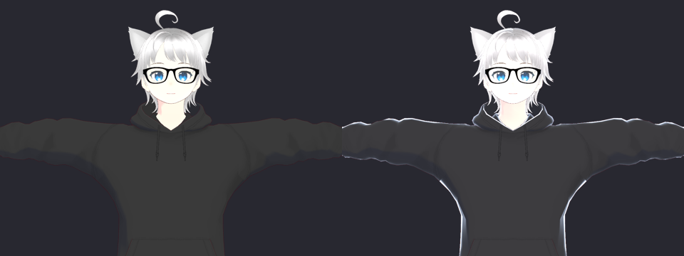
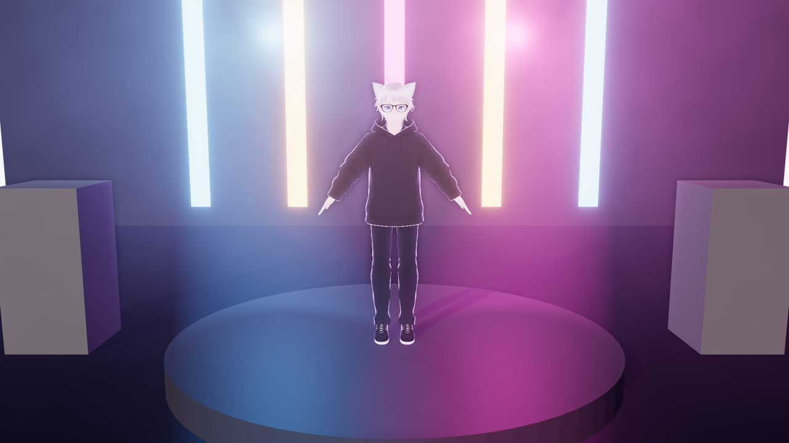
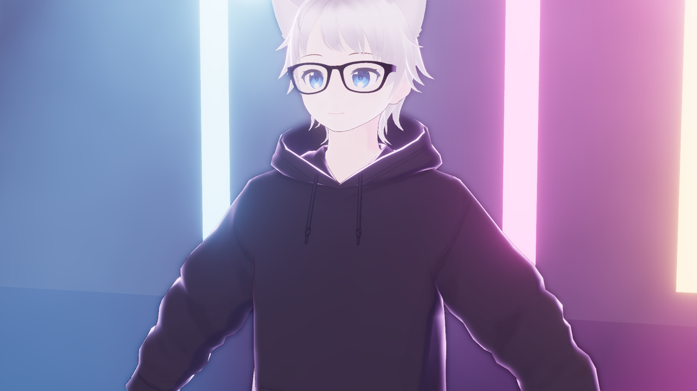
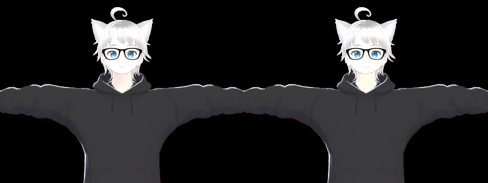

# Character lighting check

Date: 2026-11-19. Contract: [character lighting](../../spdd/prompt/2026-11-19-character-lighting.md). Design: [character lighting design](../superpowers/specs/2026-11-19-character-lighting-design.md). Issues: #73 (MAT-01), #45 (ENV-07). Branch: `liltoon-avatar-lighting-f03807ca`. The last code commit is `ec02109`. The final-review fixes (`884f8a7` to `ec02109`) masked the rim to the lit side and changed how an avatar gets its ambient; the look, stall, and shadow results below are from those commits. The baseline is `main` at `902af37`.

GPU time: unknown (#305).

## Setup

- macOS 27.2 (Darwin 27.2.0, Apple silicon), debug build (`pnpm dev:desktop`), shared Cargo target.
- Editor preview: WebGPU in WKWebView, `preview_v1`. OBS: OBS 33.0.1, browser source 1920 × 1080 at 60 FPS, WebGPU, `production_v1`, in an isolated test scene. No stream and no recording.
- Character: Catboy (VRM 0, ARKit). The before and after look also used seven more VRM files from the owner's library. Only the Catboy images are in this page.
- Demo fixture: `fixtures/shows/lighting-demo.osekai` with the Lighting Stage GLB, R2 key `sha256/30454b71…ce3d.glb` (23,148 bytes), asset ID equal to the ID in the show.
- The tools used MCP (`scene_replace`, `scene_patch`, `camera_screenshot`, `app_status`) and the local OBS WebSocket. App timing and OBS timing are separate.

## Look (R8)

### Before and after

Camera at [0, 1.3, 1.6], field of view 35°, idle animation off, 30 s after `scene_replace` so that a large avatar has loaded. "Before" is `main` with its default rig (one white directional light, intensity 3, and the fixed ambient light). "After" is `3671526` (the avatar path is the same at `ec02109`) with the new default rig (key, back, and fill lights). The value is the mean luminance of a head band (200 px under the top of the character) after / before, on pixels that are opaque in both images.

| Avatar | New rig on the branch / `main` rig on `main` | `main` rig on the branch / `main` rig on `main` |
| --- | --- | --- |
| Catboy | 1.041 | 1.002 |
| Avatar 2 | 1.048 | 1.002 |
| Avatar 3 | 1.052 | 1.003 |
| Avatar 4 | 1.034 | 1.003 |
| Avatar 5 | 1.016 | 1.003 |
| Avatar 6 | 0.935 | 1.001 |
| VRM 1 sample | 1.038 | 1.001 |
| Avatar 8 | 0.961 | 1.002 |

Pass: no face is more than 10 % darker. The second column is the same scene (the `main` default light, no Ambient light entity) on both builds: the face level does not change. A scene with an Ambient light entity was not measured.

The back light gives a rim on the hair, the shoulders, and the top of the arms. The first build also put a rim on the lower side of the arms and on the hem, because the rim did not depend on the side of the light. The rim now has a soft light-side mask (`smoothstep(-0.1, 0.4, N·L)`), and the rim on the lower edges is gone. The owner's look check decides the width of the rim on dark cloth.

### Tuned values

- `EXPONENT` is `narrow 16`, `wide 4` (was 8 and 1.5). The default Rim Width 0.5 gives exponent 10.
- The defaults stay `rimStrength 1`, `rimWidth 0.5`, `rimTint #ffffff`, `shadowStrength 0.6`, `environmentFill 1`. `CHARACTER_FILL` and `CHARACTER_AMBIENT` stay 0.5. `CHARACTER_AMBIENT` now scales the ambient term of an avatar MToon material in its lighting model; it is not a separate light. With the fill, the total ambient of an avatar at the default values is the scene ambient. A material that is not MToon, and an MToon prop or environment, keep the scene ambient as on `main`.
- Demo show: haze density 1 → 0.5 and intensity 2.5 → 1.2; the two back point lights 40 → 20; the Face camera gets the grading of the Wide camera (ACES, bloom 0.4, threshold 1, radius 0.4). Without tone mapping, the face on the Face camera clipped to white.

### Demo show

- The rim shows from each back light (left and right) in the preview and in OBS ([OBS image](character-lighting/obs-demo-wide.png)).
- On the Face camera, the face keeps its color with the ACES grading.
- Shadow to the shade color: Catboy with the new rig, idle animation off, Shadow Strength 1 (left) and 0 (right). In the 1,812 skin pixels in the key light shadow, the mean color is (0.998, 0.891, 0.873) with Shadow Strength 1 and (0.999, 0.979, 0.926) with 0. Red stays and green and blue go down, so the shadow moves the skin to its pink shade color and does not make it grey.

- File › Open of the demo show five times, alternating with `test-stage.osekai`, from a cold start: the stage and Catboy load each time, with no error. Before `1721f7c`, the first open sometimes failed with `Cannot destructure property 'useFrameBufferTarget' from null` (two `compileAsync` calls on one renderer at the same time).

### Editor

The avatar Inspector has a Lighting section with Rim Strength, Rim Width, Rim Tint, Shadow Strength, and Environment Fill ([image](character-lighting/inspector-lighting.png)). A new scene has a Key Light, a Back Light, and a Fill Light ([image](character-lighting/new-scene-rig.png)).

## OBS output

The OBS checks ran at `13b225b`. The later commits change only the avatar shading terms (the rim mask and the ambient scale), not the alpha or the post chain.

| Check | Result |
| --- | --- |
| Alpha | Pass. With the stage and the haze hidden, over black, white, and checker: the corners have alpha 0, and no pixel has a color channel above its alpha at the avatar edges. The hair edges have no bright halo ([image](character-lighting/obs-alpha-backgrounds.png)). |
| Minimized Editor | Pass. With the Editor minimized (`AXMinimized` true), two OBS screenshots 4 s apart differ in 10,694 pixels, so the output continues. |
| Frame time | Output CPU 5.1 to 5.9 ms (`production_v1`, WebGPU). Preview CPU about 4 ms (`preview_v1`). OBS `outputSkippedFrames` 0. GPU time unknown. |

## Cost (R8)

The Editor stops while new lit materials compile. The stall is the time from the `scene_patch` that adds one lit light to the first preview frame at the new revision. Each run cleared the Metal shader cache of the app and started the app again. The scene is Catboy with N − 1 lit point lights. The gate is the spot light add at 8 lit lights: fail if more than 20 % longer than `main`.

| Build | Spot add at 1 / 3 / 8 lit lights (ms) |
| --- | --- |
| `main` `902af37`, run 1 | 6914 / 6910 / 8043 |
| `main`, run 2 | 6928 / 7914 / 8070 |
| `main`, run 3 | 7937 / 6885 / 8080 |
| Branch `1721f7c` (room map fill), run 1 | 8958 / 9042 / 10244 |
| Branch `1721f7c`, run 2 | 9930 / 8971 / 10194 |
| Experiment: no environment fill | 7787 / 7844 / 8035 |
| Experiment: no rim | 9879 / 9952 / 10131 |
| Branch `e1669f9` (spherical-harmonics fill), run 1 | 7922 / 8011 / 8181 |
| Branch `e1669f9`, run 2 | 7907 / 8025 / 8210 |
| Branch `ec02109` (final) | 7842 / 6924 / 8148 |

- The room map fill (three PMREM samples in each avatar shader) made the 8-light add 26 % longer: fail. The experiments showed that the fill, not the rim, was the cost. The fill now uses the nine spherical-harmonics coefficients of the room, read back one time for each renderer (contract R4). With this change, the 8-light add is 1.7 % longer than `main`; at `ec02109` it is 1.0 % longer: pass.
- A point or directional light add takes about 100 ms on both builds. The first add at 1 lit light is not a stable measurement, because the avatar can still be in load.
- A spot light add takes 7 to 8 s on `main` too. This branch does not change that.
- 30 light-set changes at 8 lit lights (15 adds and 15 removes): no frame warning and no `Pipeline compile failed`. The app had no `Room fill unavailable` warning, so the readback worked in WebKit.

## Behavior that also occurs on `main`

- Bloom writes alpha around the hair over a transparent background: 36,000 partial-alpha pixels with bloom 0.4, and 3,000 with bloom 0. In OBS over white, this shows as a soft grey glow.
- Over a light OBS background with the default blending, beams are a dark veil. [The README](../../README.md#obs-output) tells users to set the Blending Method to SRGB Off.
- The Inspector clips the reset mark of a changed field (`.section-clip`), also on the Lighting sliders. [The stage beams check](stage-beams.md) records the same on `main`.
- `packages/contracts/test/meshes.test.ts` fails when the local asset manifest does not have `fixture_vrm0_arkit`. The same failure occurs on `main`.

## Headless checks

The TypeScript commands ran on macOS in this worktree at `ec02109`. The Rust commands ran at `bfa7e8d`; no later commit changes Rust.

| Command | Result |
| --- | --- |
| `pnpm check` | Exit 0. svelte-check 5897 files, 0 errors, 0 warnings. |
| `pnpm test:unit` | Exit 1. 285 files passed, 1 failed; 2732 tests passed, 1 failed. The failure is `packages/contracts/test/meshes.test.ts`: the local asset manifest does not have `fixture_vrm0_arkit` (see above). |
| `pnpm test:integration` | Exit 0. 49 files passed; 121 tests passed, 4 skipped. |
| `cargo fmt --all --check` | Exit 1. Differences in `apps/desktop/src-tauri/src/recent_shows.rs` and `apps/desktop/src-tauri/src/tracking/parser.rs` only. This branch does not change those files. |
| `cargo clippy --workspace --all-targets -- -D warnings` | Exit 0, 0 warnings. The first run failed with `large_enum_variant` on `PatchOp`, because the avatar entity got the `lighting` group. The group is now `Option<Box<AvatarLighting>>`, as `effects` of a camera is. |
| `cargo test --workspace --no-fail-fast` | Exit 101. 625 passed, 1 failed, 2 ignored. The failure is `prepared_local_fixtures_load_and_read`: the local asset manifest of this worktree is a copy, and its paths point to another checkout, so `resolve_asset` refuses them (`fixture_test_stage`). This branch does not change the registry. |

## Not verified

- GPU time (#305).
- The spherical-harmonics readback and the avatar look on WebGL 2. The unit tests do not draw.
- Windows.
- The look of a scene with an Ambient light entity on the eight avatars. By the shader, the ambient of an avatar MToon material is 0.5 × the entity ambient plus a fill of 0.5 × the same color, so the total is the entity ambient. The demo show has an Ambient light entity and is in the images above.
- An avatar with a lit material that is not MToon. No avatar in the check had one. By the code, it keeps the scene ambient as on `main`.
