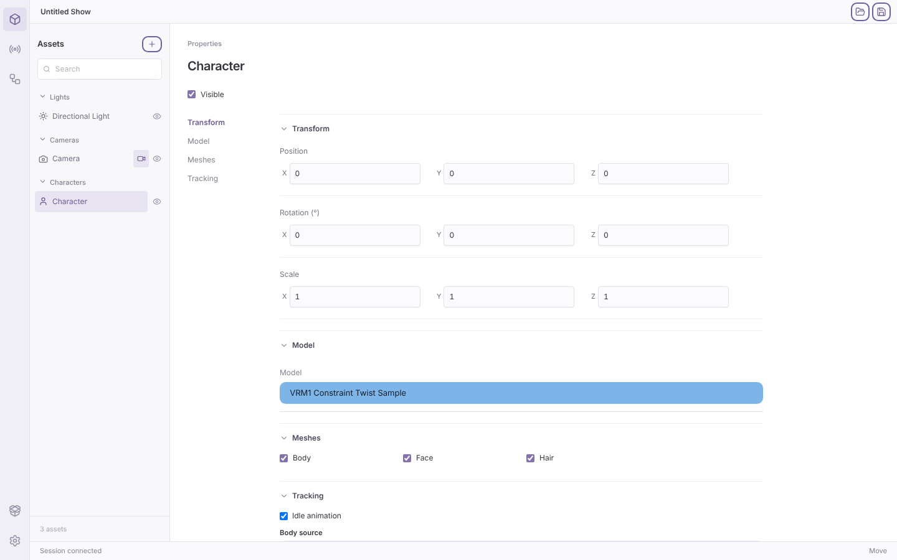
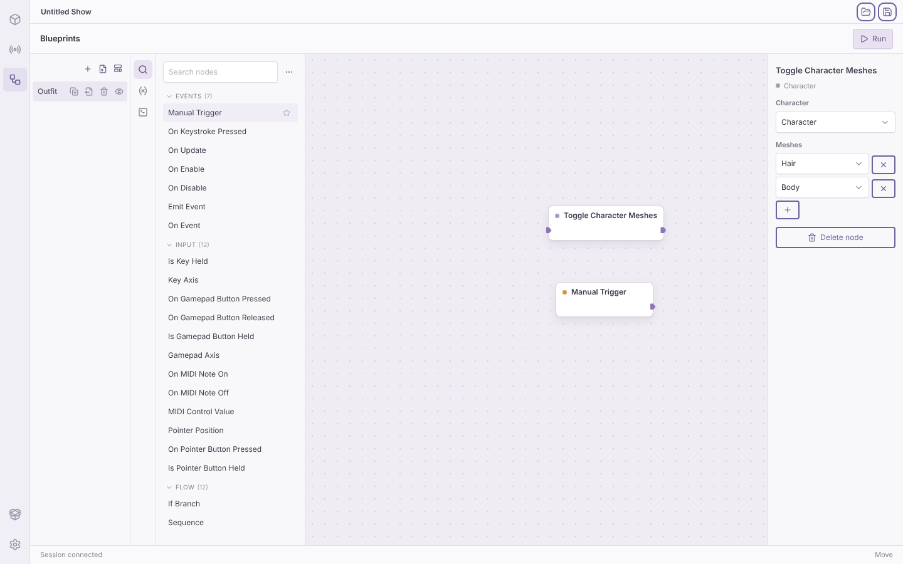
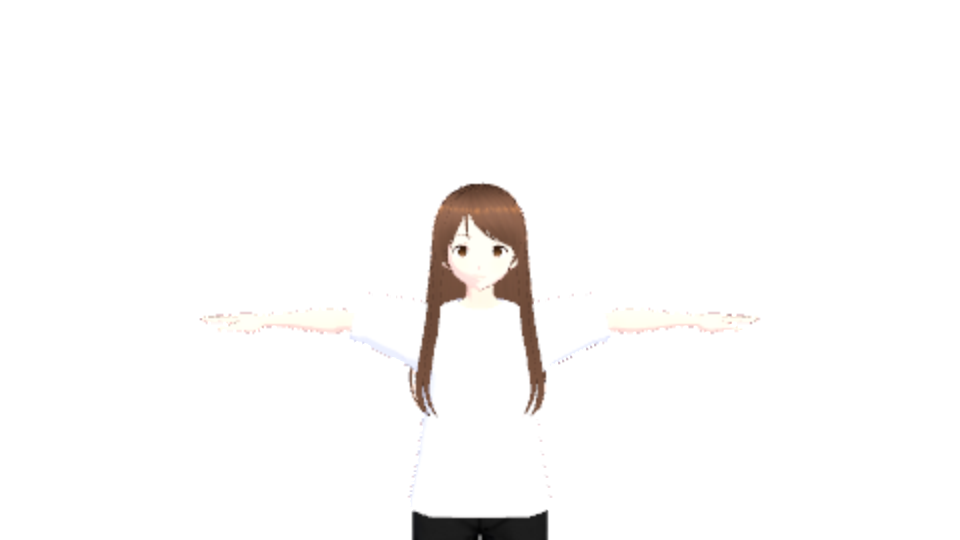

# Character mesh toggles: Linux cloud check

Date: 2026-11-03. Contract: [character mesh toggles](../../spdd/prompt/2026-10-28-character-mesh-toggles.md) (B26, BP-08 slice 1). Base commit: `3e02e98`. Platform: Linux cloud (Ubuntu x86_64, no GPU), headless Chromium from `/opt/pw-browsers`. Fixtures: `fixture_vrm_1`, `fixture_vrm0_arkit` from `fixtures/local`. No macOS app, OBS, or tracking hardware was used.

## Mesh names

| Model | Mesh nodes | Names |
| --- | --- | --- |
| `fixture_vrm_1` | 3 | `Body`, `Face`, `Hair` |
| `fixture_vrm0_arkit` | 57 | `Face`, `Body`, `Hair001` to `Hair055` |

Rust (`vrm_meshes`) and TypeScript (`meshEntries`) pass the 11 cases of `fixtures/protocol/mesh-names.json`: empty and white-space names, the U+FEFF and U+0085 trim difference, repeated names, a generated name that a later node also has, the 128-unit cut with a repeat, an emoji at the cut, a name that is not a string, and 257 mesh nodes.

## Editor window (headless)

[`editor-check.mjs`](character-mesh-toggles/editor-check.mjs) runs the Editor window build with a stand-in host and a real session, as the B18, B19, and B21 checks do. The stand-in gives the record of `fixture_vrm_1` the mesh list that the importer reads, and serves the fixture VRM. Result: 17 of 17 ([log](character-mesh-toggles/editor-check.txt)).

- The character Inspector has a Meshes section between Model and Tracking, and the section index lists it. It has one checked checkbox for each mesh, in record order.
- A clear of Hair sends one `setHiddenMeshes` patch with `["Hair"]`. A check of Hair removes the field.
- The node palette adds Toggle Character Meshes with the first mesh (`Body`). The Meshes list changes an entry, adds the next unused mesh with `+`, removes an entry, and keeps the last entry. A second entry does not offer the name of the first entry. A saved name that the record does not have shows as `Missing`.
- Manual Trigger → Toggle Character Meshes (`Hair`): the first Run hides Hair with one revision, and the second Run shows it again.

## OBS page (headless, software adapter)

[`headless-check.mjs`](character-mesh-toggles/headless-check.mjs) runs the built OBS page with a stand-in host that serves `fixture_vrm_1` and sends frames from a real session. Backend: WebGL 2 on llvmpipe (ANGLE, Mesa). The output is 960 × 540 at render scale 0.5 and 30 FPS, so that a page screenshot completes on the software adapter. The check counts the pixels with alpha above 0. This is a functional check only, not a visual quality check. Result: 5 of 5 ([log](character-mesh-toggles/headless-check.txt)).

| Hidden meshes | Drawn pixels |
| --- | --- |
| none | 56718 |
| `Hair` | 52602 |
| `Body`, `Face`, `Hair` | 0 |
| none, again | 56718 |

The model did not reload between the steps. The capture protocol (`captureFrame`) was not used: its handler timeout is shorter than a VRM readback on the software adapter.

 

## Not checked

- The hidden mesh in OBS on macOS, with alpha, on a real GPU.
- The Inspector Meshes section in the macOS app, and a long list (57 meshes) in the macOS layout.
- A hotkey toggle (On Keystroke Pressed → Toggle Character Meshes) during live tracking.
- Show save and open with `hiddenMeshes`. The session keeps the field in the scene, and the show schema did not change, but no file round trip was run.
