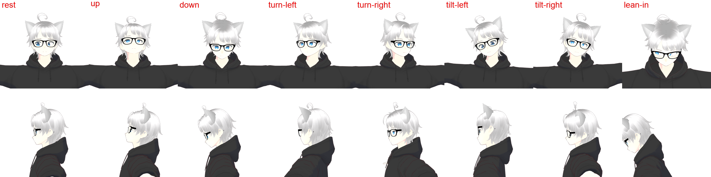

# Face-only body motion evaluation (TRK-06, BP-11)

Design: [face-only body motion](../superpowers/specs/2026-11-18-face-only-body-motion-design.md). Contract: [slice contract](../../spdd/prompt/2026-11-18-face-only-body-motion.md). Warudo values: [Warudo face tracking reference](warudo-face-reference/README.md).

## macOS check with a synthetic source

Commit: `bb8069b` (product code). Date: 2026-11-19. Platform: macOS 27.2.1 (26B131), worktree dev build (`OPENSEKAI_EVALUATION=1 pnpm dev:desktop`). Backend: webgpu. Quality profile: output_main `production_v1`, preview_main `preview_v1`. OBS 33.0.1 (obs-websocket 5.7.6), 1920x1080 at 60 FPS, isolated QA scene. Character: Catboy with black hoodie, idle animation off. No fixture file: a script made the tracking data.

### Method

A Node script sent iFacialMocap packets (`=head#rx,ry,rz,tx,ty,tz|`, degrees and raw translation) over UDP to 127.0.0.1:49983 at 60 Hz. The script held each pose for a set time and then stopped. It did not use a phone. The tracking guide created an iFacialMocap source with phone address 127.0.0.1.

The Blueprint node `character.getBoneRotation` reads the pose before bone offsets. Thus it cannot show the template output. A VMC sender entity sent the composed pose to a local VMC listener, and the listener wrote each bone rotation every 100 ms. The bone values below are rotation vectors in degrees, in VMC (Unity) axes. A second graph read `tracking.getHeadPose` through Debug Value nodes and `blueprint_debug_log`.

### Results

| Check | Result | Evidence |
| --- | --- | --- |
| The tracking guide with iFacialMocap face and no body source creates the "Face-Only Body Motion" graph for the character | Pass. One graph, 53 nodes, enabled, character `avatar_catboy`. | `02-after-connect.png` |
| Cancel removes the graph and the tracking assignment | Pass. Blueprint graphs `[]`. The source entity is gone, and the character has no face source. | `02-after-cancel.png` |
| Done keeps the graph | Pass | `02-after-done.png` |
| Head yaw turns the body | Pass. See the yaw table. | `04-obs-yaw.png` (+20°, 0°, −20°) |
| Head forward position leans the body | Pass for the numbers. The unit of the phone translation is not known. See the lean table. | `05-obs-lean.png` (0, tz 5, tz 0.05) |
| Arms sway after a head turn and stop | Pass. See the sway table. | `06-sway.png` (12 OBS frames over 3.5 s) |
| Motion returns to rest when tracking stops | Pass after the design change (see "Fade"). | — |
| OBS output moves while the editor is minimized | Pass. Output frames went from 46161 to 46536 in about 6.3 s (about 60 per second). OBS reported 60.0 FPS and 0 skipped frames. Two OBS frames 1.3 s apart differ in 91,983 pixels. | `08-obs-minimized.png` |
| The Templates menu has "Face-Only Body Motion" and "Camera Sway", and no "Upper Body Rotation" | Pass | `10-templates-menu.png` |
| Pendulum rows and Offset Bones bones editors (commit `ec9c811`) | Pass after the Inspector fixes (see "Inspector"). Add and remove of an input row and an arm row change the node settings, and the template values come back after the remove. "Add arm" is disabled at 4 arms. | `12-pendulum-inspector.png`, `12-offset-bones.png` |

### Yaw

Values after 3 s or more at the pose.

| Sender | Head | Neck | Chest | Spine |
| --- | --- | --- | --- | --- |
| ry +20° | [0, 20, 0] | [0, −7.5, 0] | [0, 2.5, 0] | [0, 5, 0] |
| ry −20° | [0, −20, 0] | [0, 7.5, 0] | [0, −2.5, 0] | [0, −5, 0] |

The spine and the chest turn in the same direction as the head. The neck turns in the opposite direction. The values agree with the design: 20° × intensity 0.5 = 10°, spine 0.5 gives 5°, chest 0.25 gives 2.5°, and neck −0.75 gives −7.5°. The value reached its full level in less than 500 ms.

### Lean

| Sender tz (raw) | `headPosition` | Spine X | Neck X | Head X |
| --- | --- | --- | --- | --- |
| +5 | (0, 0, 0.05) | 11.25 | −3.75 | −10 |
| +0.05 | (0, 0, 0.0005) | 0.11 | −0.04 | −0.10 |

The decoder multiplies the raw value by 0.01 (centimeters to meters). For tz +5: 0.05 × input scale 5 = 0.25, and spine 45 × 0.25 = 11.25°. The rise took about 2 s because of the 0.4 s input smoothing. If the phone sends meters, the lean is almost zero. A phone check must find the unit. (The phone check found meters. See "Phone check".)

### Sway

The sender went from ry 0° to 25°, held for 0.35 s, and went back to 0°. Left side, Z in degrees. The shoulder rests at 5° (the template shoulder offset).

| Time after the step (ms) | LeftShoulder | LeftUpperArm | LeftHand |
| --- | --- | --- | --- |
| 1018 | 5.24 | 0.24 | 1.19 |
| 1418 | 7.08 | 2.08 | 10.42 |
| 1820 | 4.28 | −0.72 | −3.58 |
| 2625 | 4.65 | −0.35 | −1.77 |
| 3633 | 5.08 | 0.08 | 0.40 |
| 5843 and later | 5.00 | 0.00 | 0.00 |

The right side has the opposite sign. The swing has its maximum about 0.9 s after the head goes back to 0°. It is less than 0.5° after about 2.6 s and 0 after about 5 s. The hand moves about ±10° and the upper arm about ±2°. The owner did not examine the look.

### Fade

The sender held ry 20° and tz 5 and then stopped.

| Time (ms) | Spine | Chest | Neck | LeftHand Z |
| --- | --- | --- | --- | --- |
| 8 | [11.24, 4.98, 0.49] | [0, 2.5, 0] | [−3.74, −7.5, 0.25] | 10.32 |
| 613 | [11.17, 3.54, 0.35] | [0, 1.78, 0] | [−3.72, −5.33, 0.17] | 10.32 |
| 917 | [7.35, 0, 0] | 0 | [−2.45, 0, 0] | 9.90 |
| 1525 | [0.73, 0, 0] | 0 | [−0.24, 0, 0] | −3.19 |
| 2129 | [0.04, 0, 0] | 0 | [−0.01, 0, 0] | 0.28 |
| 4548 and later | 0 | 0 | 0 | 0 |

The motion stops smoothly with no jump. The body turn goes back to rest with the head. `getHeadPose.rotation` reads the composed head, and the compose step fades the head when the source is stale (0 at about 0.9 s). The lean goes back to rest in about 1.5 s. The hand swings one time and stops at about 4.5 s. The first acceptance text said "to zero in about 2 s". The design now says that the body turn follows the head back to rest and the other motion goes back to rest in about 2 s with no jump (commit `f44d493`).

### Inspector

The first check found three problems: the whole editor body scrolled instead of the Inspector, long bone names went under the select arrow, and a new input row had scale 1 and clamp −1..1 (Warudo: scale 5, no clamp). Commit `f44d493` corrected them. A re-check at `f44d493` found that the input selects in the Pendulum rows cut "Head pitch" to "Head …". Commit `ec9c811` puts each select of a row on its own full-width line. At `ec9c811` the input selects show "Head pitch", "Head yaw", and "Head Z" in full, and long bone names stop with an ellipsis before the arrow. The Inspector goes back to the top when the user selects a different node. It does not move when the user changes a field of the same node.

### Check after the final review fixes

Commits: `32eb27b` (implicit pendulum step, a tick budget for each graph, the Warudo pendulum intensity 0.5, smoothed `headPosition`) and `d29c760` (send queue). Date: 2026-11-19. Same computer, backend, and profiles as above. Debug build.

| Check | Result | Evidence |
| --- | --- | --- |
| Lean at tz +5 | Pass. Spine X 5.63° (5.28° at about 1.0 s), neck −1.88°, head −5.0°. | `14-obs-lean.png` |
| Yaw ±20° | Pass. Spine ±5°, chest ±2.5°, neck ∓7.5°. These do not change. | — |
| Sway after ry 0° → 25° → 0° | Pass. The hand has its maximum of 4.17° about 0.94 s after the step (10.42° before the intensity). It is less than 0.1° from about 2.6 s after the head goes back. | `14-sway.png` |
| Two characters, each with a template graph and its own iFacialMocap source | Pass at `d29c760`. Both bodies turn with the head in OBS. No graph reports an operation limit. A VMC sender on each character sends for more than 60 s with the correct values. | `14-two-characters-yaw.png` |
| The template graph opens on the canvas | Pass. No nodes overlap. | `14-template-graph.png` |
| Concert benchmark | Unknown. `benchmark_start` replied `CONFLICT` ("Smoke fixture registration mismatch"): the app did not start with the fixture manifest, so no benchmark number exists. | — |

A scene can have at most 2 characters, so 3 characters were not checked.

At `32eb27b`, the VMC sender stopped when a second face-tracked character was in the scene. The cause was in the browser client send queue, not in this feature: a VMC poses message was dropped when the frame of the same tick was larger. The rule came from an earlier change and is also on main. This branch makes the frame larger, so the problem occurred more easily (one character with the graph had about 129 bytes of margin). Commit `d29c760` counts the frame and the VMC poses of one tick together.

When OpenSekai is in the background, the app stopped for about 2 s every 20 to 40 s, and then ran the missed ticks. This also occurred with the graph off and did not occur with the app in front. It is probably not caused by this branch. It was not examined further.

### Phone check

Date: 2026-11-19. The owner used iFacialMocap on an iPhone, on the same Wi-Fi network as the Mac, with the guide graph on Catboy. Debug build at `fb754d4`. A temporary Blueprint graph read `tracking.getHeadPose` through `blueprint_debug_log`, and a temporary VMC sender gave the final bone rotations to a local listener. The show was not saved.

The owner reported two problems:

1. When the owner leaned forward, the character leaned back.
2. When the owner tilted the head to the left, the body tilted to the right.

The owner held a forward lean for 10 s:

| Value | Rest | Forward lean |
| --- | --- | --- |
| `headPosition` (decoded, × 0.01), mm | (0, 0, 0) | (0.1, −0.6, 1.6) |
| Decoded head pitch (before `69b49c3`) | 0° | −31° (head up) |
| VMC Head X / Neck X / Chest X / Spine X | 0 / 0 / 0 / 0 | −34 / +6.4 / −2.6 / −4.1 |

Cause of problem 1, in two parts:

- The decoder gave the pitch the wrong sign. When the owner leaned toward the phone, the head pitched down in front of the camera (raw rx +11), and the decoder made this a head-up pitch of about 31°. The body follows the head pitch, so the spine and the chest turned back. (An earlier version of this section said that the phone measured the head up. The measured signs below show that the decoder sign was the cause.)
- The lean from the head position did not move the body: the decoder divided the translation by 100 (centimeters assumed), so a lean of about 16 cm became 1.6 mm. iFacialMocap sends meters: tz was 0.16. The forward sign was correct: a forward lean gave a positive Z. `777b90d` keeps the translation in meters. With this unit, the same lean gives a spine lean of about 18° forward (0.16 × 5 × 45 × 0.5).

Problem 2 is the Warudo default. Body Rotation Type Inverted turns the body in the opposite direction to the head roll. The template copies it (`axis-z-signed`, × −1).

After the decoder change, a synthetic source compared the two roll directions and the lean in the editor preview (head roll ±20°; tz 0.16 with the head level and with the head 30° up). With Inverted, the shoulders tip opposite to the head. With the same direction (`axis-z-signed` input b = +1), the upper body tilts with the head. The owner kept Inverted as the default. With the head level, tz 0.16 leans the spine forward clearly. With the head 30° up, the face points up and the lean is less visible, so a calibration in the real rest pose is necessary.

### Mirror direction

The owner requirement (2026-11-19): by default, the avatar moves almost like a mirror. When the owner looks up, the avatar looks up. When the owner turns or tilts the head to the left, the avatar head moves to the left side of the screen. The roll body motion stays Inverted.

A spoken guided capture logged the raw iFacialMocap `head#` values for each pose (rest rx is about −17 to −20):

| Pose | Raw value |
| --- | --- |
| Chin up | rx −33 |
| Chin down | rx +5 |
| Turn to the owner's left | ry −26 |
| Turn to the owner's right | ry +33 |
| Tilt to the owner's left | rz +22 |
| Tilt to the owner's right | rz −22 |
| Lean toward the phone | rx +11, tz +0.13 |

The decoder kept the sign of all three angles. Thus the avatar looked down when the owner looked up, and turned to the wrong side. `69b49c3` changes the sign of the pitch and the yaw for the head and the eyes (roll keeps its sign). The composed pitch now has the Warudo sign.

Live check at `69b49c3`: debug build, iFacialMocap on the owner's iPhone, guide graph on Catboy, calibrated at the owner's rest pose. A spoken guide asked for each pose, and MCP `camera_screenshot` captured a front and a side camera with the app in front. All eight poses move as a mirror: up looks up, down looks down, a turn and a tilt to the left go to the left side of the screen, a turn and a tilt to the right go to the right side, and a lean toward the phone pitches the head down and leans the body forward.

### Not checked

- The eye direction with a real phone. The decoder changes the eye signs with the head signs, but the check did not examine the eyes separately.
- The head position X sign. No template input uses it.
- A side-by-side comparison with Warudo for the pendulum spring, damping, and gravity values.
- The look of the motion. The owner did not examine it.
- An OBS recording. The sway evidence is an OBS screenshot series.
- The concert benchmark. It needs the fixture manifest (see above).
- A release build. All checks used a debug build.

### Other observations

- The lean and sway tables in the first check (commit `bb8069b`) come from before the Warudo Pendulum Physics Intensity (0.5). The check after the final review fixes gives the current values.
- A calibration saved before this branch has no `headPosition` neutral. With such a calibration, the compose step gives no `headPosition`, so the lean and the position part of the sway stay off until the user calibrates again.
- With phone address 127.0.0.1, the receiver gets its own handshake and counts it as an invalid packet (about one each second while stale). This occurs only with a test peer on the same computer.
- When OpenSekai is not the frontmost app, MCP `camera_screenshot` can return an old pose. Keep the app in front for screenshot evidence.
- Each Pendulum node and each Offset Bones node shows only the node type as its heading. On the canvas, the user cannot see which node is "Arm Movements" and which is "Finger Movements" without opening it.
