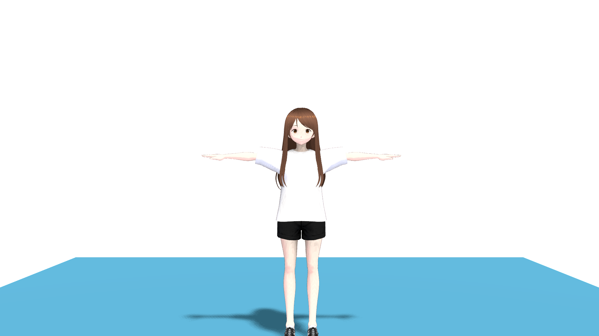
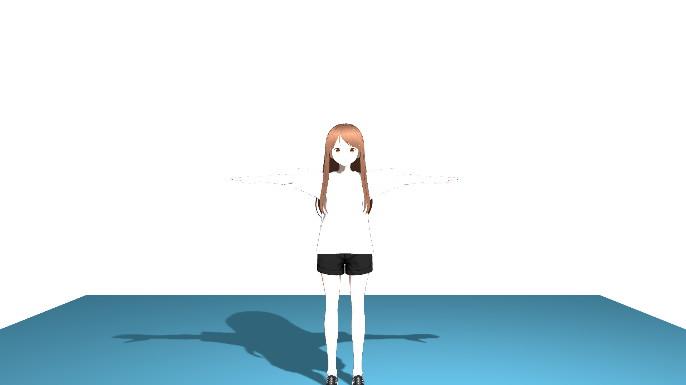
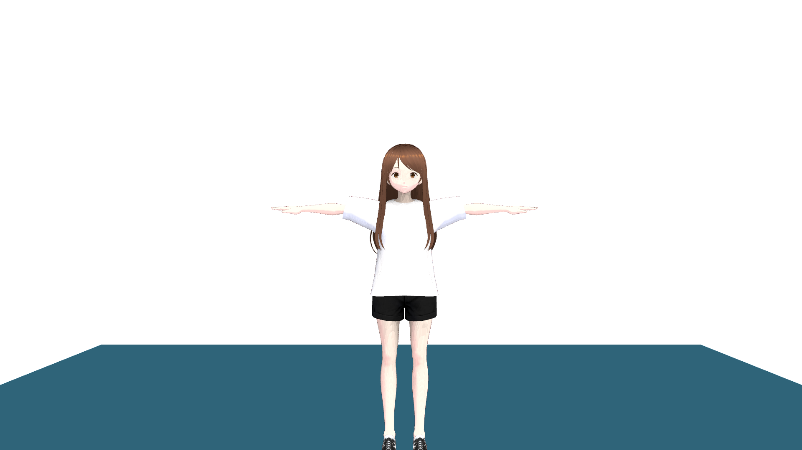
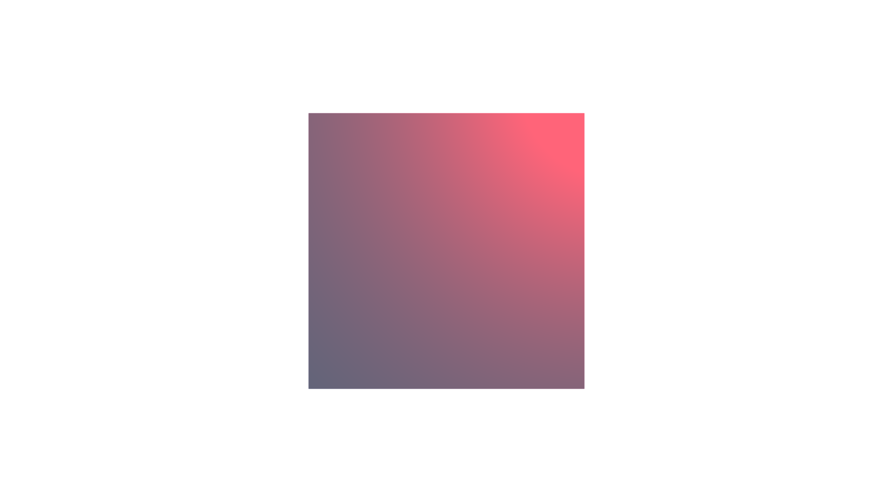
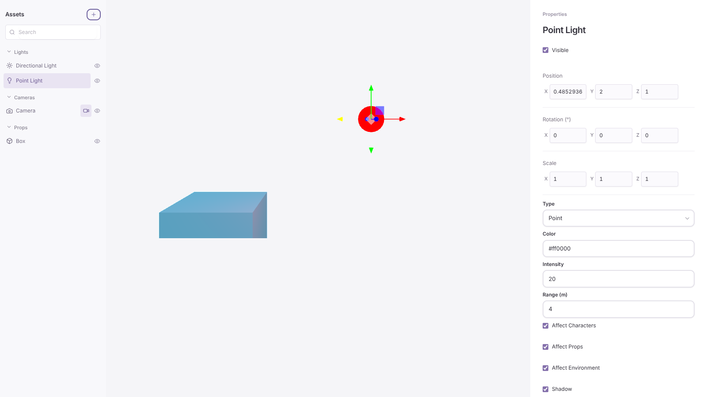

# Light entities check (B9)

Date: 2026-10-18. Contract: [light entities](../../spdd/prompt/2026-10-17-light-entities.md). Issues: #45 (ENV-07 first subset), #39 (ENV-01 lighting part).

Platform: Linux cloud container (Ubuntu, x86_64, no GPU, no OBS). Node 26.10.0, pnpm 12.8.1, rustc 1.93.1, three.js 0.180.0, `@pixiv/three-vrm` 3.5.5, Playwright Chromium (headless) from `/opt/pw-browsers` with `chromiumGpuArgs`. WebGPU is SwiftShader; WebGL 2 is ANGLE on Vulkan (llvmpipe). Fixtures: `fixture_vrm_1` (VRM1 Constraint Twist Sample) and `fixture_glb_stage`, as the setup `fixtures:` line lists. Base commit: `da19d38`; the change is the pull request head. A software adapter proves that the code runs. It does not prove the look, shadow quality, or cost on a real GPU.

## Renderer probe (O3)

Method. A scratch Vite page (not in the repository) loaded `fixture_vrm_1` with `MToonNodeMaterial` on a box floor and drew to a 512 × 384 render target on each backend. Each material got `material.lightsNode = lights([...])`. Measures: the mean luminance of a face box with the light in the character set and without it, and the count of floor pixels that change when the character stops casting.

| Check | WebGPU | WebGL 2 |
| --- | --- | --- |
| MToon accepts `lightsNode` (face luminance, light in set / not in set) | PASS. 148 / 51 | PASS. 100 / 51 |
| Custom `lightsNode` against the default scene lights, same lights | PASS. Same pixels | PASS. Same pixels |
| Point light shadow of the character on the floor | PASS. 8616 px | PASS. 8578 px |
| Directional light shadow of the character on the floor | PASS after a fix (below). 4765 px | PASS. 4754 px |

Finding. In three.js 0.180 on WebGPU, a directional shadow that is first set up during a draw stays empty (no character shadow and no self-shadow). A `renderer.compileAsync(scene, camera)` before that draw sets it up correctly. On WebGL 2 the same compile leaves a shadow that is turned on later empty. Thus `renderer.ts` compiles the scene after a node-set rebuild with a shadow on WebGPU only. The real-renderer check below covers both orders on both backends. This is not a stop condition of the contract: MToon accepts `lightsNode` and receives both shadow types.

## Real renderer (O4)

Method. A scratch Vite page called the real `createRenderer` (`output_main`, `production_v1`) with a real `createSession`, applied session frames, and read each result with `renderer.screenshot` (1920 × 1080, transparent clear). Patches went through `session.applyPatch`. "px" counts pixels that differ by more than 2 in a channel. Raw results are the same on both backends within the noise shown.

| Check | Requirement | WebGPU | WebGL 2 |
| --- | --- | --- | --- |
| A point light (intensity 20, range 10) brightens a box: luminance hidden / visible | R4, R7 | PASS. 90.2 / 235.8 | PASS. 90.2 / 235.8 |
| Color `#ff0000` shows in the next applied frame (box RGB) | R9 | PASS. [165, 100, 121] at revision 2 | PASS. [165, 100, 121] |
| `affectEnvironment: false` against the light hidden, fixture stage | R6 | PASS. 0 px | PASS. 0 px |
| `affectEnvironment: true` against `false` | R6 | PASS. 1 613 012 px | PASS. 1 615 754 px |
| Runtime flip of `affectEnvironment` true → false (fixture stage): off against the light hidden | R6, R7 | PASS. 0 px (off against on: 1 613 012 px) | PASS. 0 px (1 615 754 px) |
| Runtime flip of `affectProps` true → false (fixture stage as a GLB prop): off against the light hidden | R6, R7 | PASS. 0 px (off against on: 1 922 793 px) | PASS. 0 px (1 923 540 px) |
| Reflections Intensity 0 against 1 | R15 | PASS. 2 068 885 px | PASS. 2 069 175 px |
| MToon body luminance, `affectCharacters` true / false | R6 | PASS. 210.9 / 122.4 | PASS. 204.9 / 118.5 |
| `affectCharacters: false` against the light hidden | R6, R7 | PASS. 7706 px, below the idle-motion noise of two frames (13 634 px) | PASS. 11 091 px, noise 22 606 px |
| Directional shadow on the floor beside the legs, light starts with a shadow | R8 | PASS. 14 287 px | PASS. 14 277 px |
| Directional shadow turned on after three frames | R8 | PASS. 14 041 px | PASS. 14 308 px |
| Point shadow, starts with a shadow / turned on later | R8 | PASS. 36 966 / 36 252 px | PASS. 36 822 / 36 730 px |
| Shadow light with `affectProps: false`: floor against the same light without a shadow | R8 | PASS. 0 px (all four cases) | PASS. 0 px (all four cases) |
| The OBS output has the three.js light and no helper | R9, R14 | PASS (unit test, `environment.test.ts`) | — |

A visibility change keeps `lightSignature` (unit test), so it does not rebuild the node sets or recompile.

| Directional shadow | Point shadow | Floor not affected | Red point light |
| --- | --- | --- | --- |
|  |  |  |  |

## Canvas path (after owner QA, finding 1)

The owner's macOS check found that a runtime change of Affect Environment did not change the OBS frame. The checks above read pixels with `renderer.screenshot`, which draws into a new offscreen target and so builds new render objects; that hid the defect. Cause: three.js 0.180 leaves `lightsNode` out of the render-object cache key of a plain (glTF) material, so `needsUpdate` keeps the old pipeline on the canvas. Fix: `scene-lights.ts` disposes a lit material when its node set changes after first use.

Method. The same scratch page read the canvas with `renderer.capture()` (the evaluation path that reads what the preview and OBS draw). WebGL 2 only: a headless WebGPU canvas reads back empty, so the WebGPU canvas result stays for the owner.

| Check (WebGL 2 canvas) | Before the fix | After the fix |
| --- | --- | --- |
| `affectEnvironment` true → false, fixture stage: off against on | FAIL. 0 px | PASS. 1 615 755 px |
| Back to true: against the first frame | — | PASS. 0 px |
| Off against the light hidden | FAIL. 1 615 755 px | PASS. 0 px |
| `affectProps` true → false, GLB prop: off against on / off against hidden | FAIL. 0 / 1 923 539 px | PASS. 1 923 539 / 0 px |
| Directional shadow beside the legs, at start / turned on later | — | PASS. 14 274 / 14 074 px |
| Point shadow beside the legs, at start / turned on later | — | PASS. 36 730 / 36 448 px |
| Shadow light with `affectProps: false`: floor against no shadow | — | PASS. 0 px (all four) |

## Pipeline failure log (after owner QA, finding 2, option 3)

The owner saw `bracket nesting level exceeded maximum of 256` from the Metal translation on macOS after many light-set rebuilds. The cloud could not reproduce it: across 29 owner-like steps (environment and shadow in one patch, Soft off, up to 8 lights with 2 shadows, flag, shadow, and type changes, environment removal and re-add), Dawn compiled every pipeline. The WGSL nesting depth stayed at most 19, and the shader size depended only on the current light set (at most 48 KB).

The owner chose option 3: log the failing shader. `pipeline-diagnostics.ts` wraps the WebGPU device (R9a).

| Check | Result |
| --- | --- |
| Unit tests: async and sync failures, one report for each shader pair, at most 16, restore | PASS (`pipeline-diagnostics.test.ts`, 5 tests) |
| Real WebGPU device (Dawn, SwiftShader): a good pipeline, then a bad shader through `createRenderPipeline` and `createRenderPipelineAsync` | PASS. No report for the good pipeline; one report with the WGSL for the sync failure; the async failure of the same pair is not logged again |
| Real renderer with the watch: point light, affect flags, shadows at start and later, 40-step stress | PASS on WebGPU and WebGL 2; no `Pipeline compile failed` warning |

## Editor flow (O5)

Method. A scratch Svelte page mounted the real `Hierarchy` and `Inspector` with a real `createEditorModel` on a real `createSession`, and the real `createRenderer` with an editor on `preview_main`. The start scene was `makeEmptyScene()` with a box. Playwright used the controls and the 960 × 540 canvas. The run passed on WebGPU and on WebGL 2.

| Check | Requirement | Result |
| --- | --- | --- |
| New scene | R11, R12 | PASS. One Directional Light; Hierarchy groups Lights, Cameras, Props. With an environment: Environment, Lights, Cameras, Props. |
| Add › Point Light | R10 | PASS. The menu lists Directional Light and Point Light. The light has the R10 values at `[0, 2, 1]` and is selected. |
| Color `#FF0000`, then `red` | R13 | PASS. `#ff0000` was stored. `red` was not sent; the field showed `#ff0000` again. |
| Range 4 and Shadow on | R13 | PASS. Shadow Intensity, Soft Shadows, Bias, and Normal Bias show. Range shows for a point light only. |
| Click on empty space, then on the helper | R14 | PASS. The selection cleared, then the click selected Point Light. |
| Drag the gizmo 120 px | R14 | PASS. Position `[0, 2, 1]` → `[0.485, 2, 1]`, one `setTransform`. |
| Set Direction From Main Camera | R13 | PASS. The light rotation became the `output_main` camera rotation; the position stayed `[2, 4, 3]`. |
| A third shadow light | R2, R13 | PASS. `INVALID_INPUT`; the Shadow box showed the scene value (off); 2 shadow lights. |
| Add lights to 8 | R10 | PASS. Directional Light and Point Light are disabled at 8. |
| Reflections Intensity 0.5, then 3 | R15 | PASS. 0.5 was stored; 3 was not sent, and the field showed 0.5 again. |
| Page errors | | None after the fix below. |

The first run found a defect: Set Direction From Main Camera called `structuredClone` on the scene, which is a Svelte state proxy in the editor, and threw. It now copies the arrays.

## Gaps

- The built-in light comes back when the last light entity is removed. The Inspector and MCP give no signal for it (R5).
- Owner checks on macOS (contract Safeguards): the light look on MToon and on the environment in WebGPU; a character shadow on an environment floor in OBS with alpha; the MToon look under a point light; shadow acne and the bias defaults on a real GPU; soft (radius 2, owner decision after radius 4 streaks) and hard (radius 1) shadows at 2048 px and 1024 px; the frame cost of 8 lights and of 2 point shadows (12 shadow passes) at 60 fps in OBS; the recompile hitch in OBS when a light is added; continued motion while the editor is minimized.
- The 20 m shadow box gives no directional shadow outside it in a large environment.
- Windows is not checked.
