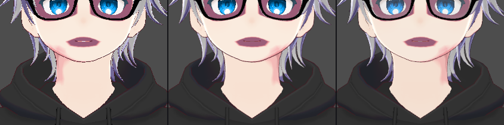
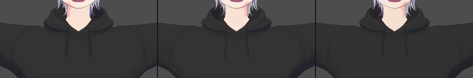
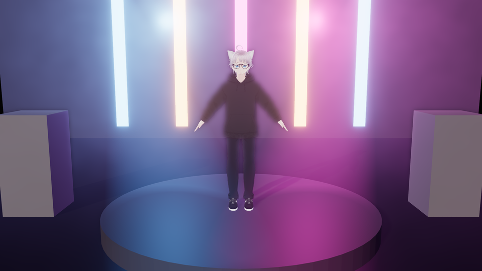

# lilToon on WebGPU check (MAT-02 slice 1)

Date: 2026-11-20. Contract: [lilToon on WebGPU](../../spdd/prompt/2026-11-19-liltoon-webgpu.md). Design: [lilToon on WebGPU design](../superpowers/specs/2026-11-19-liltoon-webgpu-design.md). Issues: #269 (spike), #74 (MAT-02). Branch: `liltoon-webgpu`. The code commit is `ad33d36`; the fork pin after the calibration is `8f7e1d7`, and after the final review `b7600f1`. OpenSekai pins the fork `danirukun/three-liltoon`, branch `webgpu`, at `66e7791` (the calibration found one defect and fixed it in `47a73c8`; the final review put the ambient inside the light limit in `66e7791`, see Calibration; the integration commit used `72d3631`). Sample revision: the second export (made after the convert-script commit `019d288`, see Sample revision). The images and the numbers on this page are from that export, except where a line says "first revision".

GPU time: unknown (#305).

## Setup

- macOS 27.2 (Darwin 27.2.0, Apple M3 Pro), debug build (`pnpm dev:desktop`, `OPENSEKAI_EVALUATION=1`, `OPENSEKAI_FIXTURE_MANIFEST` with the local manifest), shared Cargo target. Fixture revision: local manifest `smoke_v1` with `fixture_vrm_liltoon` (sha256 `90956432…52f4f335`, 18,350,904 bytes; the first revision was `36b9c223…6459152`, 18,351,096 bytes) and the stored MToon Catboy `avatar_7b7c689e…`.
- Sample: Catboy with lilToon materials, `versions.json`: Unity `6000.0.71f1`, UniVRM `0.131.4`, lilToon `2.4.1`, Mochiya Avatar Tools `c3745f3c01d43777fee6f877779b09f8ddec2f03`, export path `mochiya`. 16 materials, all `liltoon` in `material_list`, no unsupported feature. `_MainTex_ST` is `[1, 1, 0, 0]` on each material, and the only emission is the hair emission map. The file has no tangents (74 primitives, 0 `TANGENT`), so the normal map path makes its own tangents.
- Output: OBS 33.0.1, browser source 1920 × 1080 at 60 FPS, WebGPU, `production_v1`, in an isolated test scene (`OpenSekai-QA-*`), with no stream and no recording. The program scene was restored at the end. Each OpenSekai capture of the running app on this page is a `GetSourceScreenshot` of that source, so it is the real output path. The WebGL 2 image is a Playwright page screenshot of the headless check (see below).
- Preview: WebGPU in WKWebView, `preview_v1`. The login session was locked for the whole first-revision run (`CGSSessionScreenIsLocked`), so the Scene window drew no frame (`preview_main` had `lastFrame: null`); the stall, the minimized-Editor, and the first-revision frame-time rows come from that run. The second-revision capture run was in an unlocked session (`CGSSessionOnConsoleKey` only), and the Scene window drew frames (`preview_main` `cpuMs` 1 to 6 ms). The checks that need the preview are marked below.
- Tools: MCP (`scene_replace`, `scene_patch`, `app_status`, `asset_list`, `material_list`), the local OBS WebSocket, `uv run --with pillow --with numpy python -I`. The scripts live outside the repository (`~/.claude/orchestrate/opensekai/liltoon-webgpu/`). App timing and OBS timing are separate.
- Reference rig (the Unity scene of `tools/liltoon-sample`, the table in its README): camera (0, 1.3, 1.6) looking along −Z, vertical FOV 35°, 1920 × 1080; one directional light, intensity 1, color white, Unity rotation (50, 150, 0), world forward (0.3214, −0.7660, −0.5567), no shadow; flat ambient (0.2, 0.2, 0.2). In OpenSekai the light is a directional light at the default intensity 3 (3 × `UNITY_LIGHT_SCALE` = 0.955), color `#ffffff`, with the rotation quaternion (−0.408197, −0.234566, −0.109373, 0.875438), which gives the same forward, and the ambient is an Ambient light `#333333` at intensity 1: Unity reads a `Color` as sRGB in a linear project (the Unity background (0.3, 0.3, 0.3) reads back as sRGB 0.302), so `#333333` is the same flat ambient.

## Sample revision

The owner rejected the first sample export on 2026-11-20: the skin around the eyes and the mouth was pink and purple, and the cat ears were blue. The cause was the convert script, not the port. `tools/liltoon-sample/Editor/LilToonSampleConvert.cs` added three features that the MToon original does not have: the face outline width mask as `_ShadowBorderMask` and `_ShadowBlurMask` with an AO shift, the cat-ear `_MainTex_ST` (2, 2, 0.5, −1) tiling, and a cyan cat-ear emission. The Unity Game view showed the same colors: the first Unity reference read 158 / 98 / 125 inside the lens and 206 / 247 / 255 on the ear. Commit `019d288` removed the three features, and Unity was run again. The second export is sha256 `90956432…52f4f335`, 18,350,904 bytes. `check_sample.py` gives 16 materials, `failures: 0`, the same variant counts, and `_MainTex_ST` `[1, 1, 0, 0]` on each material. The captures, the crops, the calibration, the alpha check, and the Metal headless checks on this page were made again on the second export with the same methods. The stall table was not (see Cost).

## Calibration (R9)

The value is the mean Rec. 709 luminance (on sRGB values) of fixed boxes of the 1920 × 1080 frame, OpenSekai / Unity. The OpenSekai PNG is composited over the Unity background grey. `face_lit` is the forehead, the nose, and both cheeks. `face_shadow_jaw` is the first shadow band on the viewer's left jaw. `neck` is the body-skin band under the chin. Second sample revision, fork `66e7791`:

| Region | Unity | Upstream WebGL | OpenSekai WebGPU | OpenSekai / Unity |
| --- | --- | --- | --- | --- |
| `face_lit` | 0.8273 | 0.8235 (0.995) | 0.8154 | 0.986 |
| `face_shadow_jaw` | 0.5444 | 0.5636 (1.035) | 0.5622 | 1.033 |
| `neck` | 0.7947 | 0.7900 (0.994) | 0.7850 | 0.988 |

On the first revision (`36b9c223…`) the same boxes gave `face_lit` 0.8040 / 0.8001 / 0.7945 (0.988), `face_shadow_jaw` 0.5444 / 0.5636 / 0.5622 (1.033), and `neck` 0.7941 / 0.7893 / 0.7843 (0.988); the face box is lighter on the second revision because the AO band of the removed mask is gone from the cheeks, and the ratios moved by at most 0.002.

- `UNITY_LIGHT_SCALE` stays `1 / Math.PI` (0.3183). At the default directional intensity 3 the summed direct light is 3 / π = 0.955. Since fork `66e7791` the port adds the ambient to the summed light and clamps the sum once (`LilToonLightingModel.ts`, `finish()`, `limit(this.#light.add(this.#ambient))`), as Unity clamps the main light plus the SH ambient (`lilGetLightColor` = `LIL_MAINLIGHT_COLOR + lilGetSHToon()`, `lil_common_functions.hlsl:999`; `clamp(lightColor, _LightMinLimit, _LightMaxLimit)`, `lil_common_macro.hlsl:2081` and `:2086`); the shading, the effects, and the outline read that one light color. In this rig the sum is 0.955 + 0.033 / π = 0.966, below `_LightMaxLimit` 1, so the limit does not engage on either side: the Unity lit skin is the albedo × min(1 + 0.033, 1) = the albedo, and the OpenSekai lit skin is the albedo × 0.966 in linear terms, about 0.985 in sRGB terms; the measured face ratio is 0.986, inside 0.95 to 1.05. No constant changed. Before `66e7791` the port limited the direct light alone and added albedo × ambient after it; with this rig that gave the same values within 0.001 (first revision, fork `47a73c8`: `face_lit` 0.7950, `face_shadow_jaw` 0.5624, `neck` 0.7849). The `66e7791` capture of the first revision differed from the `47a73c8` capture by at most 4 of 255 in any channel, with no pixel above the 8-step threshold.
- The shadow side (jaw) is 3.3 % above Unity. The upstream WebGL viewer, which does not use the OpenSekai ambient path, shows the same 3.5 %, so the excess is not the fixed 1/π ambient path of the TSL model. `giEqualizationFactor` (0.9 on `CharacterLilToonMaterial`, the MToon default) applies on the lilToon path too: `CharacterLilToonMaterial.setupEnvironment()` returns the shared `CharacterEnvironmentNode`, which reads it through `materialReference('giEqualizationFactor')` (`packages/renderer/src/character-mtoon.ts:86`) and mixes the room irradiance toward its mean. The reference rig has no room fill (`environmentFill` at the default, no share fill in the smoke scene), so this measurement does not vary it.
- Before the calibration (first revision), the OpenSekai capture had a red lift on every pixel in a shadow band and on each lit pixel of a material with the default `_ShadowBorderColor` (1, 0.01, 0): the lips read (0.961, 0.484, 0.538) against Unity (0.707, 0.486, 0.552), and the hair ahoge (0.653, 0.389, 0.497) against (0.399, 0.376, 0.484). A variant of the sample with `_ShadowBorderColor` black removed the lift and a variant with `_ShadowBorderRange` 0 did not, so the term `mix(indirect, direct, _ShadowBorderColor × lns.w)` was active with `lns.w` above 1. The generated WGSL showed the cause: the band accumulator started as `vec4(0, 0, 0, 1)`, because `vec4()` with no value is a `Vector4` whose `w` is 1. The fork commit `47a73c8` starts it at `vec4(0, 0, 0, 0)` and adds a test that fails on the old value. After the fix the lips read (0.687, 0.475, 0.538) and the ahoge (0.406, 0.384, 0.497).

## The three captures (R9)

Unity Game view (reference 1), the upstream three-liltoon WebGL path (reference 2), and OpenSekai on WebGPU (the OBS output), with the reference rig:

Reference 2 method: the Next.js viewer of the fork has a fixed light rig and orbit controls, so reference 2 is a small page on the upstream code path (`LilToonMaterial`, `enableLilToon`, `enableLilToonVRM` from the committed `dist`) with the reference camera, one `DirectionalLight` at intensity 1 (the upstream light adapter uses the three intensity as the Unity intensity), and `AmbientLight(0x333333, 1)`, drawn by headless Chromium on the Metal GPU (`ANGLE Metal Renderer: Apple M3 Pro`), with antialiasing on. The page is not committed; it was made again from this description for the second revision, and on the unchanged regions it gives the first-revision values within 0.001 (`face_shadow_jaw` 0.5636, `neck` 0.7900 against 0.7893).

Face, with the lit side, the band on the jaw, the skin inside the lenses (the face has no shadow mask since `019d288`), the iris behind the transparent lens (lighter in OpenSekai, see the lens line below), and the transparent face layers:

### Bands, shadow color, light limit

- First band and shadow color: the pink first band on the viewer's left jaw and under the chin, and the body-skin band at the neck, are at the same place and color in the three captures (`neck` 0.988).
- Second and third bands: the purple second and third bands of the hair are on the ahoge and the strands away from the light in each capture (ahoge box, y 40 to 60, x 940 to 975: OpenSekai 0.431 / 0.413 / 0.495, upstream 0.437 / 0.417 / 0.501, Unity 0.418 / 0.398 / 0.476). The ahoge position differs by a few pixels between the captures. The file has 20 spring-bone chains; 15 of them are hair chains with 61 joints (46 without the `_end` nodes). The face second and third bands are off-camera at this framing, so the hair and the neck carry this check.
- Light limit: not shown by this rig. The summed light plus the ambient (0.966) is below `_LightMaxLimit` 1, so the limit does not engage on either side (see Calibration). The function itself has unit tests in the fork (`test/webgpu/math.test.ts`, `lilLimitLight([3, 3, 3], 0.05, 1, 0)` is `[1, 1, 1]`), and `test/webgpu/lighting.test.ts` checks that the one limit clamp of the graph reads the summed light and the ambient; the GPU result with a light above the limit is not in this check.
- Normal map without tangents: the face and the body use `_BumpMap` and the file has no tangents. The lit side and the band side of the face and the neck agree with Unity in the crops above. An inversion of the bump detail is not discriminated: the crops do not show the normal-map detail at this framing.
- Cat ears: the second revision has the identity `_MainTex_ST` (1, 1, 0, 0) and no emission on the ear, so the ear is neutral grey in the three captures (box y 110 to 160, x 820 to 860, sRGB: Unity 0.811, upstream 0.811, OpenSekai 0.799; the MToon original 0.823). The sample no longer shows the R16 rule (`_MainTex_ST` applied, a `KHR_texture_transform` on the same texture ignored) on the GPU. The first revision did: (2, 2, 0.5, −1) plus the transform on the ear, with the tiled stripe at the same place in the three captures. The rule rests on the fork unit tests. `test/webgpu/gltf.test.ts:423` (`does not apply KHR_texture_transform a second time on a lilToon texture`): a lilToon material with `_MainTex_ST` (2, 2, 0.5, −1) and the transform on its texture keeps the three texture matrix at identity and the property at (2, 2, 0.5, −1), while the PBR material on the same texture gets its transformed clone. `test/webgpu/properties.test.ts:98-116`: `_MainTex_ST` is read from a `Vector4`, the default is `[1, 1, 0, 0]`, and a wrong-shape value keeps the default. Open: no fork test asserts that the main texture sample reads uv0 × `_MainTex_ST` (`lilToonShading.ts:62`, `LilToonNodeMaterial.ts:475`; `shading.test.ts:254` and `:282` assert only that the outline texture and the emission mask do not read it), and no Catboy capture shows a non-identity `_MainTex_ST`.
- Outlines: Unity draws them without MSAA (dotted), so the comparison is a coverage fraction, not pixel equality. Outline pixels (luminance below 0.3, red above blue) in three boxes: hair strands Unity 0.0114, upstream 0.0038, OpenSekai 0.0020; glasses 0.0065, 0.0097, 0.0004; shoulder silhouette 0.0083, 0.0126, 0.0103. The rule: a box passes when the OpenSekai coverage is within ±25 % of the Unity coverage. The shoulder silhouette passes (+24 %). Two of the three boxes are outside the rule: the hair strands (−82 %) and the glasses (−94 %; on the first revision 0.0077 / 0.0144 / 0.0047, −39 %, when the dark AO band inside the lenses counted as outline pixels in that box). The outline on the hair strands and at the glasses is thinner than in Unity (the FXAA of the output softens one-pixel lines, and the dots of Unity count as more pixels); it is visible in the hair crop, but it is a difference.
- The glasses lens (transparent, matcap), two parts. Over the skin at the lens edge the three captures agree: box mean sRGB of the left lens edge (y 258 to 286, x 882 to 898) Unity 0.815 / 0.782 / 0.760, upstream 0.793 / 0.763 / 0.744, OpenSekai 0.792 / 0.758 / 0.738; the right lens edge (y 258 to 286, x 1022 to 1042) 0.770 / 0.735 / 0.712, 0.769 / 0.737 / 0.715, 0.755 / 0.720 / 0.698. Each OpenSekai channel is 0.97 to 0.98 of the Unity channel there, and the lit face box is at 0.986. Over the iris the captures do not agree: the iris behind the lens is lighter and less saturated in OpenSekai only. Left iris (y 255 to 280, x 915 to 935): Unity 0.282 / 0.520 / 0.656, upstream 0.276 / 0.515 / 0.653, OpenSekai 0.423 / 0.548 / 0.655. Right iris (y 255 to 280, x 985 to 1005): Unity 0.316 / 0.546 / 0.678, upstream 0.311 / 0.542 / 0.674, OpenSekai 0.452 / 0.573 / 0.676. The red channel of OpenSekai is 0.14 above Unity and upstream, so the eyes read grey and faded in the OpenSekai panel of the face crop and of the look-check image. The first revision showed the same (left iris OpenSekai 0.396 / 0.511 / 0.628 against Unity 0.246 / 0.467 / 0.619 and upstream 0.244 / 0.468 / 0.619). The MToon original in Unity reads 0.437 / 0.566 / 0.673 and 0.465 / 0.590 / 0.693 in the same boxes, near the OpenSekai values: the Unity lilToon render and the upstream path darken the iris behind the lens relative to the MToon original, and the port does not. This is a recorded difference. The cause is not investigated in this check. (The first-revision lens line, lighter at 0.463 / 0.405 / 0.440 against Unity 0.386 / 0.328 / 0.383 in an unrecorded box over the AO band, measured this same difference mixed with the removed band.)

### Default rig and the demo show

The default new-scene rig (key, back, and fill light) with the sample, and `fixtures/shows/lighting-demo.osekai` with the sample on the Wide and the Face camera (ACES, bloom 0.4):

The warm key light and the cool back light reach the lilToon bands and the rim of the material; the room fill and the ambient of the show light the shadow side. No frame warning.

One event in this run is not explained. Right after the default-rig capture, the `scene_replace` of the demo Wide scene was refused: `app_status` returned `ready: false`, `revision: null`, and `preview_main` `connected: false`, while the `opensekai-desktop` process stayed alive and the app log got no new line. About 10 s later the app was `ready` again at the default-rig revision, the preview drew frames, and the capture was repeated. The cause is unknown; it was not investigated.

### Load warnings

`app_status` frame warnings after each load: none. `material_list`: 16 materials, profile `liltoon`, `unsupported` empty (both revisions). The sample gives no `UNSUPPORTED` load warning, so `SAMPLE_WARNINGS` in `packages/renderer/test/liltoon-avatar.integration.test.ts` stays `[]`.

## OBS output (R9)

| Check | Result |
| --- | --- |
| Alpha | Pass. The sample over black, white, and checker: the corners have alpha 0, none of the 3,943 edge pixels has a color channel above the alpha by more than 0.1 (first revision: 0.13 % of 3,942), and 76.3 % of the frame is transparent ([image](liltoon-webgpu/obs-alpha-backgrounds.png)). No grey veil and no bright fringe. |
| Minimized Editor | First revision. Not performed as specified: a locked session was observed instead. The Editor was never minimized (`AXMinimized` could not be set through System Events while the session was locked). In the locked session the Scene window drew no frame, and with the idle animation on, two OBS screenshots 4 s apart differ in 26,763 pixels: the output continues without a preview frame. |
| Frame time | Second revision, unlocked session: output CPU 1.1 to 6.8 ms for each settled frame (`production_v1`, WebGPU, `lastFrame.cpuMs`; 14.9 ms on the first frame after the avatar load, 11.4 ms on one demo Wide frame), preview CPU 1 to 6 ms (`preview_v1`). OBS `activeFps` 60.0, `outputSkippedFrames` 0, `averageFrameRenderTime` 0.37 ms. First revision, locked session: output CPU 2.2 to 4.7 ms (1.1 ms on the demo Wide camera), preview CPU unknown (no preview frame), OBS `activeFps` 11.8 to 26.6 and `averageFrameRenderTime` 0.85 to 1.64 ms (OBS throttles then; this is an OBS value, not an app value). GPU time unknown. |

## Cost (R9)

The stall is the time from the `scene_patch` that adds one lit light to the first frame at the new revision. Each run cleared the Metal shader cache of the app (`com.apple.WebKit.GPU+opensekai_desktop-*/…/com.apple.metal`) and started the app again. The scene is the avatar with N − 1 lit point lights; the add is a point, a spot, and a directional light in turn. The gate is the spot light add at 8 lit lights: fail if the sample is more than 20 % longer than the MToon Catboy.

The session was locked, so the frames come from the OBS output renderer (`output_main`, `production_v1`), not from the Editor preview (`stall-avatar.mjs --output output_main`). Both avatars use the same method and the same cold cache. The Editor-preview stall is unknown. This table was measured on the first sample revision (`36b9c223…`) and was not repeated on the second revision. The shader graphs of the second revision differ (the face lost its border and blur masks, the ear its emission), so these values do not transfer to it. The gate stays open.

| Avatar, run | Spot add at 1 / 3 / 8 lit lights, first frame (ms) | Point and directional at 8 (ms) | Compile frame `cpuMs` at 8, spot (ms) |
| --- | --- | --- | --- |
| lilToon sample, run 1 | 107 / 160 / 239 | 362 / 265 | 204.5 |
| lilToon sample, run 2 | 128 / 166 / 260 | 264 / 243 | 222.2 |
| MToon Catboy, run 1 | 80 / 75 / 97 | 100 / 103 | 71.1 |
| MToon Catboy, run 2 | 74 / 95 / 99 | 105 / 102 | 72.5 |

- Raw: `stall-liltoon-{1,2}.json` and `stall-mtoon-{1,2}.json` in the orchestrate folder (not in the repository). The first point add at 1 lit light of the MToon run 1 (2,488 ms) overlapped the avatar load and is not a measurement.
- On the output renderer the compile frame `cpuMs` at 8 lit lights is 205 to 222 ms for the sample against 71 to 73 ms for the MToon Catboy (2.9 to 3.1 times). This renderer frame time is the evidence for the compile cost: it is the renderer's own measurement and does not depend on the OBS frame pacing. The first-frame time (239 to 260 ms against 97 to 99 ms, 2.5 to 2.6 times) is weaker evidence, because its MToon value is near one frame interval of OBS at 12 to 27 fps. The OBS output renderer (Chromium) compiles its pipelines without a stop of the Editor, so these values are not the Editor stall of the [character lighting check](character-lighting.md) (7 to 8 s on the preview); they show that the lilToon programs cost more to compile than the MToon programs (the sample has 16 lilToon materials, 8 of them with an outline (3 `Hidden/lilToonOutline`, 5 `Hidden/lilToonCutoutOutline`, `check_sample.py`): 24 programs; the MToon Catboy has 16 materials with outlines).
- Gate: **not passed: unknown on the preview; the output-renderer proxy fails** the 20 % limit. The Editor stall must be measured in an unlocked session (`stall-avatar.mjs --output preview_main`, both avatars, cold cache) before the work ships; if it also fails, the shader must get cheaper.

## WebGL 2 and the software adapter (R9)

The [material-profiles check](material-profiles/headless-check.mjs) with `FIXTURES='[{"id":"fixture_vrm_liltoon","kind":"avatar","expect":{"liltoon":16}}]'` (the sample as the only fixture; the environment options were added to that script for this check). It serves the built OBS page and the fixture bytes, answers the renderer WebSocket, loads the sample alone, and counts a `Pipeline compile failed` warning in each applied frame. `GPU_ARGS` adds Chromium flags and `LOAD_TIMEOUT_MS` extends the load wait.

| Run | Loads | Backend | Pipeline failures | Profiles | Page errors | Raw |
| --- | --- | --- | --- | --- | --- | --- |
| WebGL 2, Metal GPU (`GPU_ARGS=--use-angle=metal`, `BACKENDS=webgl2`) | Pass, no warning | `webgl2` | 0 | 16 `liltoon` | none | [txt](liltoon-webgpu/headless-check-webgl2-metal.txt), [json](liltoon-webgpu/headless-check-webgl2-metal.json), [image](liltoon-webgpu/fixture_vrm_liltoon-webgl2.png) |
| WebGPU, Metal GPU (`BACKENDS=auto`) | Pass, no warning | `webgpu` | 0 | 16 `liltoon` | none | [txt](liltoon-webgpu/headless-check-webgpu-metal.txt), [json](liltoon-webgpu/headless-check-webgpu-metal.json), [image](liltoon-webgpu/fixture_vrm_liltoon-auto.png) |
| WebGPU, SwiftShader (default flags); first revision | Fail: `Room fill unavailable` (the spherical-harmonics readback) and a WebGPU device loss | `webgpu` | 0 | 16 `liltoon` | `GPUValidationError`, `WebGPU Device Lost` | [txt](liltoon-webgpu/headless-check-software.txt), [json](liltoon-webgpu/headless-check-software.json) |
| WebGL 2, SwiftShader (default flags, 120 s); first revision | Fail: still `BUSY Asset loading` after 120 s | `webgl2` | 0 | 16 `liltoon` | none | same files; no image (the screenshot timed out) |
| Control: `fixture_vrm_1` (MToon), WebGPU, SwiftShader | Fail: the same `Room fill unavailable` and device loss | `webgpu` | 0 | 13 `mtoon` | the same `GPUValidationError` | [txt](liltoon-webgpu/headless-check-control-mtoon-software.txt) |

The two Metal rows were run again on the second sample revision, one backend for each run, and each run into its own output directory. The script names the WebGPU screenshot `fixture_vrm_liltoon-auto.png` in each run, which is how the first-revision WebGPU screenshot was lost. The logs do not name the fixture bytes, and the second-revision logs are the same text as the first-revision logs. The SwiftShader rows are from the first revision and were not repeated: they record a limit of the software adapter, not of the sample.

Result: on the Metal GPU both backends load the sample with no `Pipeline compile failed`, no page error, and no WGSL error on the console (a uniform-control-flow error from `fwidth` would be a page error; there is none). On the software adapter the room-fill readback fails for the MToon control too, so it is a limit of SwiftShader WebGPU, not of the lilToon material; the 18 MB sample also does not finish its WebGL 2 load within 120 s there. In the running app (WebKit) no frame had a `Pipeline compile failed` warning across the captures and the stall runs.

## Compatibility matrix

Each row of the three-liltoon [feature matrix](https://github.com/danirukun/three-liltoon/blob/webgpu/docs/FEATURE_MATRIX.md) (`docs/FEATURE_MATRIX.md` in the fork), with the upstream WebGL state, the state of the slice-1 TSL material, and the source in the fork (`src/webgpu/`).

| Feature | Upstream WebGL | Slice-1 TSL | Source |
| --- | --- | --- | --- |
| Base color and main texture | Implemented | Implemented: `_Color`, `_MainTex`, `_MainTex_ST` through the node UVs; `KHR_texture_transform` on the same texture is ignored (R16: fork `test/webgpu/gltf.test.ts:423` and `properties.test.ts:98-116`; the sample has only the identity `_MainTex_ST` since `019d288`, so the GPU result of a non-identity `_MainTex_ST` is not in this check) | `LilToonNodeMaterial.ts`, `vrm.ts` |
| Main UV animation and tone correction | Implemented | Not drawn: no UV scroll (`_MainTex_ScrollRotate`), no `_MainTexHSVG`, no gradation; no warning | `properties.ts` |
| Main Color 2nd/3rd, decals | Implemented | Not drawn; `unsupported-feature` warning on `_UseMain2ndTex` / `_UseMain3rdTex` | `properties.ts` |
| First, second, third toon shadow bands | Limited | Implemented with masks (`_ShadowStrengthMask`, `_ShadowBorderMask` with the AO shift, `_ShadowBlurMask`), `_ShadowBorderColor`, the band AA; `_ShadowMaskType` 1/2 and `_ShadowColorType` 1 warn and draw as 0. A band is computed for each light, see below. The second sample revision has `_ShadowStrengthMask` on the body only. For the border and blur masks the fork tests check only that the two masks are sampled once for each build (`test/webgpu/lighting.test.ts:71-92`) and the `lilAOShift` math (`test/webgpu/math.test.ts:66`); no test checks the effect of the masks on the shaded result, and no Catboy capture shows them | `LilToonLightingModel.ts`, `lilToonMath.ts` |
| Normal Map and Normal Map 2nd | Implemented | First normal map implemented, tangents generated when the file has none; `_UseBump2ndMap` warns | `LilToonLightingModel.ts`, `vrm.ts` |
| MatCap and MatCap 2nd | Implemented | First matcap implemented (blend modes 0 to 3, mask, `_MatCapNormalStrength`); `_MatCapCustomNormal` warns; `_UseMatCap2nd` warns | `lilToonShading.ts` |
| Rim and directional rim | Implemented | Rim implemented once from the summed light; `_RimDirStrength` not 0 warns and draws as 0 | `lilToonShading.ts` |
| RimShade and backlight | Limited | Backlight implemented for each light; RimShade not drawn, no warning | `lilToonShading.ts` |
| Emission and Emission 2nd | Implemented | First emission with map, blend mask, blink; `_EmissionMap_UVMode` and `_EmissionUseGrad` warn; `_UseEmission2nd` warns | `lilToonShading.ts` |
| Reflection and specular | Limited | Not drawn; `_UseReflection` warns | `properties.ts` |
| Distance fade and dissolve | Implemented | Not drawn; `_DissolveParams` warns | `properties.ts` |
| Alpha mask and cutoff | Limited | Cutoff implemented (`alphaTest` = `_Cutoff`); the alpha mask is not drawn | `LilToonNodeMaterial.ts` |
| Gradations, advanced masks, glitter, anisotropy, parallax/POM | Unverified | Not drawn; `_UseAnisotropy` warns, the others do not | `properties.ts` |
| Opaque | Implemented | Implemented | `LilToonNodeMaterial.ts` |
| Cutout | Limited | Implemented; the sample has one cutout material (mouth) and five cutout+outline materials | `LilToonNodeMaterial.ts` |
| Transparent | Limited | Normal and OnePass implemented (`transparent`, no depth write); TwoPass loads as the opaque core with a warning. Transparent+outline is untested: the sample has none (R13) | `properties.ts`, `outlines.ts` |
| Refraction / Refraction Blur | Limited | Loads as the opaque core with an `unsupported-shader-variant` warning | `properties.ts` |
| Fur | Limited | Same: opaque core with a warning | `properties.ts` |
| Gem | Limited | Same: opaque core with a warning | `properties.ts` |
| Outline | Limited | Implemented as a second material in the geometry groups (as the three-vrm MToon outline): `_OutlineWidth` × `_OutlineWidthMask`, `_OutlineColor` × `_OutlineTex`, the light limit; `_OutlineVertexR2Width` and `_OutlineZBias` warn. Skipped, without a warning, when an MToon mesh and a lilToon mesh share one geometry that already has groups | `outlines.ts` |
| Static meshes, skinned meshes, morph targets | Implemented | Implemented by three (`NodeMaterial`); the sample is skinned | three |
| Directional shadow receiving | Limited | `_ShadowReceive` faithful, default 0: no cast shadow on the material unless authored (R11); no receive floor. Shadow Strength scales only the cast shadow of a receiving material, so it has no effect on most lilToon avatars; every material of the sample has `_ShadowReceive` 0 | `character-liltoon.ts` |
| Shadow casting | Limited | three depth material; the cutout alpha test in the caster is not verified | three |
| Direct and ambient lighting | Limited: first directional light plus ambient | Each three light gets its own band set, weighted by its grey level; the ambient (the scene irradiance over π, a fixed 1/π: `UNITY_LIGHT_SCALE` applies to the lights only) is added to the summed light, and the sum goes through the light limit once and into the shadow-color mix, as the main light plus the SH ambient in Unity. `CharacterLilToonMaterial` gives the scene ambient × `CHARACTER_AMBIENT` plus the room fill | `LilToonLightingModel.ts`, `character-liltoon.ts` |
| Light limit (`_LightMinLimit`, `_LightMaxLimit`, `_MonochromeLighting`, `_AsUnlit`) | Implemented (the HLSL) | Implemented as the HLSL since fork `66e7791`: the summed light plus the ambient is clamped once (`LilToonLightingModel.ts`, `finish()`), and the shading, the effects (rim, matcap, backlight), and the outline read that one light color. `_ShadowEnvStrength` reads `saturate(ambient)` as `fd.indLightColor` (`lil_common_frag.hlsl:1125`) | `LilToonLightingModel.ts` |
| Environment reflections | Limited | Not drawn | — |
| glTF/GLB material loading | Implemented | Implemented for a VRM file in OpenSekai; a GLB prop with the extension loads PBR with a warning (R1). A plain glTF transparent lilToon material gets `renderOrder` 19 against 0 for PBR | `GLTFLilToonNodeExtension.ts`, `assets.ts` |
| VRM material expressions | Implemented | No expression binds; a VRM 0 `materialValues` bind or a VRM 1 color or texture-transform bind on a lilToon material warns | `vrm.ts` |
| Texture-info `texCoord` selection | Unsupported | Unsupported | — |
| Additional lights, lightmaps, probes | Unsupported | Each OpenSekai light is a toon light (see Direct lighting); no lightmap or probe | `LilToonLightingModel.ts` |
| Unity fog, AudioLink, VRC Light Volumes, instancing, stereo, WebXR, tessellation | Unsupported | Unsupported | — |
| WebGPU | Unsupported | Implemented: WebGPU and the WebGL 2 fallback of `WebGPURenderer` | `webgpu.ts` |

Other rows of this slice:

- The sample does not discriminate a port that draws the second or third band outside the first band region (the bands are nested under the first border).
- `_BackfaceForceShadow` and `_FlipNormal` follow Unity (R15).
- A lilToon property value of a wrong type or length in the file (null, a string, an object, a scalar for a vector, a vector for a scalar, or a too long array) keeps the default of the property and gives an `invalid-property-value` warning; the load does not fail (fork `66e7791`). The sample has no such value.

### Differences from Unity

- A band for each light: Unity lilToon shades one main light (the directional light plus the SH ambient) and adds the other lights in a simpler pass. The port computes the bands for each light and sums them by the light grey level, so a scene with several lights differs from Unity.
- No expression binds on a lilToon material (warned).
- No UV scroll and no tone correction on the main texture.
- The ambient enters the light color at 1/π of the three irradiance (the Lambert convention of three), so an Ambient light of the same color as a Unity flat ambient is weaker by π. The ambient of the reference rig is small (0.033), and the result is inside the calibration window. Its place is the Unity place: inside the light limit (fork `66e7791`).
- The outline on thin hair strands and at the glasses is thinner than the Unity outline.
- The iris behind the transparent glasses lens is lighter and less saturated than in Unity and in the upstream path (sRGB 0.423 / 0.548 / 0.655 against 0.282 / 0.520 / 0.656 in the left iris box); the lens edge over the skin agrees. Cause not investigated (see The three captures).

## Headless checks

| Command | Result |
| --- | --- |
| Fork: `npx vitest run test/webgpu` at `47a73c8` | 8 files, 135 tests passed. The new test `starts the band sum at zero in all four components` fails on the old `vec4()` (`expected [0, 0, 0, 1] to deeply equal [0, 0, 0, 0]`) and passes on the fix. |
| Fork: `npx vitest run test/webgpu` at `66e7791` | 8 files, 149 tests passed. The new tests of the final review fail on `47a73c8`: the light-limit clamp of a plain material did not read `lilAmbient`, a material with effects had two limit clamps, and a property value of a wrong shape threw `TypeError: Cannot use 'in' operator to search for 'isColor' in null` in the glTF parse. |
| Fork: `npm run build:webgpu` | Pass; `git diff --stat dist/index.js` empty. |
| `pnpm exec vitest run --project unit packages/renderer/test/character-liltoon.test.ts packages/renderer/test/material-report.test.ts` at pin `66e7791` | 2 files, 16 tests passed (run again on the second sample revision: the same). |
| `pnpm exec vitest run --project integration packages/renderer/test/liltoon-avatar.integration.test.ts` | 1 test passed (`SAMPLE_WARNINGS` `[]`); on the second revision (manifest sha256 `90956432…`) 1 test passed, not skipped. |

## Owner look check

The owner looked at the four-panel image of the second sample export (Unity MToon original, Unity lilToon, upstream WebGL, OpenSekai WebGPU; face and ears at 2×) on 2026-11-20 and passed the look. The owner said "the look looks better". The owner chose to keep the hair second and third shadow bands that the convert script adds. The MToon original does not have them. The image is in the orchestrate folder, not in the repository.

## Not verified

- The Editor-preview stall: the session was locked in the stall run, and the Scene window drew no frame. The stall table is the output renderer, on the first sample revision. (The preview frame time was read in the unlocked second-revision run, see OBS output.)
- The minimized-Editor state itself (`AXMinimized` was not settable while locked); the output-continues check used the locked session instead (first revision).
- GPU time (#305).
- Windows.
- Transparent+outline, TwoPass, Fur, Gem, and Refraction materials (the sample has none).
- The cutout alpha test in the shadow caster.
- A scene with more than one toon light against Unity (by design different).
- The look of the avatar on the WebGL 2 fallback: the headless check proves that it loads and compiles; the only image is the page screenshot of the Metal GPU WebGL 2 run (`fixture_vrm_liltoon-webgl2.png`, the smoke-scene camera and lights, not the reference rig). The SwiftShader runs made no image.
- A non-identity `_MainTex_ST` on the GPU (R16): unit tests only since the second sample revision.
- The cause of the lighter iris behind the transparent lens.
- The cause of the `ready: false` event of about 10 s during the second-revision capture run.
