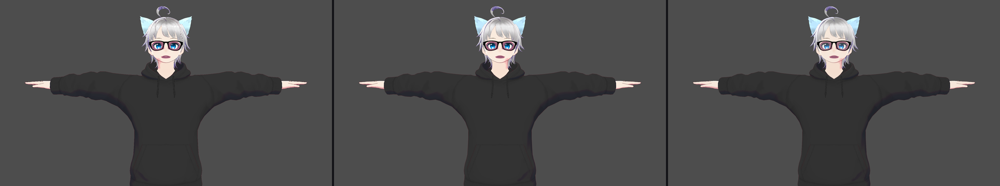
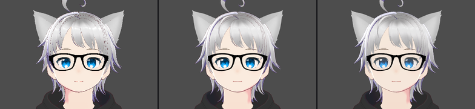
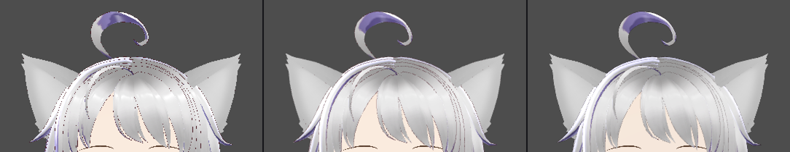
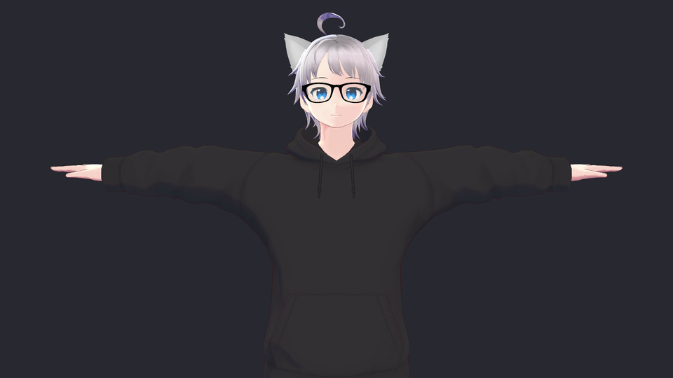
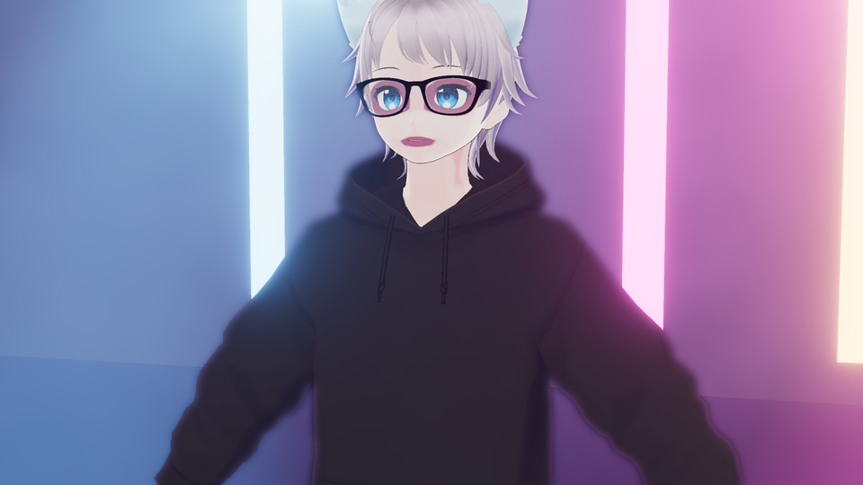

# lilToon on WebGPU check (MAT-02 slice 1)

Date: 2026-11-20. Contract: [lilToon on WebGPU](../../spdd/prompt/2026-11-19-liltoon-webgpu.md). Design: [lilToon on WebGPU design](../superpowers/specs/2026-11-19-liltoon-webgpu-design.md). Issues: #269 (spike), #74 (MAT-02). Branch: `liltoon-webgpu`. The code commit is `ad33d36`; the fork pin after the calibration is `8f7e1d7`. The fork `danirukun/three-liltoon`, branch `webgpu`, is at `47a73c8` (the calibration found one defect and fixed it, see below; the integration commit used `72d3631`).

GPU time: unknown (#305).

## Setup

- macOS 27.2 (Darwin 27.2.0, Apple M3 Pro), debug build (`pnpm dev:desktop`, `OPENSEKAI_EVALUATION=1`, `OPENSEKAI_FIXTURE_MANIFEST` with the local manifest), shared Cargo target. Fixture revision: local manifest `smoke_v1` with `fixture_vrm_liltoon` (sha256 `36b9c223…6459152`, 18,351,096 bytes) and the stored MToon Catboy `avatar_7b7c689e…`.
- Sample: Catboy with lilToon materials, `versions.json`: Unity `6000.0.71f1`, UniVRM `0.131.4`, lilToon `2.4.1`, Mochiya Avatar Tools `c3745f3c01d43777fee6f877779b09f8ddec2f03`, export path `mochiya`. 16 materials, all `liltoon` in `material_list`, no unsupported feature. The file has no tangents (74 primitives, 0 `TANGENT`), so the normal map path makes its own tangents.
- Output: OBS 33.0.1, browser source 1920 × 1080 at 60 FPS, WebGPU, `production_v1`, in an isolated test scene (`OpenSekai-QA-*`), with no stream and no recording. The program scene was restored at the end. Each OpenSekai capture of the running app on this page is a `GetSourceScreenshot` of that source, so it is the real output path. The WebGL 2 image is a Playwright page screenshot of the headless check (see below).
- Preview: WebGPU in WKWebView, `preview_v1`. The login session was locked for the whole run (`CGSSessionScreenIsLocked`), so the Scene window drew no frame (`preview_main` had `lastFrame: null`). The checks that need the preview are marked below.
- Tools: MCP (`scene_replace`, `scene_patch`, `app_status`, `asset_list`, `material_list`), the local OBS WebSocket, `uv run --with pillow --with numpy python -I`. The scripts live outside the repository (`~/.claude/orchestrate/opensekai/liltoon-webgpu/`). App timing and OBS timing are separate.
- Reference rig (the Unity scene of `tools/liltoon-sample`): camera (0, 1.3, 1.6) looking along −Z, vertical FOV 35°, 1920 × 1080; one directional light with forward (0.3214, −0.7660, −0.5567), no shadow; flat ambient (0.2, 0.2, 0.2). In OpenSekai the light is at the default intensity 3 with rotation (−0.408197, −0.234566, −0.109373, 0.875438), and the ambient is an Ambient light `#333333` at intensity 1: Unity reads a `Color` as sRGB in a linear project (the Unity background (0.3, 0.3, 0.3) reads back as sRGB 0.302), so `#333333` is the same flat ambient.

## Calibration (R9)

The value is the mean Rec. 709 luminance (on sRGB values) of fixed boxes of the 1920 × 1080 frame, OpenSekai / Unity. The OpenSekai PNG is composited over the Unity background grey. `face_lit` is the forehead, the nose, and both cheeks. `face_shadow_jaw` is the first shadow band on the viewer's left jaw. `neck` is the body-skin band under the chin.

| Region | Unity | Upstream WebGL | OpenSekai WebGPU | OpenSekai / Unity |
| --- | --- | --- | --- | --- |
| `face_lit` | 0.8040 | 0.8001 (0.995) | 0.7950 | 0.989 |
| `face_shadow_jaw` | 0.5444 | 0.5636 (1.035) | 0.5624 | 1.033 |
| `neck` | 0.7941 | 0.7893 (0.994) | 0.7849 | 0.988 |

- `UNITY_LIGHT_SCALE` stays `1 / Math.PI` (0.3183). At the default directional intensity 3 the summed direct light is 3 / π = 0.955. The port applies the light limit to the summed direct light only (`LilToonLightingModel.ts:409`, `limit(this.#light)`) and adds the ambient as a separate Lambert term after the limit (`:414-415`), so in this rig the limit does not engage (0.955 is below `_LightMaxLimit` 1). Unity clamps the main light plus the SH ambient (`lilGetLightColor` = `LIL_MAINLIGHT_COLOR + lilGetSHToon()`, `lil_common_functions.hlsl:999`; `clamp(lightColor, _LightMinLimit, _LightMaxLimit)`, `lil_common_macro.hlsl:2081` and `:2086`), so its lit skin is the albedo × min(1 + 0.033, 1) = the albedo. The OpenSekai lit skin is the albedo × (0.955 + 0.033 / π) = 0.966 of the albedo in linear terms, which is about 0.985 in sRGB terms; the measured face ratio is 0.989, inside 0.95 to 1.05. No constant changed. The limit placement is a difference from the HLSL (see the compatibility matrix).
- The shadow side (jaw) is 3.3 % above Unity. The upstream WebGL viewer, which does not use the OpenSekai ambient path, shows the same 3.5 %, so the excess is not the fixed 1/π ambient path of the TSL model. `giEqualizationFactor` (0.9 on `CharacterLilToonMaterial`) does not apply: `CharacterEnvironmentNode` reads it on the MToon path, and nothing on the lilToon path reads it, so the measurement says nothing about it.
- Before the calibration, the OpenSekai capture had a red lift on every pixel in a shadow band and on each lit pixel of a material with the default `_ShadowBorderColor` (1, 0.01, 0): the lips read (0.961, 0.484, 0.538) against Unity (0.707, 0.486, 0.552), and the hair ahoge (0.653, 0.389, 0.497) against (0.399, 0.376, 0.484). A variant of the sample with `_ShadowBorderColor` black removed the lift and a variant with `_ShadowBorderRange` 0 did not, so the term `mix(indirect, direct, _ShadowBorderColor × lns.w)` was active with `lns.w` above 1. The generated WGSL showed the cause: the band accumulator started as `vec4(0, 0, 0, 1)`, because `vec4()` with no value is a `Vector4` whose `w` is 1. The fork commit `47a73c8` starts it at `vec4(0, 0, 0, 0)` and adds a test that fails on the old value. After the fix the lips read (0.687, 0.475, 0.538) and the ahoge (0.406, 0.384, 0.497).

## The three captures (R9)

Unity Game view (reference 1), the upstream three-liltoon WebGL path (reference 2), and OpenSekai on WebGPU (the OBS output), with the reference rig:

Reference 2 method: the Next.js viewer of the fork has a fixed light rig and orbit controls, so reference 2 is a small page on the upstream code path (`LilToonMaterial`, `enableLilToon`, `enableLilToonVRM` from the committed `dist`) with the reference camera, one `DirectionalLight` at intensity 1 (the upstream light adapter uses the three intensity as the Unity intensity), and `AmbientLight(0x333333, 1)`, drawn by headless Chromium on the Metal GPU (`ANGLE Metal Renderer: Apple M3 Pro`), with antialiasing on. The page is not committed.

Face, with the lit side, the band on the jaw, the eye sockets (the `_ShadowBorderMask` AO of the face), and the transparent face layers:

### Bands, shadow color, light limit

- First band and shadow color: the pink first band on the viewer's left jaw and under the chin, and the body-skin band at the neck, are at the same place and color in the three captures (`neck` 0.988).
- Second and third bands: the purple second and third bands of the hair are on the ahoge and the strands away from the light in each capture (ahoge box 0.406 / 0.384 / 0.497 against Unity 0.399 / 0.376 / 0.484). The face second and third bands are off-camera at this framing, so the hair and the neck carry this check.
- Light limit: not shown by this rig. The port limits the summed direct light (0.955) before the ambient is added, so `_LightMaxLimit` 1 does not engage on the OpenSekai side (see Calibration). The function itself has unit tests in the fork (`test/webgpu/math.test.ts`, `lilLimitLight([3, 3, 3], 0.05, 1, 0)` is `[1, 1, 1]`); the GPU result with a light above the limit is not in this check.
- Normal map without tangents: the face and the body use `_BumpMap` and the file has no tangents. The lit side and the band side of the face and the neck agree with Unity in the crops above. An inversion of the bump detail is not discriminated: the crops do not show the normal-map detail at this framing.
- The cat ear has `_MainTex_ST` (2, 2, 0.5, −1) and a `KHR_texture_transform` on the same texture; the port applies only `_MainTex_ST` (R16) and the tiled stripe and the cyan emission agree with Unity ([ear crop](liltoon-webgpu/bands-ear.png)).
- Outlines: Unity draws them without MSAA (dotted), so the comparison is a coverage fraction, not pixel equality. Outline pixels (luminance below 0.3, red above blue) in three boxes: hair strands Unity 0.0114, upstream 0.0038, OpenSekai 0.0020; glasses 0.0077, 0.0144, 0.0047; shoulder silhouette 0.0083, 0.0126, 0.0103. The rule: a box passes when the OpenSekai coverage is within ±25 % of the Unity coverage. The shoulder silhouette passes (+24 %). Two of the three boxes are outside the rule: the hair strands (−82 %) and the glasses (−39 %). The outline on the hair strands is thinner than in Unity (the FXAA of the output softens one-pixel lines, and the dots of Unity count as more pixels); it is visible in the hair crop, but it is a difference.
- The glasses lens (transparent, matcap) is lighter in OpenSekai (box mean 0.463 / 0.405 / 0.440 against Unity 0.386 / 0.328 / 0.383): a difference, recorded.

### Default rig and the demo show

The default new-scene rig (key, back, and fill light) with the sample, and `fixtures/shows/lighting-demo.osekai` with the sample on the Wide and the Face camera (ACES, bloom 0.4):

The warm key light and the cool back light reach the lilToon bands and the rim of the material; the room fill and the ambient of the show light the shadow side. No frame warning.

### Load warnings

`app_status` frame warnings after each load: none. `material_list`: 16 materials, profile `liltoon`, `unsupported` empty. The sample gives no `UNSUPPORTED` load warning, so `SAMPLE_WARNINGS` in `packages/renderer/test/liltoon-avatar.integration.test.ts` stays `[]`.

## OBS output (R9)

| Check | Result |
| --- | --- |
| Alpha | Pass. The sample over black, white, and checker: the corners have alpha 0, 0.13 % of the 3,942 edge pixels have a color channel above the alpha by more than 0.1, and 76.3 % of the frame is transparent ([image](liltoon-webgpu/obs-alpha-backgrounds.png)). No grey veil and no bright fringe. |
| Minimized Editor | Not performed as specified: a locked session was observed instead. The Editor was never minimized (`AXMinimized` could not be set through System Events while the session was locked). In the locked session the Scene window drew no frame, and with the idle animation on, two OBS screenshots 4 s apart differ in 26,763 pixels: the output continues without a preview frame. |
| Frame time | Output CPU 2.2 to 4.7 ms for each frame (`production_v1`, WebGPU, `lastFrame.cpuMs`; 1.1 ms on the demo Wide camera). Preview CPU unknown (no preview frame in the locked session). OBS `outputSkippedFrames` 0; OBS `activeFps` 11.8 to 26.6 and `averageFrameRenderTime` 0.85 to 1.64 ms while the session was locked (OBS throttles then; this is an OBS value, not an app value). GPU time unknown. |

## Cost (R9)

The stall is the time from the `scene_patch` that adds one lit light to the first frame at the new revision. Each run cleared the Metal shader cache of the app (`com.apple.WebKit.GPU+opensekai_desktop-*/…/com.apple.metal`) and started the app again. The scene is the avatar with N − 1 lit point lights; the add is a point, a spot, and a directional light in turn. The gate is the spot light add at 8 lit lights: fail if the sample is more than 20 % longer than the MToon Catboy.

The session was locked, so the frames come from the OBS output renderer (`output_main`, `production_v1`), not from the Editor preview (`stall-avatar.mjs --output output_main`). Both avatars use the same method and the same cold cache. The Editor-preview stall is unknown.

| Avatar, run | Spot add at 1 / 3 / 8 lit lights, first frame (ms) | Point and directional at 8 (ms) | Compile frame `cpuMs` at 8, spot (ms) |
| --- | --- | --- | --- |
| lilToon sample, run 1 | 107 / 160 / 239 | 362 / 265 | 204.5 |
| lilToon sample, run 2 | 128 / 166 / 260 | 264 / 243 | 222.2 |
| MToon Catboy, run 1 | 80 / 75 / 97 | 100 / 103 | 71.1 |
| MToon Catboy, run 2 | 74 / 95 / 99 | 105 / 102 | 72.5 |

- Raw: `stall-liltoon-{1,2}.json` and `stall-mtoon-{1,2}.json` in the orchestrate folder (not in the repository). The first point add at 1 lit light of the MToon run 1 (2,488 ms) overlapped the avatar load and is not a measurement.
- On the output renderer the compile frame `cpuMs` at 8 lit lights is 205 to 222 ms for the sample against 71 to 73 ms for the MToon Catboy (2.9 to 3.1 times). This renderer frame time is the evidence for the compile cost: it is the renderer's own measurement and does not depend on the OBS frame pacing. The first-frame time (239 to 260 ms against 97 to 99 ms, 2.5 to 2.6 times) is weaker evidence, because its MToon value is near one frame interval of OBS at 12 to 27 fps. The OBS output renderer (Chromium) compiles its pipelines without a stop of the Editor, so these values are not the Editor stall of the [character lighting check](character-lighting.md) (7 to 8 s on the preview); they show that the lilToon programs cost more to compile than the MToon programs (the sample has 16 lilToon materials, 9 of them with an outline: 25 programs; the MToon Catboy has 16 materials with outlines).
- Gate: **not passed: unknown on the preview; the output-renderer proxy fails** the 20 % limit. The Editor stall must be measured in an unlocked session (`stall-avatar.mjs --output preview_main`, both avatars, cold cache) before the work ships; if it also fails, the shader must get cheaper.

## WebGL 2 and the software adapter (R9)

The [material-profiles check](material-profiles/headless-check.mjs) with `FIXTURES='[{"id":"fixture_vrm_liltoon","kind":"avatar","expect":{"liltoon":16}}]'` (the sample as the only fixture; the environment options were added to that script for this check). It serves the built OBS page and the fixture bytes, answers the renderer WebSocket, loads the sample alone, and counts a `Pipeline compile failed` warning in each applied frame. `GPU_ARGS` adds Chromium flags and `LOAD_TIMEOUT_MS` extends the load wait.

| Run | Loads | Backend | Pipeline failures | Profiles | Page errors | Raw |
| --- | --- | --- | --- | --- | --- | --- |
| WebGL 2, Metal GPU (`GPU_ARGS=--use-angle=metal`) | Pass, no warning | `webgl2` | 0 | 16 `liltoon` | none | [txt](liltoon-webgpu/headless-check-webgl2-metal.txt), [json](liltoon-webgpu/headless-check-webgl2-metal.json), [image](liltoon-webgpu/fixture_vrm_liltoon-webgl2.png) |
| WebGPU, Metal GPU | Pass, no warning | `webgpu` | 0 | 16 `liltoon` | none | [txt](liltoon-webgpu/headless-check-webgpu-metal.txt), [json](liltoon-webgpu/headless-check-webgpu-metal.json); its page screenshot `fixture_vrm_liltoon-auto.png` (named in the JSON) is not kept: the later SwiftShader run wrote the same file name and removed it as one flat color |
| WebGPU, SwiftShader (default flags) | Fail: `Room fill unavailable` (the spherical-harmonics readback) and a WebGPU device loss | `webgpu` | 0 | 16 `liltoon` | `GPUValidationError`, `WebGPU Device Lost` | [txt](liltoon-webgpu/headless-check-software.txt), [json](liltoon-webgpu/headless-check-software.json) |
| WebGL 2, SwiftShader (default flags, 120 s) | Fail: still `BUSY Asset loading` after 120 s | `webgl2` | 0 | 16 `liltoon` | none | same files; no image (the screenshot timed out) |
| Control: `fixture_vrm_1` (MToon), WebGPU, SwiftShader | Fail: the same `Room fill unavailable` and device loss | `webgpu` | 0 | 13 `mtoon` | the same `GPUValidationError` | [txt](liltoon-webgpu/headless-check-control-mtoon-software.txt) |

Result: on the Metal GPU both backends load the sample with no `Pipeline compile failed`, no page error, and no WGSL error on the console (a uniform-control-flow error from `fwidth` would be a page error; there is none). On the software adapter the room-fill readback fails for the MToon control too, so it is a limit of SwiftShader WebGPU, not of the lilToon material; the 18 MB sample also does not finish its WebGL 2 load within 120 s there. In the running app (WebKit) no frame had a `Pipeline compile failed` warning across the captures and the stall runs.

## Compatibility matrix

Each row of the three-liltoon [feature matrix](https://github.com/danirukun/three-liltoon/blob/webgpu/docs/FEATURE_MATRIX.md) (`docs/FEATURE_MATRIX.md` in the fork), with the upstream WebGL state, the state of the slice-1 TSL material, and the source in the fork (`src/webgpu/`).

| Feature | Upstream WebGL | Slice-1 TSL | Source |
| --- | --- | --- | --- |
| Base color and main texture | Implemented | Implemented: `_Color`, `_MainTex`, `_MainTex_ST` through the node UVs; `KHR_texture_transform` on the same texture is ignored (R16) | `LilToonNodeMaterial.ts`, `vrm.ts` |
| Main UV animation and tone correction | Implemented | Not drawn: no UV scroll (`_MainTex_ScrollRotate`), no `_MainTexHSVG`, no gradation; no warning | `properties.ts` |
| Main Color 2nd/3rd, decals | Implemented | Not drawn; `unsupported-feature` warning on `_UseMain2ndTex` / `_UseMain3rdTex` | `properties.ts` |
| First, second, third toon shadow bands | Limited | Implemented with masks (`_ShadowStrengthMask`, `_ShadowBorderMask` with the AO shift, `_ShadowBlurMask`), `_ShadowBorderColor`, the band AA; `_ShadowMaskType` 1/2 and `_ShadowColorType` 1 warn and draw as 0. A band is computed for each light, see below | `LilToonLightingModel.ts`, `lilToonMath.ts` |
| Normal Map and Normal Map 2nd | Implemented | First normal map implemented, tangents generated when the file has none; `_UseBump2ndMap` warns | `LilToonLightingModel.ts`, `vrm.ts` |
| MatCap and MatCap 2nd | Implemented | First matcap implemented (blend modes 0 to 3, mask, `_MatCapNormalStrength`); `_MatCapCustomNormal` warns; `_UseMatCap2nd` warns | `lilToonShading.ts` |
| Rim and directional rim | Implemented | Rim implemented once from the summed light; `_RimDirStrength` not 0 warns and draws as 0 | `lilToonShading.ts` |
| RimShade and backlight | Limited | Backlight implemented for each light; RimShade not drawn, no warning | `lilToonShading.ts` |
| Emission and Emission 2nd | Implemented | First emission with map, blend mask, blink; `_EmissionMap_UVMode` and `_EmissionUseGrad` warn; `_UseEmission2nd` warns | `lilToonShading.ts` |
| Reflection and specular | Limited | Not drawn; `_UseReflection` warns | `properties.ts` |
| Distance fade and dissolve | Implemented | Not drawn; `_DissolveParams` warns | `properties.ts` |
| Alpha mask and cutoff | Limited | Cutoff implemented (`alphaTest` = `_Cutoff`); the alpha mask is not drawn | `LilToonNodeMaterial.ts` |
| Gradations, advanced masks, glitter, anisotropy, parallax/POM | Unverified | Not drawn; `_UseAnisotropy` warns, the others do not | `properties.ts` |
| Opaque | Implemented | Implemented | `LilToonNodeMaterial.ts` |
| Cutout | Limited | Implemented; the sample has one cutout material (mouth) and six cutout+outline materials | `LilToonNodeMaterial.ts` |
| Transparent | Limited | Normal and OnePass implemented (`transparent`, no depth write); TwoPass loads as the opaque core with a warning. Transparent+outline is untested: the sample has none (R13) | `properties.ts`, `outlines.ts` |
| Refraction / Refraction Blur | Limited | Loads as the opaque core with an `unsupported-shader-variant` warning | `properties.ts` |
| Fur | Limited | Same: opaque core with a warning | `properties.ts` |
| Gem | Limited | Same: opaque core with a warning | `properties.ts` |
| Outline | Limited | Implemented as a second material in the geometry groups (as the three-vrm MToon outline): `_OutlineWidth` × `_OutlineWidthMask`, `_OutlineColor` × `_OutlineTex`, the light limit; `_OutlineVertexR2Width` and `_OutlineZBias` warn. Skipped, without a warning, when an MToon mesh and a lilToon mesh share one geometry that already has groups | `outlines.ts` |
| Static meshes, skinned meshes, morph targets | Implemented | Implemented by three (`NodeMaterial`); the sample is skinned | three |
| Directional shadow receiving | Limited | `_ShadowReceive` faithful, default 0: no cast shadow on the material unless authored (R11); no receive floor. Shadow Strength scales only the cast shadow of a receiving material | `character-liltoon.ts` |
| Shadow casting | Limited | three depth material; the cutout alpha test in the caster is not verified | three |
| Direct and ambient lighting | Limited: first directional light plus ambient | Each three light gets its own band set, weighted by its grey level, and the summed light goes through the light limit once; the ambient is a separate Lambert term at a fixed 1/π (`UNITY_LIGHT_SCALE` applies to the lights only). `CharacterLilToonMaterial` gives the scene ambient × `CHARACTER_AMBIENT` plus the room fill | `LilToonLightingModel.ts`, `character-liltoon.ts` |
| Light limit (`_LightMinLimit`, `_LightMaxLimit`, `_MonochromeLighting`, `_AsUnlit`) | Implemented (the HLSL) | Implemented on the summed direct light; Unity clamps the main light plus the SH ambient (`lil_common_macro.hlsl:2081`), the port clamps the direct light and adds the ambient after it (`LilToonLightingModel.ts:409`, `:414-415`). The light color of the effects (rim, matcap, backlight) includes the ambient inside the limit (`:396`) | `LilToonLightingModel.ts` |
| Environment reflections | Limited | Not drawn | — |
| glTF/GLB material loading | Implemented | Implemented for a VRM file in OpenSekai; a GLB prop with the extension loads PBR with a warning (R1). A plain glTF transparent lilToon material gets `renderOrder` 19 against 0 for PBR | `GLTFLilToonNodeExtension.ts`, `assets.ts` |
| VRM material expressions | Implemented | No expression binds; a VRM 0 `materialValues` bind or a VRM 1 color or texture-transform bind on a lilToon material warns | `vrm.ts` |
| Texture-info `texCoord` selection | Unsupported | Unsupported | — |
| Additional lights, lightmaps, probes | Unsupported | Each OpenSekai light is a toon light (see Direct lighting); no lightmap or probe | `LilToonLightingModel.ts` |
| Unity fog, AudioLink, VRC Light Volumes, instancing, stereo, WebXR, tessellation | Unsupported | Unsupported | — |
| WebGPU | Unsupported | Implemented: WebGPU and the WebGL 2 fallback of `WebGPURenderer` | `webgpu.ts` |

Other rows of this slice:

- The sample does not discriminate a port that draws the second or third band outside the first band region (the bands are nested under the first border).
- A VRM 0 lilToon file can get one false `UNSUPPORTED` load warning from `materialReport`, because the shader-name check runs before the extension check; the sample is VRM 1 and does not show it.
- `_BackfaceForceShadow` and `_FlipNormal` follow Unity (R15).

### Differences from Unity

- A band for each light: Unity lilToon shades one main light (the directional light plus the SH ambient) and adds the other lights in a simpler pass. The port computes the bands for each light and sums them by the light grey level, so a scene with several lights differs from Unity.
- No expression binds on a lilToon material (warned).
- No UV scroll and no tone correction on the main texture.
- The ambient is a separate term at 1/π, added after the light limit, not folded into the main light before the limit as in Unity. With a light at or above the limit, Unity clamps the ambient away and the port keeps it, so the port is brighter by the ambient term; with the reference rig (0.955 direct) the result is inside the calibration window.
- The outline on thin hair strands is thinner than the Unity outline; the glasses lens is lighter.

## Headless checks

| Command | Result |
| --- | --- |
| Fork: `npx vitest run test/webgpu` at `47a73c8` | 8 files, 135 tests passed. The new test `starts the band sum at zero in all four components` fails on the old `vec4()` (`expected [0, 0, 0, 1] to deeply equal [0, 0, 0, 0]`) and passes on the fix. |
| Fork: `npm run build:webgpu` | Pass; `git diff --stat dist/index.js` empty. |
| `pnpm exec vitest run --project unit packages/renderer/test/character-liltoon.test.ts packages/renderer/test/material-report.test.ts` at pin `47a73c8` | 2 files, 16 tests passed. |
| `pnpm exec vitest run --project integration packages/renderer/test/liltoon-avatar.integration.test.ts` | 1 test passed (`SAMPLE_WARNINGS` `[]`). |

## Not verified

- The Editor-preview stall and the preview frame time: the session was locked and the Scene window drew no frame. The stall table is the output renderer.
- The minimized-Editor state itself (`AXMinimized` was not settable while locked); the output-continues check used the locked session instead.
- GPU time (#305).
- Windows.
- Transparent+outline, TwoPass, Fur, Gem, and Refraction materials (the sample has none).
- The cutout alpha test in the shadow caster.
- A scene with more than one toon light against Unity (by design different).
- The look of the avatar on the WebGL 2 fallback: the headless check proves that it loads and compiles; the only image is the page screenshot of the Metal GPU WebGL 2 run (`fixture_vrm_liltoon-webgl2.png`, the smoke-scene camera and lights, not the reference rig). The SwiftShader runs made no image.
