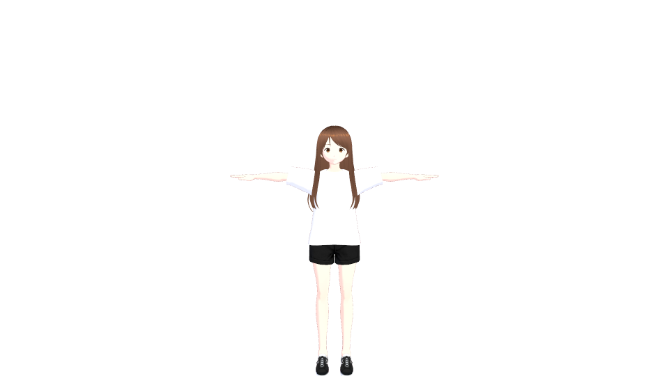
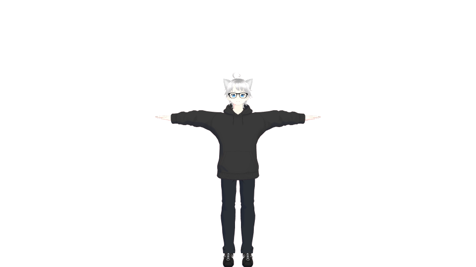
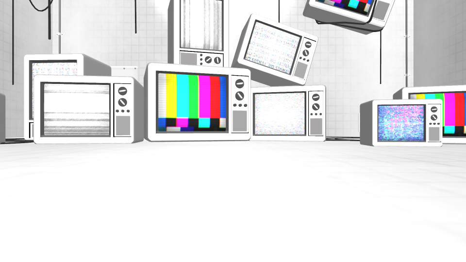
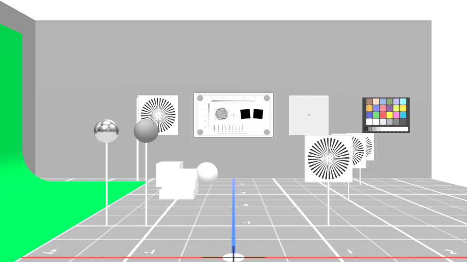

# Material profiles check (B27, MAT-01 slice 1)

Date: 2026-11-03. Contract: [material profiles](../../spdd/prompt/2026-11-03-material-profiles.md). Issue: #73 (MAT-01, slice 1).

Platform: Linux cloud container (Ubuntu, x86_64, no GPU, no OBS). Node 26.10.0, three.js 0.180.0, `@pixiv/three-vrm` 3.5.5, Playwright Chromium (headless) from `/opt/pw-browsers` with `chromiumGpuArgs`. Base commit: `b1d5ac5`; the change is the pull request head of `claude/b27-mtoon-pbr-impl`. A software adapter proves that the code runs. It does not prove the MToon look, alpha, outlines, or cost on a real GPU or in OBS.

Setup lines:

- `fixtures:` ready `fixture_vrm_1`, `fixture_vrm0_arkit`, `fixture_glb_stage`, `fixture_test_stage`; skipped none.
- `gpu:` WebGPU SwiftShader (device true); WebGL 2 ANGLE (Mesa, Vulkan 1.4.318, llvmpipe).

## Headless fixture check (R7)

Method. `headless-check.mjs` serves the built OBS page (`apps/output/dist`) and the fixture bytes at `GET /assets/{id}`, answers the renderer WebSocket, and sends frames of a real `@opensekai/session`. Each fixture loads alone (an avatar entity for a VRM, an environment entity for a GLB), once with WebGPU (`auto`) and once with WebGL 2. The check waits for an applied frame without a `BUSY` or `UNAVAILABLE` warning for the fixture, then reads the warnings of the last frame acknowledgment. It also checks that the `auto` run used WebGPU, and it counts a `Pipeline compile failed` warning in each applied frame, not only the last one. The profile counts come from `materialReport` on the same bytes in Node; the renderer runs the same function, and its result reaches the acknowledgment only as a warning. Raw output: [headless-check.txt](material-profiles/headless-check.txt) and [headless-check.json](material-profiles/headless-check.json).

| Fixture | Profiles | WebGPU | WebGL 2 |
| --- | --- | --- | --- |
| `fixture_vrm_1` | 13 `mtoon` | PASS. Loads, 0 pipeline failures, no material warning | PASS. Same |
| `fixture_vrm0_arkit` | 16 `mtoon` | PASS. Same | PASS. Same |
| `fixture_glb_stage` | 25 `pbr` | PASS. Same | PASS. Same |
| `fixture_test_stage` | 11 `pbr`, 1 `unlit` | PASS. Same | PASS. Same |

Result: 40 pass, 0 fail, 0 fixtures skipped. The only other warnings are the existing `VRMC_springBone` and `VRMC_node_constraint` notes on `fixture_vrm_1`.

Images. The PNGs are page screenshots without the page background (960 × 540), not `captureFrame`: the 2 s capture handler limit is too short for a full fixture on the software adapter (`Handler timed out`). Frames pause for 1 s before each screenshot. The WebGL 2 screenshots show each fixture on a transparent page. The WebGPU screenshots are one flat color (the headless WebGPU readback limit in the [light entities check](light-entities.md)), so the WebGPU image is unknown and no file is kept. In the full run the `fixture_vrm_1` WebGL 2 screenshot timed out after 20 s; a second run of that fixture alone (`ONLY=fixture_vrm_1 BACKENDS=webgl2`, 5 pass, 0 fail) gave the image below.

| `fixture_vrm_1` | `fixture_vrm0_arkit` | `fixture_glb_stage` | `fixture_test_stage` |
| --- | --- | --- | --- |
|  |  |  |  |

Run it again from the repository root:

```sh
pnpm --filter @opensekai/output build
pnpm exec tsx docs/evaluation/material-profiles/headless-check.mjs docs/evaluation/material-profiles
```

`BACKENDS=webgl2` limits the backends, and `ONLY=<fixture id>` limits the fixtures.

## Tests

| Requirement | Test |
| --- | --- |
| R1, R2 report and lists | `packages/contracts/test/materials.test.ts` (9 tests) |
| R2 pin to the installed loaders | `packages/renderer/test/material-report.test.ts` (reads `GLTFLoader.js` and the three-vrm bundle) |
| R3 load warning on the real loader | `packages/renderer/test/material-report.test.ts` (a VRM 0.x `Standard` shader; a VRM 0.x `VRM/MToon` material with `KHR_materials_clearcoat`, which v0compat drops from the parsed JSON; 1 and 20 unsupported materials; no warning) |
| R4 required extensions | `registry.rs` `import_checks_required_extensions` and `stored_avatar_is_not_checked_for_required_extensions_again`; `scene_import.rs` `accepts_required_extensions_that_the_loader_reads` and the existing rejection test |
| R5, R6 UV values and wrap | `packages/renderer/test/mtoon-uv.test.ts`; frame path `packages/renderer/test/mtoon-uv-frame.test.ts` (fails on the old code: the values stay 0) |

## Not shown here

Owner checks on macOS: the MToon look on the OBS output with alpha (blend and cutout), the outlines, and a model with MToon UV animation on a real GPU. MAT-01 stays unchecked.
