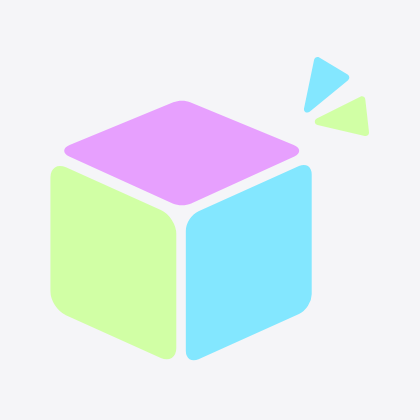
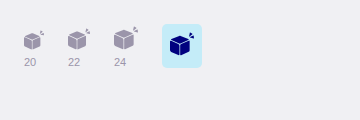

# Rail logo

The shots below are a headless Chrome render of the editor chrome. The page uses the classes in `apps/desktop/src/app.css` and the rail mark from `OpenSekaiMark.svelte`. It is not the Tauri window. The Linux cloud host has no macOS app.

Window size: 1440 × 900. Browser: Google Chrome headless.

| View | Before | After |
| --- | --- | --- |
| Editor rail | [before](rail-logo/before-rail.png) | [after](rail-logo/after-rail.png) |

The full-colour asset, on the app background, with no navy tile and no viewfinder:

The rail mark at 20 px, 22 px, and 24 px, in the rail icon grey, and at 24 px on the cyan selection fill:

The first rail item is the muted cube and sparkles. The Assets item under it stays the active item on the scene view.
