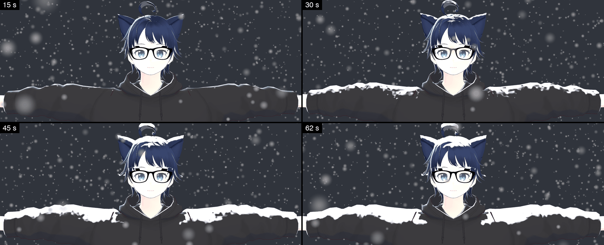
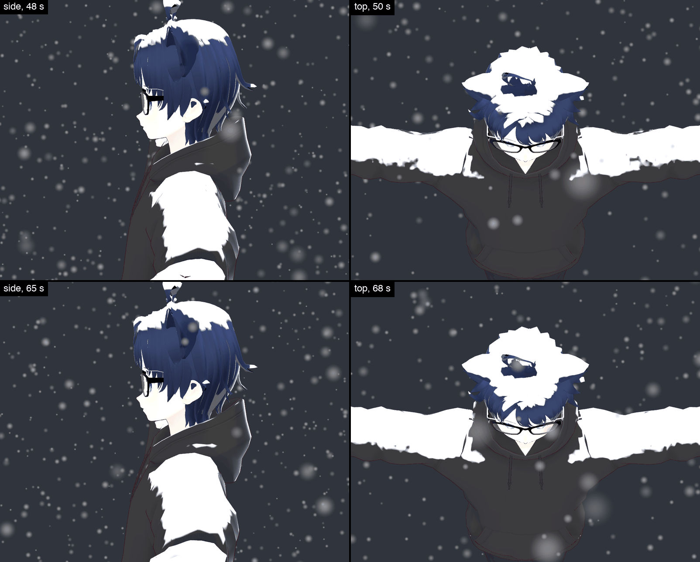
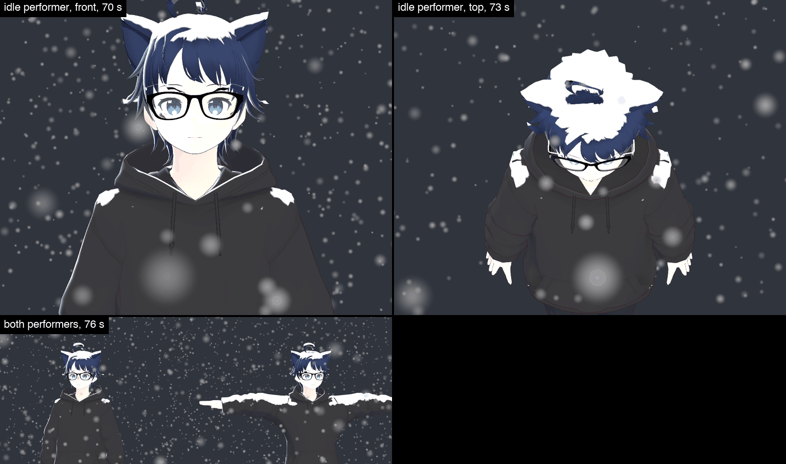
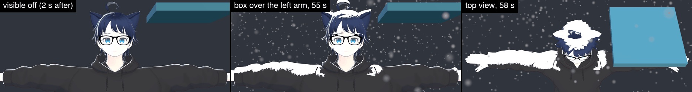
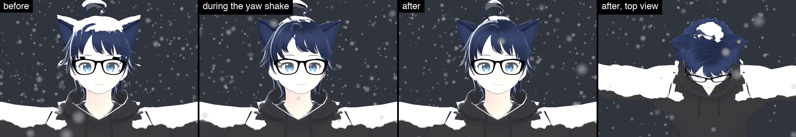
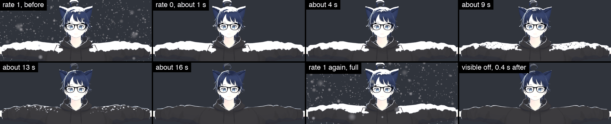
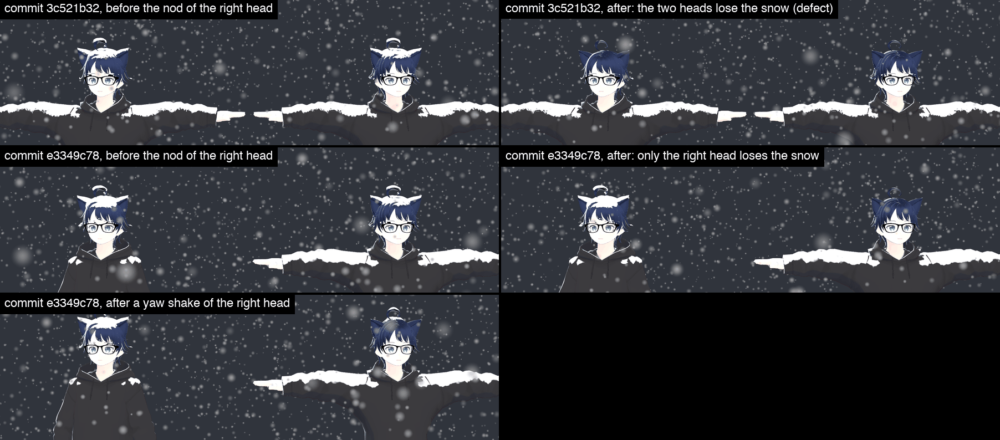
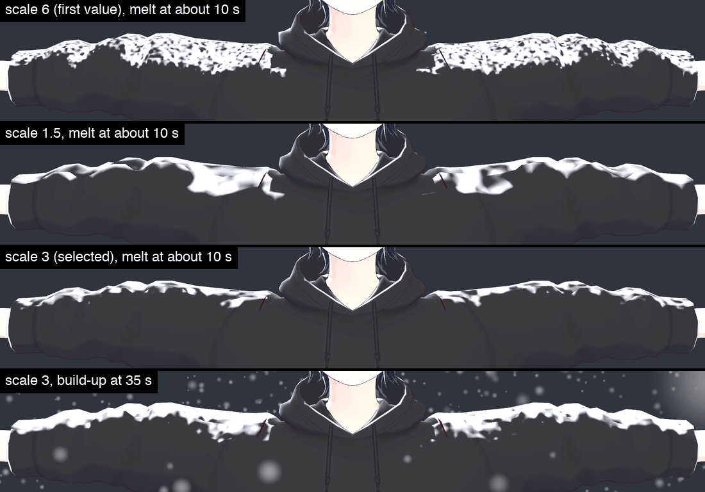

# Snow feasibility check (slice 1)

Date: 2026-11-27. Design: [snow](../superpowers/specs/2026-11-26-snow-design.md). Contract: [snow feasibility spike](../../spdd/prompt/2026-11-26-snow-spike.md). Issue: #48 (ENV-10). Commits: `3c521b32` (first run on a GPU), `ec55f90a` (fix for two avatars), `e3349c78` (tuned constants; the last code commit).

## Result

The gate of slice 1 is not closed. It did not fail on a valid measurement, and it did not pass.

| Evidence | OBS browser source (Chromium, WebGPU) | Editor window (WKWebView, WebGPU) |
| --- | --- | --- |
| 1. Build-up and shelter | Pass for the behavior, with one substitute: the shelter check used a box above an arm, not a raised arm. The owner accepts or rejects the look. | Unknown |
| 2. Shed, melt, clear | Pass after the fix `ec55f90a` and the tuning `e3349c78`, for a scripted head shake. A yaw shake keeps a small tuft at the turn axis. The tuned shed speeds are not final: usual nods can shed snow also (see [Limits seen](#limits-seen)). | Unknown |
| 6. Budget | Unknown. `benchmark_start` cannot run on this Mac. A substitute sample on a locked screen gave +2.29 ms p95 `gpuMs` and +1.7 ms p95 `cpuMs`. These values are above the limits (2 ms and 0.5 ms), but the conditions were not valid for the gate. | Not applicable (the gate is the OBS output) |

Two conditions stopped the gate:

- **The screen was locked for the full run.** The owner was not at the Mac. A WKWebView does not draw while the screen is locked. `preview_main` was connected, but it sent no frame (`lastFrame: null`), and `camera_screenshot` replied `TIMEOUT` ("RPC timed out") three times. Thus no check ran in the Editor window: no screenshot, no Hierarchy check, and no Inspector check. OBS made its own frames at 10 to 14 FPS (`GetStats.activeFps`) with the display asleep. The browser source applied about 60 session frames each second in the same time.
- **`benchmark_start` replies `CONFLICT` ("Smoke fixture registration mismatch").** See [Budget](#evidence-6-budget).

The run stopped at 02:02 because the Mac was on battery power at 25 %. The lever tries of the brief (Step 8) did not run.

## Conditions

| Item | Value |
| --- | --- |
| Host | MacBook Pro (Mac15,6), Apple M3 Pro (6 performance and 6 efficiency cores), 36 GB |
| OS | macOS 27.2.1 (26B131) |
| Power | Battery (41 % at 01:38, 25 % at 02:02). Low Power Mode off. |
| Display | Built-in display, 3024 × 1964. Screen locked and display asleep. |
| Build | Debug build of the host from the worktree: `OPENSEKAI_EVALUATION=1 direnv exec . pnpm dev:desktop`. The output page is the production Vite build of `apps/output`. |
| Backend and profile | `output_main`: `webgpu`, `production_v1` (`?quality=production_v1` on the source URL), `gpuTimer: supported` |
| OBS | 33.0.2, obs-websocket 5.7.6, CEF Chrome/150.0.7871.287, 1920 × 1080 at 60 FPS. Isolated scene `OpenSekai-QA-020c0b7e` with one Browser Source (1920 × 1080, custom 60 FPS, no shutdown when hidden). The program scene went back to `Scene` at the end. No stream and no recording. OBS ran since 2026-11-23, before this run. The notes for this task said that no OBS ran at dispatch; that was a controller error (a truncated process list). The run used the OBS of the owner with the isolated scene and did not quit it. |
| Versions | three 0.187.0, Node 26.13.0, pnpm 12.8.1, rustc 1.93.1 |
| Character | "Catboy with black hoodie", asset `avatar_7b7c689e4e2ad3e6f6fe6cdb615ffad76d81ff788fcf61e7b9473fa73e024373` (the same file as `fixture_vrm0_arkit`): 57 skinned meshes, 16 MToon materials |
| Scene | The new-scene lights (Key Light 3 with a shadow, Back Light 2, Fill Light) and no environment. Snow entity: position `[0, 2, 0]`, scale `[6, 4, 6]`, `rate` 1, the other values from `DEFAULT_SNOW`. |
| Control | MCP only (`apps/mcp/src/cli.ts` over stdio): `scene_patch`, `camera_select`, `app_status`. OBS images come from `GetSourceScreenshot`. |

The default hair of the character is white, and white snow does not show on it ([image](snow/obs-default-hair.png)). For the other images, `setMaterialValues` gave the hair and the ears of the test entities a dark blue color. The asset record did not change.

`GetSourceScreenshot` gives premultiplied RGBA. The sheets below put each capture on a dark background (#30343c) with the premultiplied rule. The sheets are 256-color PNG files.

## First frame with snow (Step 2)

All values are from `output_main` in OBS. A script read `app_status` each 100 ms.

| Case | Commit | Result |
| --- | --- | --- |
| First snow frame of this Mac, 1 performer | `3c521b32` | The first frame at the new revision came 0.23 s after the patch. Then no frame was acknowledged for 2.7 s (the one-time buffer build and pipeline compile). After that, the output ran at 60 frames each second. |
| Second performer added while snow is on | `3c521b32` | One frame with `cpuMs` 143. No gap above 0.2 s. |
| Later launches, 2 performers, snow added | `ec55f90a` | One frame with `cpuMs` 187. No gap above 0.2 s. Inferred cause, not measured: the shader cache of the browser source had the pipelines of the first run. |

- `app_status` had no warning in each state of this page: no `Pipeline compile failed`, no `Snow failed`, and no `Snow build-up shares a material`.
- Flakes show in the OBS output. They are round and soft. The captures are still images, so the fall is not verified (see [Not verified](#not-verified)).
- The compute pass writes the state buffer, and the MToon vertex stage reads it in the same frame. This works in the OBS browser source.
- Editor window: unknown. The Hierarchy group and the Inspector section were not checked.

## Evidence 1: build-up and shelter (Step 3)

Commit `e3349c78`. Performer 1 stands in the T-pose (no tracking packet arrives), so the two arms are held out. Performer 2 plays the built-in idle with the arms down. The time is from `visible` on.

What the images show:

- At 15 s no snow shows. At 30 s there are patches on the top of the sleeves, and the head has almost none. At 45 s the top of the sleeves, the shoulders, the top of the head, the top edge of the ears, and the top of the ahoge are white. At 62 s the cover is complete.
- The face, the fringe, the hair at the sides, the front of the body, and the underside of the arms have no snow. The top view shows a clean area on the head below the ahoge, and the part of the hood below the head is clean.
- The idle performer has snow on the head, on the ears, and on the shoulder tops only. The lower arms hang down and stay clean.
- No stripes show on the shoulders or the sleeves. `SNOW.skyBand` stays 0.02 m.
- The snow is flat white. With the Key Light at intensity 3 the snow color clips, so no shade shows on it.

Shelter for the flakes: a roof (a box of 2 × 0.04 × 6 m at a height of 2.05 m) over the right half of the snow box. No flake is drawn below the roof ([image](snow/obs-flakes-roof.png)).

Flake alpha: in the raw capture, 38,057 partly transparent flake pixels have one ratio of color to alpha (0.665, the fill color; 0.660 to 0.669 for an alpha above 150, which is the 8-bit rounding), and R, G, and B are equal. No pixel has a color above its alpha. Thus the flakes have no dark and no bright halo in the premultiplied output. The check over light and checker backgrounds (evidence 3) is not part of this slice.

Not checked: the flake fall and the wind drift (a still image does not show them), shelter from a raised arm (the box of the sky side check is the substitute), the outline near the snow, and the shadow of the snow layer.

## Sky side check (Step 4, Review Focus 1)

Commit `3c521b32`. A box of 0.4 × 0.04 × 0.4 m at `[0.4, 1.7, 0]` is above the left upper arm of the performer (the right side of the image). `visible` went off and on, and the capture is 55 s later.

Pass. The left arm is clean below the box. The left shoulder near the neck and the cuff are outside the box and have snow. The right arm has snow along its full length. The lookup is not mirrored. `skyMatrix` did not change.

## Evidence 2: shed, melt, clear (Step 5)

The tracking feed is [`shake-feed.mjs`](snow/shake-feed.mjs). It sends the `Head` bone at 60 Hz to a VMC tracking source of performer 1 (`positions: rotationsOnly`, smoothing off). The run used a TypeScript copy of this script; a compare of the two encoders gave equal packets. `pnpm evaluate:tracking-feed` gives only a slow sway (5° in 4 s), so it cannot shake the head.

Measured motion of the shake: ±30° at 2 Hz for 3 s. The peak turn rate is 6.58 rad/s. For a yaw shake, a vertex 0.10 m from the turn axis (an ear tip) has a peak speed of 0.66 m/s, a vertex at 0.05 m has 0.33 m/s, and the crown is on the axis and almost does not move. For a nod, the crown is about 0.2 m above the head joint and has a peak speed of about 1.3 m/s.

| Shake | Shed start, shed full (m/s) | Commit | Result |
| --- | --- | --- | --- |
| Nod (pitch) | 0.6, 2 | `3c521b32` | The head lost all its snow in less than 1.5 s. The shoulders kept the snow. |
| Yaw | 0.6, 2 | `3c521b32` | The head kept all its snow. |
| Yaw | 0.15, 0.6 | `e3349c78` | The head and the ears lost the snow. A tuft stayed on the ahoge, which is near the turn axis. The shoulders and the arms kept the snow. |
| Built-in idle, 70 s | 0.15, 0.6 | `e3349c78` | The idle performer kept the snow on the head and the shoulders. |

Melt and clear, commit `e3349c78`:

- `rate: 0`: the flakes are gone in the first capture (about 1 s). The snow is complete at 4 s, has holes at 9 s, has small patches at 13 s, and is gone at 16 s. The amount of a vertex melts in 20 s; the mask hides the last part.
- `rate: 1` again: the flakes come back and the snow builds up again.
- `visible: false`: the capture 0.4 s later has no flake and no snow.

## Two performers (Step 6, Review Focus 2)

- Commit `3c521b32`: fail. A nod of performer 1 removed the head snow of the two performers. Performer 2 did not move. Cause: the MToon materials of the two avatars had the same program cache key. three.js keeps one node build for each key, and the build holds the storage buffer of the first material. Each avatar drew the amounts of one state buffer. The warning `Snow build-up shares a material` did not show, because the material objects are not shared.
- Fix, commit `ec55f90a`: the cache key of a material has the id of the state buffer of its share. The WGSL is the same for each avatar, so the GPU program stays a cache hit. Test: `packages/renderer/test/snow-surface.test.ts`, "gives two shares two program keys, and one share one key" (fail before the fix, pass after it).
- Commit `e3349c78`: pass. After a nod and after a yaw shake of performer 1, only its head lost the snow.

## Evidence 6: budget

### Why `benchmark_start` did not run

`benchmark_start` needs the app to start with the smoke fixture manifest (`OPENSEKAI_FIXTURE_MANIFEST`). The app started again with a local manifest of the two smoke assets (`fixture_vrm_1`, `fixture_glb_1`, hashes equal to `fixtures/smoke/manifest.json`). The reply stayed `CONFLICT` ("Smoke fixture registration mismatch"). Cause: `AssetRegistry::fixture_records` (`apps/desktop/src-tauri/src/assets/registry.rs`) counts each record whose ID does not start with `avatar_`, `scene_`, `image_`, `video_`, or `hdr_`. The asset library of this Mac has 4 `animation_` records, so the count is 6 and not 2. This slice does not change the host or the library of the owner. No benchmark summary exists.

### Substitute sample

Method: [`cost-sample.mjs`](snow/cost-sample.mjs), after the method of [spring bones](spring-bones.md). It reads `FrameApplied.cpuMs` and `gpuMs` of `output_main` from `app_status` each 100 ms. Each run has a 30 s warm-up and a 120 s window. A window has about 1,145 of the about 7,200 frames. A null `gpuMs` is unknown and is not a sample. Raw results: [`cost-runs.jsonl`](snow/cost-runs.jsonl).

Conditions: commit `e3349c78`, the conditions table above, two Catboy performers (one in the T-pose, one with the built-in idle), a camera that shows the two full bodies (`[-0.8, 1.2, 4.5]`, 50 mm), the default output format, the app started with the smoke fixture manifest and the smoke entities removed. The preview was off because the screen was locked. The run order was A, B, C, three times. In C, `visible` was on for 50 s before the window.

- A: no Snow entity.
- B: Snow entity with `visible` off (the brief's "off"). The MToon materials have the snow nodes.
- C: Snow entity with `visible` on and `rate` 1 (the brief's "on").

| Run | Start of the warm-up (CET) | `cpuMs` mean | `cpuMs` p95 | `gpuMs` mean | `gpuMs` p95 | `gpuMs` samples / unknown |
| --- | --- | --- | --- | --- | --- | --- |
| A 1 | 01:38 | 7.583 | 8.8 | 3.791 | 4.784 | 1133 / 10 |
| B 1 | 01:40 | 8.517 | 9.1 | 4.727 | 5.308 | 1113 / 33 |
| C 1 | 01:43 | 9.746 | 11.0 | 6.702 | 7.602 | 957 / 189 |
| A 2 | 01:46 | 8.381 | 9.2 | 3.955 | 4.850 | 1119 / 22 |
| B 2 | 01:48 | 8.639 | 9.3 | 4.304 | 5.308 | 1116 / 29 |
| C 2 | 01:51 | 9.546 | 11.0 | 6.795 | 7.668 | 939 / 207 |
| A 3 | 01:54 | 8.439 | 9.2 | 4.417 | 4.981 | 1122 / 21 |
| B 3 | 01:56 | 8.607 | 9.3 | 4.653 | 5.374 | 1116 / 29 |
| C 3 | 01:59 | 10.055 | 11.1 | 6.625 | 7.602 | 961 / 184 |

| Difference of the medians | p95 `gpuMs` | p95 `cpuMs` | Mean `gpuMs` | Mean `cpuMs` |
| --- | --- | --- | --- | --- |
| C − B (the gate: on minus off) | +2.29 ms | +1.7 ms | +2.05 ms | +1.14 ms |
| C − A (snow against no Snow entity) | +2.75 ms | +1.8 ms | +2.75 ms | +1.37 ms |
| Limit | 2 ms | 0.5 ms | — | — |

How to read these values:

- They are not a gate result. The source is a sample of `app_status` and not a benchmark summary. The screen was locked, the display was asleep, OBS made 10 to 14 frames each second, and the Mac was on battery power. The host is a debug build.
- The acknowledged sequence went up by 59.7 to 59.9 each second in each window, so the browser source did not stop.
- In each of the three rounds, C is above B and B is above A. The spread in one condition is 0.07 to 0.2 ms (`gpuMs` p95) and 0.1 to 0.4 ms (`cpuMs` p95).
- With snow on, 16 to 18 % of the sampled frames have a null `gpuMs` (1 to 3 % without snow). Thus a part of the snow frame (the sky pass, the compute step, or the flakes) stops the GPU time sample of about 1 frame in 6. The brief (Step 7) says to find that render and to fix it before a new run. This run did not find it. Each `gpuMs` percentile in the table is taken from the frames that have a sample only. If the frames without a sample are the heavy frames, the p95 `gpuMs` of C and the two differences are too low. The error can go one way, so +2.29 ms is a lower limit of what this sample shows.
- The parts of the cost (sky pass, compute, flakes) were not measured apart.

Step 8 (a lower `SNOW_FLAKES`, then a lower `SNOW_SKY_SIZE`) did not run: there is no valid measurement to compare against, and the battery was at 25 %. Expected, not measured: the two levers lower the GPU work, and they do not lower the CPU time of the sky pass (one more scene render for each frame) or of the compute step.

## Tuning

| Constant | First value | Value now | Reason |
| --- | --- | --- | --- |
| `SNOW.shedStart` | 0.6 m/s | 0.15 m/s | A yaw shake of ±30° at 2 Hz kept all the head snow at 0.6 m/s |
| `SNOW.shedFull` | 2 m/s | 0.6 m/s | The same. The two values are not final: see the trade-off in [Limits seen](#limits-seen). |
| Noise scale in `snowMaskNode` (`snow-surface.ts`) | 6 for each metre | 3 for each metre | At 6, a melt or a build-up showed as a 5 mm speckle. At 1.5, the patches had smooth edges of 5 to 10 cm. At 3, the snow comes and goes as patches with a ragged edge. |

`SNOW.upStart` (0.35), `SNOW.skyBand` (0.02 m), `SNOW.slideSeconds` (0.5 s), `SNOW.shedSeconds` (0.25 s), `SNOW_FLAKES` (12,000), and `SNOW_SKY_SIZE` (512) did not change.

## Limits seen

- A shake around the vertical axis does not move the vertices on the axis, so the speed rule keeps a tuft there. Lower thresholds make the tuft smaller, and then usual motion sheds snow also.
- The tuned shed speeds are 4 times lower than the first values, and they have a cost. The design wants a head shake or an arm swing to clear the snow, and breathing and idle sway to keep it. An estimate from the rule for 0.15 and 0.6 m/s: a small nod of ±8° at 0.7 Hz (0.12 m/s at the crown) keeps the snow; a nod of ±15° at 1 Hz (0.33 m/s) sheds most of it in 3 s. A performer who talks can nod like that, so the head can lose its snow in usual motion. The "keeps the snow" half was checked only with the built-in idle. It was not checked with live tracking (tracker jitter, or a feed below the tick rate, can give a high vertex speed for one tick). The owner selects the two constants after a check with live tracking.
- No snow shows in the first 15 to 20 s at `rate` 1 and `buildUpSeconds` 45, because the mask starts above the lowest noise value. A slope gets its full cover later than 45 s (62 s in the images), because the amount grows with `up`.
- The snow clips to white under the default Key Light.
- The snow state stays when `setMaterialValues` rebuilds a material. It does not stay when the output page reloads (the session `cover` value is slice 2).
- The top of a box prop gets no snow (the static cap is slice 4).
- An avatar now has its own node build for each MToon material with snow (the fix). The first snow frame of two performers took 187 ms of `cpuMs`. This was not the first snow frame of this Mac, so the shader cache was probably warm (inferred).

## Not verified

- Each check in the Editor window (WKWebView): the compute path, the flakes, the build-up, `camera_screenshot` with flakes, the Hierarchy group, and the Inspector Transform section.
- The budget gate with a benchmark summary, on an unlocked screen and on mains power, and in a release build.
- The cost of each part, and the effect of the Step 8 levers.
- Flake motion (fall, flutter, wind drift), and that the motion continues while the Editor is minimized. Each flake result of this page is from a still image.
- Shelter from a body part: a raised arm over a shoulder or over the head. The shelter checks used a box prop, the ahoge over the head, and the head over the hood.
- The cause of the null `gpuMs` values with snow on.
- That usual motion with live tracking keeps the snow at the tuned shed speeds.
- The outline near snow, the back-light rim on snow, and shadows.
- Release of buffers when an avatar or the Snow entity leaves the scene (Review Focus 4), and memory over time.
- WebGL 2, lilToon materials, props, environments, Windows, and Linux.

## Tests

- `pnpm --filter @opensekai/renderer exec vitest run`: 3 files failed, 66 passed, 4 skipped; 9 tests failed, 585 passed, 8 skipped. The 9 failing names are the 9 `packages/renderer` names of the baseline of `main` (`asset-lifecycle.test.ts` 4, `prop.test.ts` 4, `renderer-dispose.test.ts` 1). No new failing name.
- `pnpm --filter @opensekai/renderer check`: exit 0.
- New test: "gives two shares two program keys, and one share one key" in `snow-surface.test.ts`. Before the fix it failed (`expected 'CharacterMToonMaterial…' not to be 'CharacterMToonMaterial…'`); after the fix it passes.
- Changed test: the shed test in `snow-math.test.ts` reads `SNOW.shedStart` and `SNOW.shedFull`.

## To close the gate

1. Unlock the Mac, connect mains power, and run `caffeinate -d -u`. Keep the Editor window in view.
2. Start `OPENSEKAI_EVALUATION=1 direnv exec . pnpm dev:desktop` from the worktree. Add the scene of this page through MCP, and take `camera_screenshot` images from the front, the side, and the top at 45 s, after a nod, after `rate: 0`, and after `visible: false`. Compare them with the OBS sheets of this page.
3. Before a budget run, find the render that stops the GPU time sample with snow on, and fix it (brief Step 7). Compare the null rate of `gpuMs` with the sky pass only (`settleOnCharacters` off, `rate` 0), with the compute step added (`rate` 0), and with the flakes added. Candidates from `packages/renderer/src/gpu-timer.ts`, not checked: a pass that writes no timestamp in some frames, a batch of more than 4 frames, a reset of the query pool by three.js, and a render that counts as outside the applied frame. The rate must go back to the rate without snow (1 to 3 %), or the budget values stay a lower limit.
4. For the budget, either run `cost-sample.mjs` again in these conditions (A, B, C, three times), or make `benchmark_start` usable first (the `animation_` records in `fixture_records`).
5. If the difference stays above a limit, the owner selects again (contract R8.5). Expected, not measured: the CPU part needs the cheap-tier levers of the design (a sky pass and a build-up step on each second frame), not only the flake count and the sky size.
6. Check the shed speeds with live tracking (a performer who talks and nods), and let the owner select the two constants.
